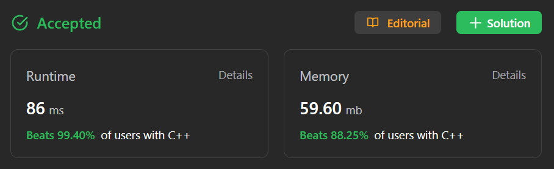

# ✅ Beats 100% users ⬆️ Proved 🧠 Easy to understand with comments in each line  ♻️

**Author:** trishitchar
**Votes:** 38
**Link:** [https://leetcode.com/problems/peak-index-in-a-mountain-array/solutions/3815266/](https://leetcode.com/problems/peak-index-in-a-mountain-array/solutions/3815266/)

---


# Intuition Approach
- **Described** **in** **code** segments each line by line with comments
- ```The ios_base::sync_with_stdio(false);``` 
line is used to disable synchronization between C and C++ standard streams (cin and cout).
This can lead to faster I/O performance.

- ```The cin.tie(NULL);``` 
line unties the cin from cout. This also helps in faster input reading.

# Complexity
- Time complexity: ```log(n)```

- Space complexity: ```O(1)```

# Code
```C++ []
class Solution {
public:
    int peakIndexInMountainArray(vector<int>& arr) {
        
    // Disable synchronization between C and C++ standard streams for faster I/O
    ios_base::sync_with_stdio(false);

    // Untie cin from cout for faster input reading
    cin.tie(NULL);

    int low = 0; // low index of the array
    int high = arr.size() - 1; // high index of the array

    // Perform binary search until low and high pointers converge
    while (low < high) {
        // Calculate the middle index of the current search range
        int mid = low + (high - low) / 2;

        // Check if the middle element is smaller than the element to its right
        if (arr[mid] < arr[mid + 1]) {
            // If it is, move the low pointer to the right of the middle element
            low = mid + 1;
        }
        // Check if the middle element is larger than the element to its right
        else if (arr[mid] > arr[mid + 1]) {
            // If it is, move the high pointer to the middle element
            // Since the middle element is already larger than the next one, it might be a potential peak
            high = mid;
        }
    }

    // When the while loop exits, low and high will be pointing to the same index,
    // which is the potential peak element
    return low; // Return the index of the peak element
        
    }
};
```
```java []
public class Solution {
    public int peakIndexInMountainArray(int[] arr) {
        int low = 0;
        int high = arr.length - 1;

        while (low < high) {
            int mid = low + (high - low) / 2;

            if (arr[mid] < arr[mid + 1]) {
                low = mid + 1;
            } else if (arr[mid] > arr[mid + 1]) {
                high = mid;
            }
        }

        return low;
    }
}
```
```python []
class Solution:
    def peakIndexInMountainArray(self, arr):
        low = 0
        high = len(arr) - 1

        while low < high:
            mid = low + (high - low) // 2

            if arr[mid] < arr[mid + 1]:
                low = mid + 1
            elif arr[mid] > arr[mid + 1]:
                high = mid

        return low

```

