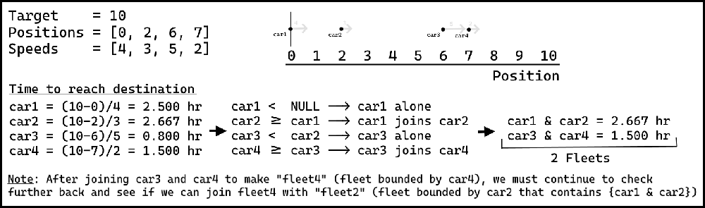

# [C++] O(nlog(n)) + Visual Explanation & Clean code

**Author:** tsepten
**Votes:** 22
**Link:** [https://leetcode.com/problems/car-fleet/solutions/2183237/](https://leetcode.com/problems/car-fleet/solutions/2183237/)

---

**The Logic**: 
* Compute the time it takes for each car to reach its destination using: `float(target - position[i]) / speed[i]`
* Sort by position
* Iterate through positions_i [0, n] (fleets)
	* If stack is empty, add fleet_i to stack
	* If time it takes for fleet_i takes longer than fleet_i-1, join them together by popping fleet_i-1 from the stack. Pop until this is no longer true. (This is the "Note" part of the visual explanation below. This is where we "combine" the fleets if possible)
* Return size of stack since that is the final number of fleets that remain




```
class Solution {
public:
    int carFleet(int target, vector<int>& position, vector<int>& speed) {
        
        stack<float> fleets;
        vector<pair<int, float>> pos_time; // { {position_i, timeLeft_i}, {...}, ... }
         
        for(int i = 0; i < position.size(); i++)
            pos_time.push_back({ position[i], float(target - position[i]) / speed[i] });
        
        sort(pos_time.begin(), pos_time.end());
                   
        
        for(int i = 0; i < position.size(); i++){
            float fleet_i = pos_time[i].second;
         
            while(fleets.size() && (fleet_i >= fleets.top()))
                fleets.pop();
            
            fleets.push(fleet_i);
        }
        
        return fleets.size();
    }
};
```