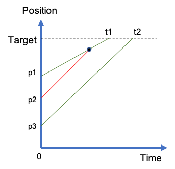

# Python Code with Explanations and Visualization Beats 95%

**Author:** infinute
**Votes:** 188
**Link:** [https://leetcode.com/problems/car-fleet/solutions/255589/](https://leetcode.com/problems/car-fleet/solutions/255589/)

---

**Time-space diagrams** can be very helpful. Just look at the example shown in the picture. Vehicle 1 is the closest to the target, therefore, it will definitely lead a fleet since no one behind it can pass it. The initial position of vehicle 2 is a little farther away than vehicle 1, but its speed is faster (steeper slope). Ideally, if vehicle 1 does not exist, vehicle 2 will arrive at the target before t1. However, since in reality vehicle 1 is in front of it, it will join the fleet led by vehicle 1 at the black point. For vehicle 3, its ideal arrival time `(dist/vel)` is larger than the fleet in front of it, so itself will form a fleet. 

Therefore, the steps are:
1. Sort the vehicles by the `(pos, vel)` pair.
2. Since the first vehicle will always lead a fleet, starting from the second vehicle, compare each vehicle's ideal arrival time with the arrival time of the fleet in front of it, i.e.,  `stack[-1]`. If its ideal arrival time is earlier, it will join the fleet in front of it. Otherwise, it will lead a new fleet and we append its arrival time into `stack`. 
3. Finally, `stack` contains the arrival times of the fleets and the length of `stack` will be the number of distinct arrival times, i.e., the number of fleets.
```
class Solution:
    def carFleet(self, target: int, position: List[int], speed: List[int]) -> int:
        stack = []
        for pos, vel in sorted(zip(position, speed))[::-1]:
            dist = target - pos
            if not stack:
                stack.append(dist / vel)
            elif dist / vel > stack[-1]:
                stack.append(dist / vel)
        return len(stack)
```
