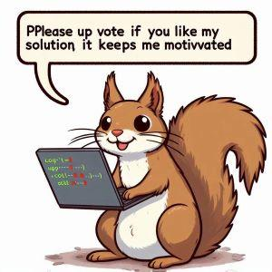

# ✅BEATS 100% | ✅CLEAN CODE | ✅CONCISE ELABORATION | ✅MULTI LANG

**Author:** arib21
**Votes:** 16
**Link:** [https://leetcode.com/problems/minimum-cost-to-hire-k-workers/solutions/5142233/](https://leetcode.com/problems/minimum-cost-to-hire-k-workers/solutions/5142233/)

---

* **Approach : Sorting + Max Heap (Priority Queue)**

* **Intution**

	1. **Prepare Data**:
	   - We start by creating a list that contains each worker's wage-to-quality ratio along with their quality.
	   - This step is crucial because we need to evaluate each worker based on their wage-to-quality ratio, as per the problem statement.

	2. **Sort by Ratio**:
	   - Sorting the list based on the wage-to-quality ratio is essential because we want to start from the workers with the smallest ratio.
	   - This ensures that we prioritize workers who expect lower wages relative to their quality, which might potentially reduce the overall cost.

	3. **Maintain a Max Heap**:
	   - We use a max heap data structure to keep track of the top k qualities encountered so far.
	   - The max heap allows us to efficiently select the best k workers based on their quality.
	   - By maintaining the max heap, we ensure that we always consider the highest quality workers when forming the paid group.

	4. **Iterate and Update**:
	   - As we iterate through the sorted list, we add each worker's quality to the max heap.
	   - If the size of our group exceeds the limit (k), we remove the worker with the highest quality from the group.
	   - This removal ensures that as we progress through the list, we maintain our focus on minimizing the cost. Since we're sorting workers by their wage-to-quality ratio, adding a worker with the highest quality won't help us minimize costs at that point, so we remove them to stay on track toward our goal.

	5. **Calculate Minimum Cost**:
	   - Whenever the size of the heap reaches k, we calculate the total cost for the current group of workers.
	   - We do this by multiplying the total quality of the current group by the wage-to-quality ratio of the last worker added to the heap.
	   - This step ensures that each worker's wage expectation is met, as their pay must be directly proportional to their quality.
	   - We update the minimum cost encountered so far if necessary, ensuring we keep track of the lowest possible cost.

	6. **Return Minimum Cost**:
	   - Once all workers are processed, we return the minimum cost found.
	   - This minimum cost represents the least amount of money needed to form a paid group satisfying the given conditions.

	*By following these steps, we systematically evaluate each worker, maintain the necessary data structures, and calculate the minimum cost, ultimately achieving the goal of forming a paid group with optimal cost.*

* **Complexity :**

	Let n be the total workers and k is size of the group of workers we are forming.

	* 	**Time :** O(nlogn) ~ O(nlogn + nlogk), nlogn for sorting and nlogk while forming the heap
	* 	**Space :**  O(n) ~ O(n + k), n is the array size and k is the heap size


``` Java []
class Solution {
    public double mincostToHireWorkers(int[] quality, int[] wage, int k) {
        
        int n = quality.length;
        
        List<Pair<Double, Integer>> wageToQualityRatioList = new ArrayList<>();
        
        for (int i = 0 ; i < n ; i++) {
            wageToQualityRatioList.add(new Pair((double) wage[i] / quality[i], quality[i]));
        }
        
        Collections.sort(wageToQualityRatioList, (x, y) -> Double.compare(x.getKey(), y.getKey()));
        
        PriorityQueue<Integer> maxHeap = new PriorityQueue<>((x, y) -> (y - x));
        
        
        int curTotalQuality = 0;
        int curQuality = 0;
        
        for (int i = 0 ; i < k ; i++) {
            curQuality = wageToQualityRatioList.get(i).getValue();
            maxHeap.add(curQuality);
            curTotalQuality += curQuality;
        }
        
        double curRatio = wageToQualityRatioList.get(k-1).getKey();
        double ans = curTotalQuality * curRatio;
        
        for (int i = k ; i < n ; i++) {
            curRatio = wageToQualityRatioList.get(i).getKey();
            curQuality = wageToQualityRatioList.get(i).getValue();
            
            maxHeap.add(curQuality);
            curTotalQuality += curQuality - maxHeap.poll();
            ans = Math.min(ans, curTotalQuality * curRatio);
        }
        
        return ans;
    }
}
```
``` C++ []
class Solution {
public:
    double mincostToHireWorkers(vector<int>& quality, vector<int>& wage,
                                int k) {
        const int n= quality.size();
        
        vector<vector<double>> wage2Quality(n, vector<double>(2));
        
        for(int i= 0; i < n; i++) {
            wage2Quality[i]={(double)wage[i]/quality[i], (double)quality[i]}; 
        }

        sort(wage2Quality.begin(), wage2Quality.end());

        int curTotalQuality = 0;

        priority_queue<int> maxHeap;
        
        for(int i = 0; i < k; i++) {
            maxHeap.push(wage2Quality[i][1]);
            curTotalQuality += wage2Quality[i][1];
        }
        
        double ans = curTotalQuality*wage2Quality[k-1][0];
        
        for(int i = k; i < n; i++) {
            maxHeap.push(wage2Quality[i][1]);
            
            curTotalQuality+=wage2Quality[i][1]-maxHeap.top();
            maxHeap.pop();

            ans = min(ans, curTotalQuality*wage2Quality[i][0]);
        }
        return ans;
    }
};
```


