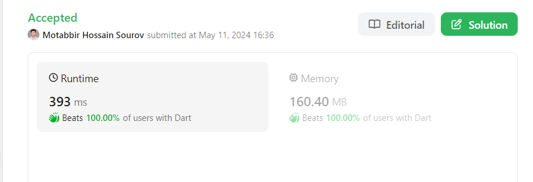

# ✅DART  BEATS 100%  Runtime And Memory

**Author:** Motabbir
**Votes:** 1
**Link:** [https://leetcode.com/problems/minimum-cost-to-hire-k-workers/solutions/5142831/](https://leetcode.com/problems/minimum-cost-to-hire-k-workers/solutions/5142831/)

---





# Intuition
<!-- Describe your first thoughts on how to solve this problem. -->

# Approach
<!-- Describe your approach to solving the problem. -->

# Complexity
- Time complexity:
<!-- Add your time complexity here, e.g. $$O(n)$$ -->

- Space complexity:
<!-- Add your space complexity here, e.g. $$O(n)$$ -->

# Code
```
class Solution {
  double mincostToHireWorkers(List<int> quality, List<int> wage, int k) {
    var workers = List.generate(quality.length, (index) => Pair(wage[index] / quality[index], quality[index]));
    workers.sort((a, b) => a.first.compareTo(b.first));
    
    var minCost = double.infinity;
    var qualitySum = 0;
    var maxHeap = MaxHeap();

    for (var worker in workers) {
      maxHeap.add(worker.second);
      qualitySum += worker.second;

      if (maxHeap.size() > k) {
        qualitySum -= maxHeap.removeTop();
      }

      if (maxHeap.size() == k) {
        minCost = min(minCost, worker.first * qualitySum);
      }
    }

    return minCost;
  }
}

class Pair {
  final double first;
  final int second;

  Pair(this.first, this.second);
}

class MaxHeap {
  List<int> heap = [];

  void add(int value) {
    heap.add(value);
    heapifyUp(heap.length - 1);
  }

  int removeTop() {
    if (heap.isEmpty) {
      throw Exception("Heap is empty");
    }
    int top = heap[0];
    heap[0] = heap.last;
    heap.removeLast();
    if (heap.isNotEmpty) {
      heapifyDown(0);
    }
    return top;
  }

  void heapifyUp(int index) {
    while (index > 0) {
      int parent = (index - 1) ~/ 2;
      if (heap[parent] >= heap[index]) break;
      swap(index, parent);
      index = parent;
    }
  }

  void heapifyDown(int index) {
    while (true) {
      int leftChild = 2 * index + 1;
      int rightChild = 2 * index + 2;
      int largest = index;

      if (leftChild < heap.length && heap[leftChild] > heap[largest]) {
        largest = leftChild;
      }

      if (rightChild < heap.length && heap[rightChild] > heap[largest]) {
        largest = rightChild;
      }

      if (largest == index) break;
      swap(index, largest);
      index = largest;
    }
  }

  void swap(int i, int j) {
    var temp = heap[i];
    heap[i] = heap[j];
    heap[j] = temp;
  }

  int size() {
    return heap.length;
  }
}

```