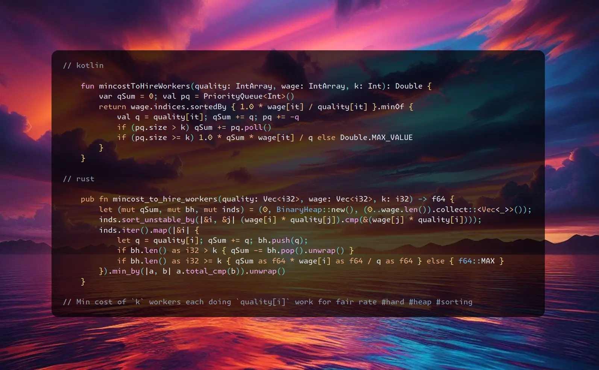

# Kotlin | Rust

**Author:** SamoylenkoDmitry
**Votes:** 1
**Link:** [https://leetcode.com/problems/minimum-cost-to-hire-k-workers/solutions/5142221/](https://leetcode.com/problems/minimum-cost-to-hire-k-workers/solutions/5142221/)

---


https://youtu.be/3uFRD2BGM0w
#### Join me on Telegram

https://t.me/leetcode_daily_unstoppable/599

#### Problem TLDR

Min cost of `k` workers each doing `quality[i]` work for fair rate #hard #heap #sorting

#### Intuition

Let's do the painful part - try to solve this problem by bare hands:
```j
    // 10 20 5   70 50 30   2
    //  5    10    20    30 70 50
    //  5/20 10/20
    //  5/10
    //  5/20   5/10  10/20 
    // 30,50  30,70  70,50
    // 30*4   30*2   50/2=25
    // 50/4   70/2   70*2
    // take 70: q=10
    //   i=1  pay=20/10*70=140 q1=20
    //   i=2  pay=(10/5)*70=35
    // sort by quality
    // 5 10 20   30 70 50
    // take q=5 p=30, price = 30/5=6
    // i=1 pay=10*6=60 (less than 70, increase price 70/10=7)
    // ...
    // convert q-w to prices: 70/10 50/20 30/5
    // 7 2.5 6
    // sort
    // 20  5   10
    // 2.5 6.0 7.0    how many workers we can take 
    //                for price = 2.5? 1, cost = 50
    // 2.5*20 2.5*5  2.5*10
    // 50     7.5    25
    //                for price = 6.0? 2, cost 120+30=150
    // 6*20 6*5 6*10
    // 120  30  60                             
    //                for price = 7.0? 3, cost 140+35+70=245
    // 7*20 7*5 7*10
    // 140  35  70
    // 20   25  35 prefix sum?
    //      [5+10=15]
```
At this point I had an idea: there is a `rate` which is the `wage/quality`. The `fair` rate condition is just we must pay this rate * quality each worker produces.
Now the interesting part: when we sort the workers by thier rate, we can try first with the `lowest possible` rate and then increase it to the `next worker's` rate. And we can take as much workers to `the left` as we want - all of them will agree to this rate as it is the largest so far.


```j
    // 4 8 2  2  7 w     k=3
    // 3 1 10 10 1 q
    // sort by cost
    // 2  2  4  7  8  w
    // 10 10 3  1  1  q    3*4/3 + 10*2*4/3 + 10*2*4/3 = 4*23/3 = 92/3
    // 10 20 23 24 25 prefixSum?
```

The last piece is how to choose `k` workers from the all available: the simple sliding window is `not optimal`, as the qualities varies and we can leave cheap at the start. 

Let's just take all the workers with the `lowest qualities` to pay them less. The cost would be total sum of the workers qualities multiplied by top rate.

#### Approach

* use a min-heap PriorityQueue to choose the lowest `k`
* Rust can't just pick min or sort by `f64` key

#### Complexity

- Time complexity:
$$O(nlog(n))$$

- Space complexity:
$$O(n)$$

#### Code

```kotlin []

    fun mincostToHireWorkers(quality: IntArray, wage: IntArray, k: Int): Double {
        var qSum = 0; val pq = PriorityQueue<Int>()
        return wage.indices.sortedBy { 1.0 * wage[it] / quality[it] }.minOf {
            val q = quality[it]; qSum += q; pq += -q
            if (pq.size > k) qSum += pq.poll()
            if (pq.size >= k) 1.0 * qSum * wage[it] / q else Double.MAX_VALUE
        }
    }

```
```rust []

    pub fn mincost_to_hire_workers(quality: Vec<i32>, wage: Vec<i32>, k: i32) -> f64 {
        let (mut qSum, mut bh, mut inds) = (0, BinaryHeap::new(), (0..wage.len()).collect::<Vec<_>>()); 
        inds.sort_unstable_by(|&i, &j| (wage[i] * quality[j]).cmp(&(wage[j] * quality[i])));
        inds.iter().map(|&i| {
            let q = quality[i]; qSum += q; bh.push(q);
            if bh.len() as i32 > k { qSum -= bh.pop().unwrap() }
            if bh.len() as i32 >= k { qSum as f64 * wage[i] as f64 / q as f64 } else { f64::MAX }
        }).min_by(|a, b| a.total_cmp(b)).unwrap()
    }

```