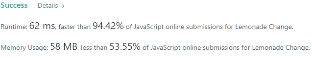
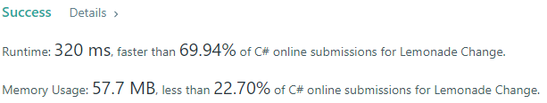
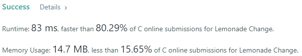
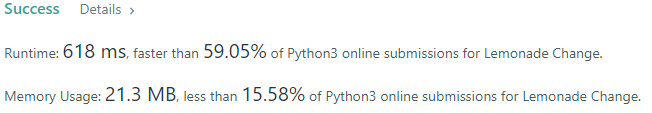
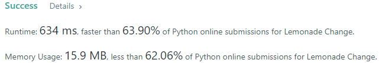
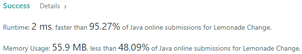

# 💢☠💫Easiest👾Faster✅💯 Lesser🧠 🎯 C++✅Python3🐍✅Java✅C✅Python🐍✅C#✅💥🔥💫Explained☠💥🔥 Beats 💯

**Author:** Edwards310
**Votes:** 9
**Link:** [https://leetcode.com/problems/lemonade-change/solutions/5639858/](https://leetcode.com/problems/lemonade-change/solutions/5639858/)

---

# Intuition







```javascript []
//JavaScript Code
/**
 * @param {number[]} bills
 * @return {boolean}
 */
var lemonadeChange = function(bills) {
    let five = 0, ten = 0;
        for(let bill of bills) {
            if( bill == 5)
                five++;
            
            else if( bill == 10) {
                if( five >= 1) {
                    five--;
                    ten++;
                }
                else
                    return false;
            }
            else {
                if(five >= 1 && ten >= 1) {
                    ten--;
                    five--;
                }
                else if( five >= 3)
                    five -= 3;
                else
                    return false;
            }
        }
        return true;
};
```
```python3 []
#Python3 Code
class Solution:
    def lemonadeChange(self, bills: List[int]) -> bool:
        cur_five, cur_ten = 0, 0
        for doller in bills:
            if doller == 5:
                cur_five += 1
            elif doller == 10:
                cur_five -= 1
                cur_ten += 1
            elif cur_ten > 0:
                cur_ten -= 1
                cur_five -= 1
            else:
                cur_five -= 3
            
            if cur_five < 0:
                return False
        
        return True
```
```C++ []
//C++ Code
#pragma GCC optimize("O2")
#include <bits/stdc++.h>
using namespace std;
typedef vector<int> vi;
typedef vector<vi> vvi;
#define FOR(a, b, c) for (int a = b; a < c; a++)
#define FOR1(a, b, c) for (int a = b; a <= c; ++a)
#define Rep(i, n) FOR(i, 0, n)
#define Rep1(i, n) FOR1(i, 1, n)
#define RepA(ele, nums) for (auto& ele : nums)
#define WHL(i, n) while (i < n)
#define fi first
#define se second
#define mp make_pair
#define pb push_back
#define ALL(v) v.begin(), v.end()
#define SORT(v) sort(ALL(v))

class Solution {
public:
    bool lemonadeChange(vector<int>& bills) {
        int five = 0, ten = 0;
        RepA(bill, bills) {
            if( bill == 5)
                five++;
            
            else if( bill == 10) {
                if( five >= 1) {
                    five--;
                    ten++;
                }
                else
                    return false;
            }
            else {
                if(five >= 1 && ten >= 1) {
                    ten--;
                    five--;
                }
                else if( five >= 3)
                    five -= 3;
                else
                    return false;
            }
        }
        return true;
    }
};
```
```Java []
//Java Code
class Solution {
    public boolean lemonadeChange(int[] bills) {
        int five = 0, ten = 0;
        for (int bill : bills) {
            if( bill == 5)
                five++;
            
            else if( bill == 10) {
                if( five >= 1) {
                    five--;
                    ten++;
                }
                else
                    return false;
            }
            else {
                if(five >= 1 && ten >= 1) {
                    ten--;
                    five--;
                }
                else if( five >= 3)
                    five -= 3;
                else
                    return false;
            }
        }
        return true;
    }
}
```
```C []
//C Code
bool lemonadeChange(int* bills, int billsSize) {
    int five = 0, ten = 0;
        for(int i = 0; i < billsSize; i++) {
            int bill = bills[i];
            if( bill == 5)
                five++;
            
            else if( bill == 10) {
                if( five >= 1) {
                    five--;
                    ten++;
                }
                else
                    return false;
            }
            else {
                if(five >= 1 && ten >= 1) {
                    ten--;
                    five--;
                }
                else if( five >= 3)
                    five -= 3;
                else
                    return false;
            }
        }
        return true;
}
```
```Python []
#Python Code
class Solution(object):
    def lemonadeChange(self, bills):
        """
        :type bills: List[int]
        :rtype: bool
        """
        f , t = 0, 0
        for bill in bills:
            if bill == 5:
                f += 1
            elif bill == 10:
                if f >= 1:
                    f -= 1
                    t += 1
                else:
                    return False
            else:
                if f >= 1 and t >= 1:
                    t -= 1
                    f -= 1
                elif f >= 3:
                    f -= 3
                else:
                    return False
        return True
    
        
```
```C# []
//C# Code
public class Solution {
    public bool LemonadeChange(int[] bills) {
        int five = 0, ten = 0;
        foreach(var bill in bills) {
            if( bill == 5)
                five++;
            
            else if( bill == 10) {
                if( five >= 1) {
                    five--;
                    ten++;
                }
                else
                    return false;
            }
            else {
                if(five >= 1 && ten >= 1) {
                    ten--;
                    five--;
                }
                else if( five >= 3)
                    five -= 3;
                else
                    return false;
            }
        }
        return true;
    }
}
```

<!-- Describe your first thoughts on how to solve this problem. -->

# Approach
<!-- Describe your approach to solving the problem. -->

# Complexity
- Time complexity:
<!-- Add your time complexity here, e.g. $$O(n)$$ -->
     O(n)
- Space complexity:
<!-- Add your space complexity here, e.g. $$O(n)$$ -->
     O(1)
# Code

