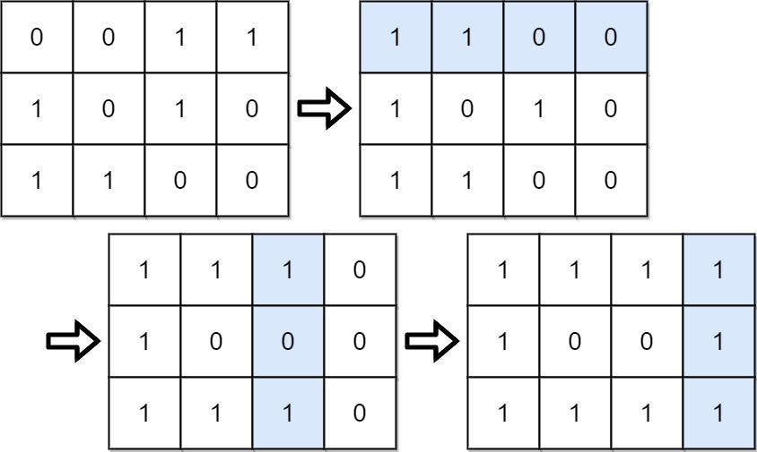

# [861. Score After Flipping Matrix](https://leetcode.com/problems/score-after-flipping-matrix/)

| Category | Difficulty | Likes | Dislikes |
| :------: | :--------: | :---: | :------: |
| Algorithms | Medium | 2453 | 224 |

**Tags:** [`array`](https://leetcode.com/tag/array), [`greedy`](https://leetcode.com/tag/greedy), [`bit-manipulation`](https://leetcode.com/tag/bit-manipulation), [`matrix`](https://leetcode.com/tag/matrix)

**Companies:** `google`, `amazon`, `iit-bombay`

## Description

You are given an `m x n` binary matrix `grid`.

A **move** consists of choosing any row or column and toggling each value in that row or column (i.e., changing all `0`'s to `1`'s, and all `1`'s to `0`'s).

Every row of the matrix is interpreted as a binary number, and the **score** of the matrix is the sum of these numbers.

Return *the highest possible **score** after making any number of **moves** (including zero moves)*.

 

**Example 1:**


```

Input: grid = [[0,0,1,1],[1,0,1,0],[1,1,0,0]]
Output: 39
Explanation: 0b1111 + 0b1001 + 0b1111 = 15 + 9 + 15 = 39

```

**Example 2:**

```

Input: grid = [[0]]
Output: 1

```

 

**Constraints:**

	- `m == grid.length`

	- `n == grid[i].length`

	- `1 <= m, n <= 20`

	- `grid[i][j]` is either `0` or `1`.

---

**Links:** [Submissions](https://leetcode.com/problems/score-after-flipping-matrix/) | [Solutions](https://leetcode.com/problems/score-after-flipping-matrix/)
