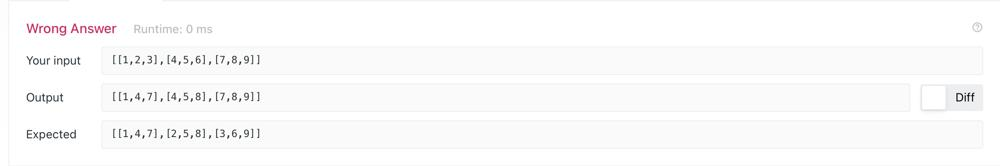
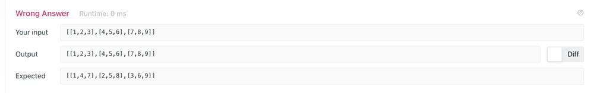

# Interview Follow-Up: Square Matrix

**Author:** ciote
**Votes:** 95
**Link:** [https://leetcode.com/problems/transpose-matrix/solutions/2100127/](https://leetcode.com/problems/transpose-matrix/solutions/2100127/)

---

### A Potential Follow-Up Question:
> If you were given a `n*n` square matrix, transpose the matrix **in-place**.

Before we answer the follow-up, let's just make sure we're on the same page regarding the original question. The basic idea of transposing a matrix is swapping the rows with the columns. This allows for a reasonably straight-forward implementation. Assuming the original matrix is of size `n*m`, create a new matrix of size `m*n` and assign `outputMatrix[i][j] = matrix[j][i]`. That'll give you your transpose! 

As you might have noticed, we are forced to use up space and create an output matrix especially since `n` and `m` aren't necessarily the same. However, what if the matrix was strictly square? 
___

### Logic:
If the matrix was strictly square, then we don't need to waste space creating an output matrix. In fact, we can just use our intput matrix! 

The tricky bit here is that we can't just do `matrix[i][j] = matrix[j][i]`. This will result in duplicate matrix cells since we lose `matrix[i][j]` in the process:


To avoid this, we'll have to swap these values using a temporary variable:
* Store `matrix[i][j]` in `temp`
* Set `matrix[i][j] = matrix[j][i]`
* Set `matrix[j][i] = temp`

Another thing to be careful of is our nested for-loop. If we simply do `for (int j=0; j<n; j++)`, we end up swapping row and column values _twice_, giving us our original matrix:


To avoid this, we want to make sure we're only swapping `i` and `j` once. Therefore, start our nested for-loop at `j = i+1` (the "+1" is there since we can skip the diagonals as well).    

And that's it! Now we're ready to start coding.
___
### Code:
I hope you found this helpful. If you have any questions, suggestions or improvements, feel free to let me know!
**Original Question:**
> Time complexity: `O(n*m)`
> Space complexity: `O(n*m)` for the output matrix.
```java
class Solution {
    public int[][] transpose(int[][] matrix) {
        int n = matrix.length, m = matrix[0].length;
        int[][] transposedMatrix = new int[m][n];
        
        for (int i=0; i<m; i++)
            for (int j=0; j<n; j++)
                transposedMatrix[i][j] = matrix[j][i];
        
        return transposedMatrix;
    }
}
```

**Follow-up for square matrices:**
> Time complexity: `O(n*m)`
> Space complexity: `O(1)`
```java
class Solution {
    public int[][] transpose(int[][] matrix) {
        int n = matrix.length;
        
        for (int i=0; i<n; i++) {
            for (int j=i+1; j<n; j++) {
                int temp = matrix[i][j];
                matrix[i][j] = matrix[j][i];
                matrix[j][i] = temp;
            }
        }
        
        return matrix;
    }
}
```