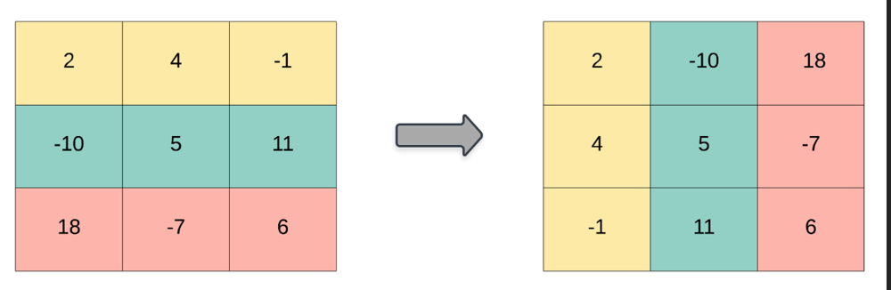

# 【Video】Give me 5 minutes - 2 solutions - How we think about a solution.

**Author:** niits
**Votes:** 34
**Link:** [https://leetcode.com/problems/transpose-matrix/solutions/4384180/](https://leetcode.com/problems/transpose-matrix/solutions/4384180/)

---

# Intuition
Iterate the matrix vertically.

# Approach

---

# Solution Video

https://youtu.be/lsAZepsNRPo

\u25A0 Timeline of the video

`0:04` Explain algorithm of Solution 1
`1:12` Coding of solution 1
`2:30` Time Complexity and Space Complexity of solution 1
`2:54` Explain algorithm of Solution 2
`3:49` Coding of Solution 2
`4:53` Time Complexity and Space Complexity of Solution 2
`5:12` Step by step algorithm with my stack solution code

### \u2B50\uFE0F\u2B50\uFE0F Don't forget to subscribe to my channel! \u2B50\uFE0F\u2B50\uFE0F

**\u25A0 Subscribe URL**
http://www.youtube.com/channel/UC9RMNwYTL3SXCP6ShLWVFww?sub_confirmation=1

Subscribers: 3,401
My first goal is 10,000 (It's far from done \uD83D\uDE05)
Thank you for your support!

---

## How we think about a solution.

## Solution 1

I think most people do like this.

```python []
class Solution:
    def transpose(self, matrix: List[List[int]]) -> List[List[int]]:
        res = [[0] * len(matrix) for _ in range(len(matrix[0]))]

        for r in range(len(matrix)):
            for c in range(len(matrix[0])):
                res[c][r] = matrix[r][c]
        
        return res
```
```javascript []
var transpose = function(matrix) {
    const res = Array.from({ length: matrix[0].length }, () => Array(matrix.length).fill(0));

    for (let r = 0; r < matrix.length; r++) {
        for (let c = 0; c < matrix[0].length; c++) {
            res[c][r] = matrix[r][c];
        }
    }

    return res;    
};
```
```java []
class Solution {
    public int[][] transpose(int[][] matrix) {
        int[][] res = new int[matrix[0].length][matrix.length];

        for (int r = 0; r < matrix.length; r++) {
            for (int c = 0; c < matrix[0].length; c++) {
                res[c][r] = matrix[r][c];
            }
        }

        return res;        
    }
}
```
```C++ []
class Solution {
public:
    vector<vector<int>> transpose(vector<vector<int>>& matrix) {
        vector<vector<int>> res(matrix[0].size(), vector<int>(matrix.size(), 0));

        for (size_t r = 0; r < matrix.size(); r++) {
            for (size_t c = 0; c < matrix[0].size(); c++) {
                res[c][r] = matrix[r][c];
            }
        }

        return res;        
    }
};
```

If I write the same algorithm, it's boring. So I'll show you different way.
(I explain an algorithm of this solution in the video)

---

## Solution 2



Look at the picure carefully. What if we iterate the matrix vertically? We can create the target matrix.

```
Left matrix

[2,   4, -1]
[-10, 5, 11]
[18, -7,  6]
```
We iterate it vertically, so

```
 \u2193
[2,   4, -1]
[-10, 5, 11]
[18, -7,  6]

We can create [2, -10, 18]

      \u2193
[2,   4, -1]
[-10, 5, 11]
[18, -7,  6]

We can create [4, 5, -7]

          \u2193
[2,   4, -1]
[-10, 5, 11]
[18, -7,  6]

We can create [-1, 11, 6]
```
Get all arrays together we created
```
Output:

[2, -10, 18]
[4, 5, -7]
[-1, 11, 6]

= right matrix in the picture
```
 
Easy!\uD83D\uDE04
Let's see a real algorithm!


---

# Step by step Algorithm

1. **Initialize an empty list for the result (`res`):**
   ```python
   res = []
   ```
   This list will hold the transposed matrix.

2. **Iterate over each column of the input matrix:**
   ```python
   for c in range(len(matrix[0])):
   ```
   This outer loop iterates over each column of the input matrix. `c` represents the current column index.

3. **Initialize a temporary list for the current transposed row (`temp`):**
   ```python
   temp = []
   ```
   This list will hold the elements of the current transposed row.

4. **Iterate over each row of the input matrix:**
   ```python
   for r in range(len(matrix)):
   ```
   This inner loop iterates over each row of the input matrix. `r` represents the current row index.

5. **Append the element at the current (r, c) position to the temporary list:**
   ```python
   temp.append(matrix[r][c])
   ```
   This line adds the element at the current position in the input matrix to the temporary list. This is a key step in transposing the matrix.

6. **Append the temporary list (representing a transposed row) to the result:**
   ```python
   res.append(temp)
   ```
   After the inner loop completes for a specific column (`c`), the temporary list `temp` is added to the result `res`. This represents a transposed row.

7. **Return the transposed matrix (`res`):**
   ```python
   return res
   ```
   After the outer loop completes for all columns, the transposed matrix is returned as the final result.

In summary, the algorithm transposes the input matrix by iterating over its columns and rows, creating a new matrix where the rows become columns and vice versa. The result is a transposed matrix.


---


# Complexity
- Time complexity: $$O(r * c)$$
<!-- Add your time complexity here, e.g. $$O(n)$$ -->

- Space complexity: $$O(r * c)$$
<!-- Add your space complexity here, e.g. $$O(n)$$ -->

```python []
class Solution:
    def transpose(self, matrix: List[List[int]]) -> List[List[int]]:
        res = []

        for c in range(len(matrix[0])):
            temp = []

            for r in range(len(matrix)):
                temp.append(matrix[r][c])

            res.append(temp)

        return res

```
```javascript []
var transpose = function(matrix) {
    const res = [];

    for (let c = 0; c < matrix[0].length; c++) {
        const temp = [];

        for (let r = 0; r < matrix.length; r++) {
            temp.push(matrix[r][c]);
        }

        res.push(temp);
    }

    return res;    
};
```
```java []
class Solution {
    public int[][] transpose(int[][] matrix) {
        List<List<Integer>> resList = new ArrayList<>();

        for (int c = 0; c < matrix[0].length; c++) {
            List<Integer> temp = new ArrayList<>();

            for (int r = 0; r < matrix.length; r++) {
                temp.add(matrix[r][c]);
            }

            resList.add(temp);
        }

        // Convert List<List<Integer>> to int[][]
        int[][] res = new int[resList.size()][];
        for (int i = 0; i < resList.size(); i++) {
            List<Integer> row = resList.get(i);
            res[i] = row.stream().mapToInt(Integer::intValue).toArray();
        }

        return res;        
    }
}
```
```C++ []
class Solution {
public:
    vector<vector<int>> transpose(vector<vector<int>>& matrix) {
        vector<vector<int>> res;

        for (size_t c = 0; c < matrix[0].size(); c++) {
            vector<int> temp;

            for (size_t r = 0; r < matrix.size(); r++) {
                temp.push_back(matrix[r][c]);
            }

            res.push_back(temp);
        }

        return res;        
    }
};
```

---

Thank you for reading my post.
\u2B50\uFE0F Please upvote it and don't forget to subscribe to my channel!

\u25A0 Subscribe URL
http://www.youtube.com/channel/UC9RMNwYTL3SXCP6ShLWVFww?sub_confirmation=1

\u25A0 Twitter
https://twitter.com/CodingNinjaAZ

### My next daily coding challenge post and video.

post
https://leetcode.com/problems/element-appearing-more-than-25-in-sorted-array/solutions/4388310/video-give-me-5-minutes-2-solutions-how-we-think-about-a-solution/

video
https://youtu.be/bTm-6y7Ob0A

\u25A0 Timeline of the video

`0:07` Explain algorithm of Solution 1
`2:46` Coding of solution 1
`3:49` Time Complexity and Space Complexity of solution 1
`4:02` Step by step algorithm of solution 1
`4:09` Explain key points of Solution 2
`4:47` Explain the first key point
`6:06` Explain the second key point
`7:40` Explain the third key point
`9:33` Coding of Solution 2
`14:20` Time Complexity and Space Complexity of Solution 2
`14:48` Step by step algorithm with my stack solution code


### My previous daily coding challenge post and video.

post
https://leetcode.com/problems/binary-tree-inorder-traversal/solutions/4380244/video-give-me-5-minutes-recursion-and-stackbonus-solution-how-we-think-about-a-solution/

video
https://youtu.be/TKMxiXRzDZ0

\u25A0 Timeline
`0:04` How to implement inorder, preorder and postorder
`1:16` Coding (Recursive)
`2:14` Time Complexity and Space Complexity
`2:37` Explain Stack solution
`7:22` Coding (Stack)
`8:45` Time Complexity and Space Complexity
`8:59` Step by step algorithm with my stack solution code

