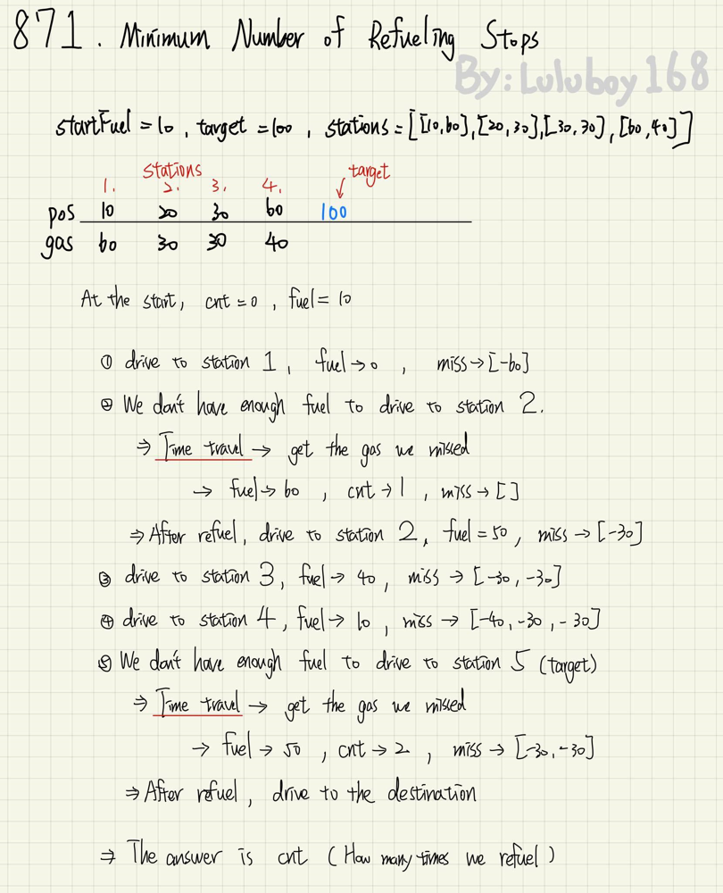
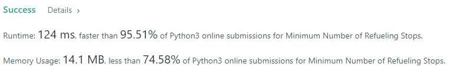

# ✔️Python🔥96%✅Pretend we can Time Travel | heap with explantion | Best solution | easy understand

**Author:** luluboy168
**Votes:** 112
**Link:** [https://leetcode.com/problems/minimum-number-of-refueling-stops/solutions/2451321/](https://leetcode.com/problems/minimum-number-of-refueling-stops/solutions/2451321/)

---

**Idea:**
* We have a Time Machine
* We keep driving forward until we run out of fuel, then we time travel back to get the gas.

Here's an example for better understand:


**Python Code:**
```
class Solution:
    def minRefuelStops(self, target: int, startFuel: int, stations: List[List[int]]) -> int:
        
        stations.append([target, 0])    # regard target as a station
        fuel = startFuel
        cnt, prev = 0, 0
        miss = []
        
        for pos, gas in stations:
            dis, prev = pos - prev, pos    # calculate the distance between two stations
            
            if fuel < dis:  # we are running out of fuel
                
                while miss and fuel < dis:  # use Time machine to get some fuel we missed~
                    fuel += -heapq.heappop(miss)
                    cnt += 1    # cnt is how many times we travel back to get gas
                    
                if fuel < dis: return -1    # we have used all the gas, but still cannot get to the next station
                
            fuel -= dis
            heapq.heappush(miss, -gas)  # we don't need the gas until we run out of all fuel
            
        return cnt
```

**Here's how the code work:**
1. We loop throught every stations, get its position and how much gas that station has.
`dis` is the distance between current position and next station. 
`miss` is how many gas we have missed.(We don't refuel at every station.)
2. We use `if fuel < dis:` to check if the car's fuel is enough to drive to that station.
3. Image the car keep driving forward until it runs out of fuel. (`fuel < dis')
4. Once the car is out of fuel, we check what is in `miss`.
We simply grab the biggest number in `miss` using `heapq.heappop`.
One refuel, we add 1 to `cnt`.
If we already add everything in `miss` to our fuel, the car still cannot drive to the next station, we `return -1`.
5. After the loop, the  car is at its destination, so we can `return  cnt`.
(cnt is the answer which is how many time we refuel.)

**Please UPVOTE if you LIKE!!**


