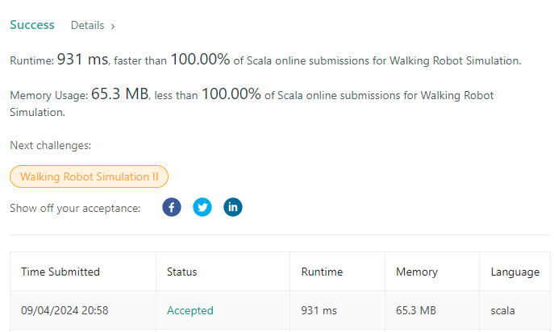

# Scala solution. 100% time / space.

**Author:** densungkim
**Votes:** 0
**Link:** [https://leetcode.com/problems/walking-robot-simulation/solutions/5737143/](https://leetcode.com/problems/walking-robot-simulation/solutions/5737143/)

---


```
object Solution {
  def robotSim(commands: Array[Int], obstacles: Array[Array[Int]]): Int = {
    // directions (north, east, south, west)
    val directions  = Array((0, 1), (1, 0), (0, -1), (-1, 0))
    val obstacleSet = obstacles.map(obs => (obs(0), obs(1))).toSet

    @annotation.tailrec
    def walk(pos: (Int, Int), direction: Int, maxDist: Int, cmds: List[Int]): Int =
      cmds match {
        case Nil             => maxDist
        case command :: tail =>
          command match {
            case -2    => // turn left
              val newDirection = (direction + 3) % 4 // turn left (90 degree)
              walk(pos, newDirection, maxDist, tail)
            case -1    => // turn right
              val newDirection = (direction + 1) % 4 // turn right (90 degree)
              walk(pos, newDirection, maxDist, tail)
            case steps => // go forward
              val newPos = move(pos, directions(direction), steps, obstacleSet)
              val dist   = newPos._1 * newPos._1 + newPos._2 * newPos._2
              walk(newPos, direction, math.max(maxDist, dist), tail)
          }
      }

    // calculates new position
    def move(pos: (Int, Int), direction: (Int, Int), steps: Int, obstacles: Set[(Int, Int)]): (Int, Int) = {
      @annotation.tailrec
      def step(currentPos: (Int, Int), remainingSteps: Int): (Int, Int) =
        if (remainingSteps == 0) currentPos
        else {
          val (newX, newY) = (currentPos._1 + direction._1, currentPos._2 + direction._2)
          if (obstacles.contains((newX, newY))) currentPos // stop in front of an obstacle
          else step((newX, newY), remainingSteps - 1)
        }

      step(pos, steps)
    }

    // starting from position (0, 0) and heading north (index 0)
    walk((0, 0), 0, 0, commands.toList)
  }
}
```