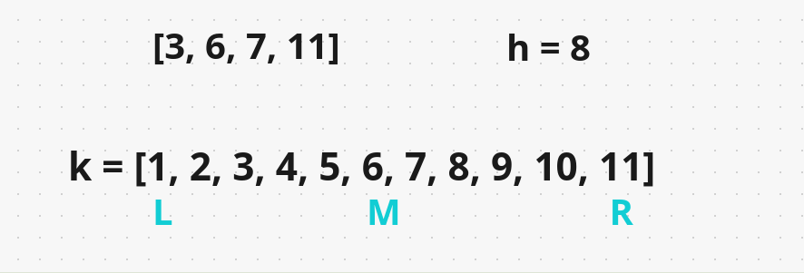
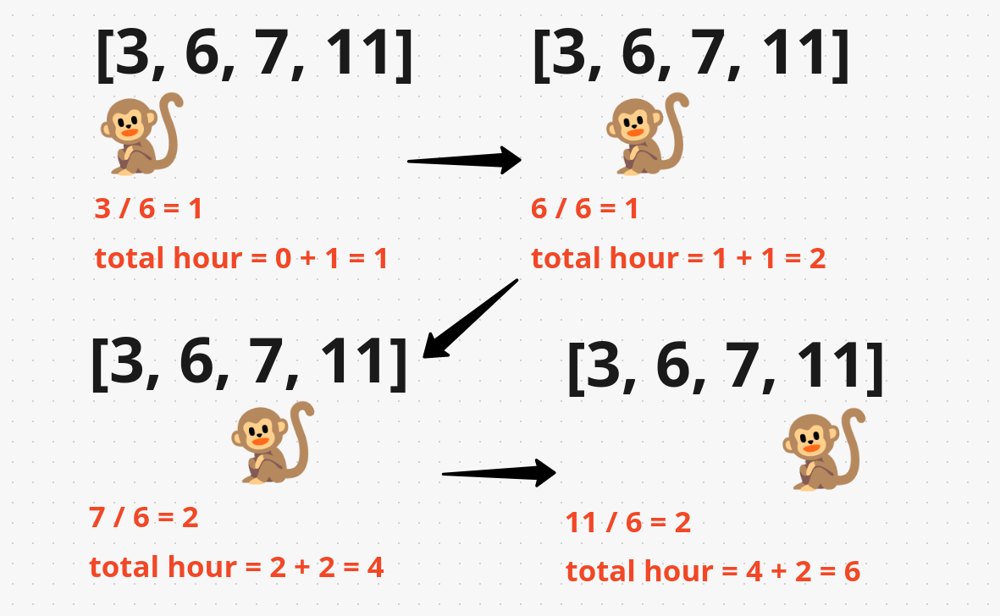
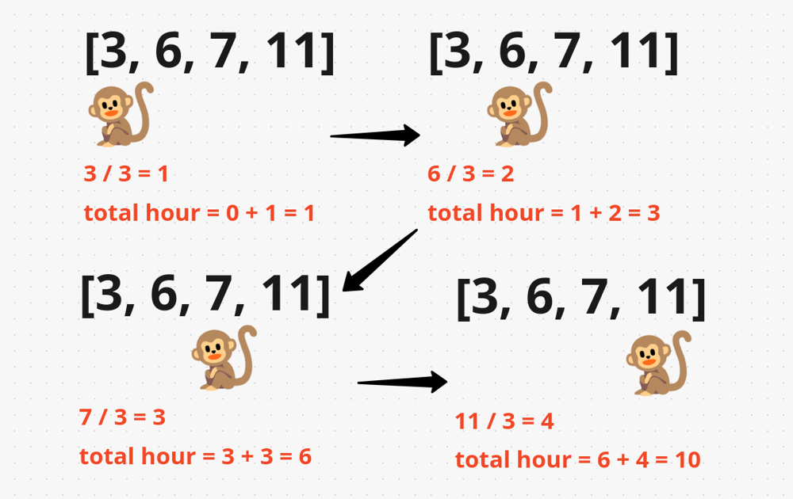
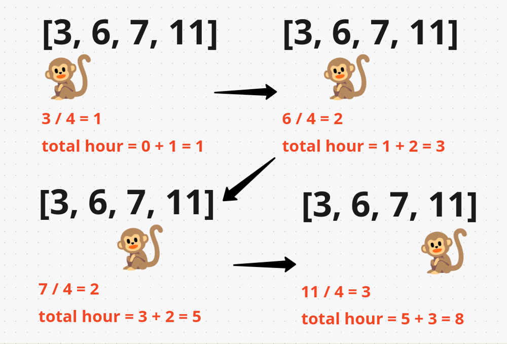

# [Java/C++] A very-very well detailed explanation

**Author:** hi-malik
**Votes:** 527
**Link:** [https://leetcode.com/problems/koko-eating-bananas/solutions/1703687/](https://leetcode.com/problems/koko-eating-bananas/solutions/1703687/)

---

```
Let's understand the solution, as we are going to be using Binary Search we have given an Array [3,6,7,11] 
And we have to eat every single pile of bananas in less than or equals to hours = 8.
If we not able to do that Gurad will kill KOKO [just a joke] 
```
As we know that the potential rate that we're eating bananas at **k** is going to be between **1**  that's the minimum it could possibly be. The max it could possibly be is going to be whatever the max in our input array is and that is **11**.
So, then we're going to initialize a range like this **k = [1,2,3,4,5,6,7,8,9,10,11]** the entire range we have. Going all the way from **1** to the max value **11**.


So, in other words we're going to have a **left pointer** at the **minimum** and a **right pointer** at the **maximum** . Then we compute the middle by taking the **average of left & right / 2 i.e. 1 + 11 / 2 = 6**. So, our **middle** will be here at **6** in other words that **k** we're trying is going to be here at this rate that we're going to eat bananas at rate of **6** .

`Now let's check can we eat all the piles of bananas at rate of 6. Let's check it,`


If you see that we just eat all piles of bananas in **6 hour** is that a good value. Well it is less than or equals to **8 hours**, but still we have to find the **minimum possible** of **k** value. This might be the solution but less try is there any more **smaller** **k** value then **6**. 
So, we **decrement** our **right pointer to mid - 1** becuase there might be the best possible solution available.

So, once again we compute the middle by taking the **average of left & right / 2 i.e. 1 + 5 / 2 = 3** our **k** is here at **3** value 

`Now let's check can we eat all the piles of bananas at rate of 3. Let's check it,`


If you see that we just eat all piles of bananas in **10 hour** but if you see we went over **8 hours** we took too long to eat all the bananas. So, eating at **rate of 3** didn't work.
Let's start searching to right of our range we **increment** our **left pointer to mid + 1** *but remember when we shift our right pointer from the last position to mid -1 we just consider that this range will not work. And that's how Binary search work!*

So, once again we compute the middle by taking the **average of left & right / 2 i.e. 4 + 5 / 2 = 4** our **k** is here at **4** value 

`Now let's check can we eat all the piles of bananas at rate of 4. Let's check it,`



If you see that we just eat all piles of bananas in **8 hour**. So, we able to eat all bananas in less than or equals to **8 hours** if we had a rate of **4**. Let's compare this with our current result. So, far we find a value of **6** we update this **6** and we can say there is a more smaller rate we can use i.e. **4**.
```
But if we try to calculate more further on then we see our right pointer moves more left to the left pointer. Then we can now stop our Binar Search.
```
**I hope you got the point. Let's code it up**

*code each line explained :* `Similar for C++ & Java`

* Step 1 :
```
int minEatingSpeed(int[] piles, int h) {
        int left = 1;
        int right = 1000000000;
        
        while(left <= right){ // performing binary search
            int mid = left + (right - left) / 2; // doing in that way, to handle overflow instead of left + right / 2
            // if koko can eat, mid bananas per hour in less then or equals to h time
            if(canEatInTime(piles, mid, h)) right = mid - 1; // means decrement our right pointer to optimise better solution 
            else left = mid + 1; // if not true, increment left pointer
        }
        return left; // bcz left pointer hold our optimize k, at the end of BS
    }
```
* Step 2 : 
```
boolean canEatInTime(int piles[], int k, int h){
        
        int hours = 0; // track count of hours
        for(int pile : piles){
            // performing claculation, take an example 
            // k = 4
            // pile = 10

            // pile / k => 10 / 4 = 2
            // pile % k => 2, so we need to have one more hour to eat remaining bananas left over as remainder 
            // hours = 3;
            int div = pile / k;
            hours += div;
            if(pile % k != 0) hours++; // if remainder value is not 0, we need to have an extra hour
        }
        return hours <= h;
```
**Java**
```
class Solution {
    public int minEatingSpeed(int[] piles, int h) {
        int left = 1;
        int right = 1000000000;
        
        while(left <= right){
            int mid = left + (right - left) / 2;
            if(canEatInTime(piles, mid, h)) right = mid - 1;
            else left = mid + 1;
        }
        return left;
    }
    public boolean canEatInTime(int piles[], int k, int h){
        int hours = 0;
        for(int pile : piles){
            int div = pile / k;
            hours += div;
            if(pile % k != 0) hours++;
        }
        return hours <= h;
    }
}
```
**C++**
```
class Solution {
public:
    int minEatingSpeed(vector<int>& piles, int h) {
        int left = 1;
        int right = 1000000000;
        
        while(left <= right){
            int mid = left + (right - left) / 2;
            if(canEatInTime(piles, mid, h)) right = mid - 1;
            else left = mid + 1;
        }
        return left;
    }
    bool canEatInTime(vector<int>& piles, int k, int h){
        int hours = 0;
        for(int pile : piles){
            int div = pile / k;
            hours += div;
            if(pile % k != 0) hours++;
        }
        return hours <= h;
    }
};
```
ANALYSIS :-
* **Time Complexity :-** BigO(N * log(M)) where N is no of piles & M is range of K (left to right)

* **Space Complexity :-** BigO(1) as not using any extra space