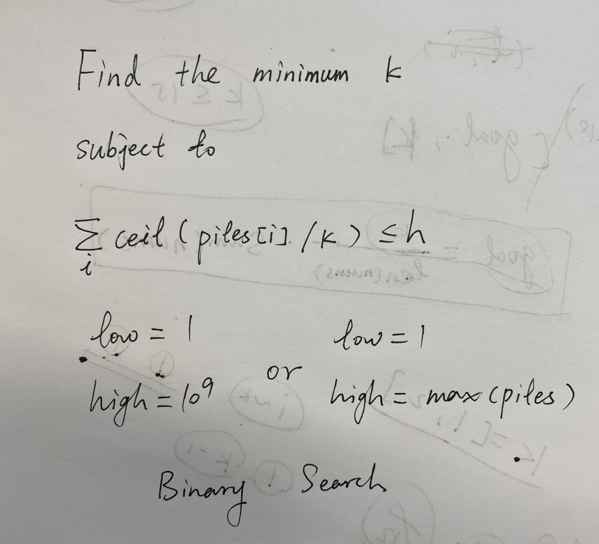

# ✅ [C++/Java/Python] 6 Lines || Binary Search || Image Explained || Beginner Friendly

**Author:** linfq
**Votes:** 105
**Link:** [https://leetcode.com/problems/koko-eating-bananas/solutions/1703550/](https://leetcode.com/problems/koko-eating-bananas/solutions/1703550/)

---


**PLEASE UPVOTE if you like** \uD83D\uDE01 **If you have any question, feel free to ask.** 

* Given `k`, koko need `ceil(1.0 * piles[i] / k)` to eat up all bananas in `piles[i]`
	* so given `k`, koko need `hours = sum(math.ceil(1.0 * pile / k) for pile in piles)` to eat up all the bananas from all piles.
	* `ceil(1.5) = 2`
* We can use **Binary Search** to find the minimum `k`
	* if `hours > h`, that indicates `k` is too small, then `low = k + 1`
	* if `hours < h`, that indicates `k` is too large, then `high = k - 1`
	* if `hours == h`, we can try a smaller `k`, then also `high = k - 1`
	* intuitively, we can initialize ` low = 1, high = 1000000000` or  `low = 1, high = max(piles)`
* Note that we are searching `k` via **Binary Search**, we need not sort any array or list, the condition of **Binary Search** is 
	* The search space is limited
	* Every time after checking for the current `mid`, we know exactly where to search next (greater than `mid` or lower than `mid`)




```
Time  Complexity: O(30 * N)  # log2(10 ** 9) = 29.9
Space Complexity: O(1)
```

**Python**
```
class Solution(object):
    def minEatingSpeed(self, piles, h):
        low, high = 1, 10 ** 9
        while low <= high:
            k = (low + high) // 2
            if sum(math.ceil(1.0 * pile / k) for pile in piles) > h: low = k + 1
            else: high = k - 1
        return low
```

**C++**
```
class Solution {
public:
    int minEatingSpeed(vector<int>& piles, int H) {
        int low = 1, high = 1000000000, k = 0;
        while (low <= high) {
            k = (low + high) / 2;
            int h = 0;
            for (int i = 0; i < piles.size(); i ++) 
                h += ceil(1.0 * piles[i] / k);
            if (h > H)
                low = k + 1;
            else
                high = k - 1;
        }
        return low;
    }
};
```

**Java**
```
class Solution {
    public int minEatingSpeed(int[] piles, int H) {
        int low = 1, high = 1000000000, k = 0;
        while (low <= high) {
            k = (low + high) / 2;
            int h = 0;
            for (int i = 0; i < piles.length; i ++) 
                h += Math.ceil(1.0 * piles[i] / k);
            if (h > H)
                low = k + 1;
            else
                high = k - 1;
        }
        return low;
    }
}
```
**PLEASE UPVOTE if you like** \uD83D\uDE01 **If you have any question, feel free to ask.**