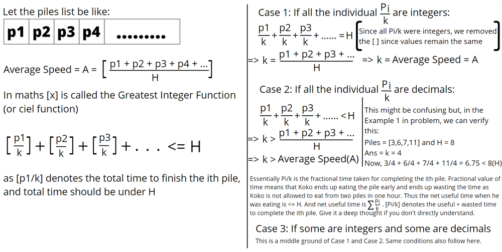

# [Python] BinarySearch + Optimizations | Explained

**Author:** anCoderr
**Votes:** 62
**Link:** [https://leetcode.com/problems/koko-eating-bananas/solutions/1705145/](https://leetcode.com/problems/koko-eating-bananas/solutions/1705145/)

---

k -> Speed of eating bananas per hour
T -> Total time to eat all the piles under given conditions
H -> Given time limit
A -> Average speed of eating bananas per hour, ```A = ceil(sum(piles)/h)```

## **Method 1: Brute Force** *[Gives TLE]*
Intuitively we can take these steps:
1. Simply consider the initial speed k to be 1.
2. Calculate the total time T required to finish all the  piles.
3. If T is greater than the given time limit H, we increment k and repeat steps 1, 2, 3
4. If T is <= H then we return k as our answer.
```
class Solution:
    def minEatingSpeed(self, piles: List[int], h: int) -> int:
        k = 1
        while True:
            total_time = 0
            for i in piles:
                total_time += ceil(i / k)
            if total_time > h:
                k += 1
            else:
                return k
```
## **Method 2: Brute Force + Optimizations** *[Gives TLE]*
We can optimize 2 things about our Brute Force Solution code
1. Rather than finishing the loop even if T exceeds H and then incrementing k. We can directly exit the inner loop as soon as T > H. This optimization is rather easy to get to.
2. This optimization is related to our initial assumption. We consider the initial speed to be 1. Well, **one can mathematically prove that k must always be greater than or equal to the average speed of eating**. We can see as a result of case 1 and case 2, `k>=A`



```
class Solution:
    def minEatingSpeed(self, piles: List[int], h: int) -> int:
        k = ceil(sum(piles)/h)
        while True:
            total_time = 0
            for i in piles:
                total_time += ceil(i/k)
                if total_time > h:
                    break # as time exceeds H
            if total_time <= h:
                return k # answer found as time is in the given limits.
            k += 1
```
#### Intution for next solution:
1. **One thing is obvious in this problem. We do not know the required speed and we cannot know this without any sort of hit and try. In method 1 we do this hit and trial linearly. In method 2 we optimize our approach by removing some values we know that are not going to work and exiting the loop early if time exceeds H.** 
2. We know the lower bound of k >= A. We also know the upper bound of k that is k <= (max element in Piles).
Thus, **A<=k<=(max element in Piles)**
3. In essence we are looking for a value that might satisfy **T<=H** in the range mentioned above. We were looking for an answer by **searching linearly**, which is of course is slow. *A much better searching algorithm within a given range would be* **Binary Search.**
4. If k = x works fine then x+1, x+2, x+3, basically x plus anything +ve would also work fine. But since we need minimum value we must return x. 
5. If the current value satisfies the condition then the answer must exist to the left of it including itself. If the current value does not satisfy the condition then the answer must exist to the right of it exclusive of itself.

With this idea, we code the next solution with Binary search and Optimizations in mind.

## **Method 3: Binary Search + Previous Optimizations** *[Works Perfectly with Runtime beating 82%]*
```
class Solution:
    def minEatingSpeed(self, piles: List[int], h: int) -> int:
        left = ceil(sum(piles) / h) # lower bound of Binary Search 
        right = max(piles) # upper bound of Binary Search 
        while left < right:
            mid = (left + right) // 2 # we check for k=mid
            total_time = 0
            for i in piles:
                total_time += ceil(i / mid)
                if total_time > h:
                    break
            if total_time <= h:
                right = mid # answer must lie to the left half (inclusive of current value ie mid)
            else:
                left = mid + 1 # answer must lie to the right half (exclusive of current value ie mid)
        return right
```
### Give an \u2B06\uFE0Fupvote if you found this article helpful ;D