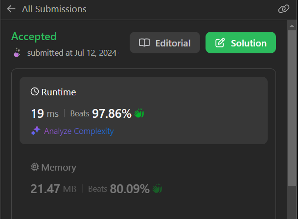

# Binary Search.Beat 97.86%.Easy to understand code with explanation.

**Author:** __Dishant772__
**Votes:** 45
**Link:** [https://leetcode.com/problems/koko-eating-bananas/solutions/5462518/](https://leetcode.com/problems/koko-eating-bananas/solutions/5462518/)

---

# Intuition
The initial thought is to use a binary search approach. Since the speed can range from 1 banana per hour to the maximum number of bananas in any pile, binary search helps to efficiently narrow down the minimum feasible eating speed.

# Approach

-    Binary Search Setup: Initialize low to 1 (minimum possible eating speed) and high to the largest number in the piles array (maximum possible eating speed).
- Binary Search Execution::
 Calculate mid as the average of low and high.

    Use the helper function check to determine if Koko can eat all bananas at the speed mid within h hours.

    If Koko can finish the piles at speed mid within h hours, try a lower speed by setting high to mid.

    If Koko cannot finish, increase the speed by setting low to mid + 1.


-   Helper Function check: This function iterates over each pile, calculating the total hours required to eat all bananas at a given speed mid. If the calculated time is within the allowed h hours, the function returns true; otherwise, it returns false.

- Result: The binary search continues until low meets high, and the smallest feasible eating speed is returned.

# Complexity
- Time complexity:  O(nlogm)
 where n is the number of piles and m is the maximum number of bananas in a pile. The binary search runs in O(logm) and for each mid value, the check function iterates over all piles, resulting in O(n) work per iteration.

- Space complexity: O(1)

# Code

```C++ []
class Solution {
public:
    int check(vector<int>& piles, int h, int mid) {
        int ans = 0;
        for (int i = 0; i < piles.size(); i++) {
            ans += (piles[i] / mid);
            if (piles[i] % mid != 0) {
                ans++;
            }
        }
        return ans <= h;
    }

    int minEatingSpeed(vector<int>& piles, int h) {
        int n = piles.size();
        int low = 1;
        int high = *max_element(piles.begin(), piles.end());

        while (low < high) {
            int mid = (low + high) >> 1;
            if (check(piles, h, mid)) {
                high = mid;
            } else {
                low = mid + 1;
            }
        }
        return low;
    }
};
```
```Java []
class Solution {

    private int check(int[] piles, int h, int mid) {
        int ans = 0;
        for (int pile : piles) {
            ans += pile / mid;
            if (pile % mid != 0) {
                ans++;
            }
        }
        return ans <= h ? 1 : 0;
    }

    public int minEatingSpeed(int[] piles, int h) {
        int n = piles.length;
        int low = 1;
        int high = Arrays.stream(piles).max().getAsInt();

        while (low < high) {
            int mid = (low + high) >> 1;
            if (check(piles, h, mid) == 1) {
                high = mid;
            } else {
                low = mid + 1;
            }
        }
        return low;
    }
}

```
```python []
class Solution:  
    def check(self, piles, h, mid):
        ans = 0
        for pile in piles:
            ans += pile // mid
            if pile % mid != 0:
                ans += 1
        return 1 if ans <= h else 0

    def minEatingSpeed(self, piles, h):
        low = 1
        high = max(piles)

        while low < high:
            mid = (low + high) >> 1
            if self.check(piles, h, mid) == 1:
                high = mid
            else:
                low = mid + 1
                
        return low
```
```Javascript []
/**
 * @param {number[]} piles
 * @param {number} h
 * @return {number}
 */
var minEatingSpeed = function(piles, h) {
    function check(piles, h, mid) {
        let ans = 0;
        for (let pile of piles) {
            ans += Math.floor(pile / mid);
            if (pile % mid !== 0) {
                ans++;
            }
        }
        return ans <= h;
    }

    let low = 1;
    let high = Math.max(...piles);

    while (low < high) {
        let mid = Math.floor((low + high) / 2);
        if (check(piles, h, mid)) {
            high = mid;
        } else {
            low = mid + 1;
        }
    }

    return low;
};

```
```Ruby []
def check(piles, h, mid)
  ans = 0
  piles.each do |pile|
    ans += pile / mid
    ans += 1 if pile % mid != 0
  end
  ans <= h
end
def min_eating_speed(piles, h)
  low = 1
  high = piles.max
  while low < high
    mid = (low + high) / 2
    if check(piles, h, mid)
      high = mid
    else
      low = mid + 1
    end
  end
  low
end

```


```
```


