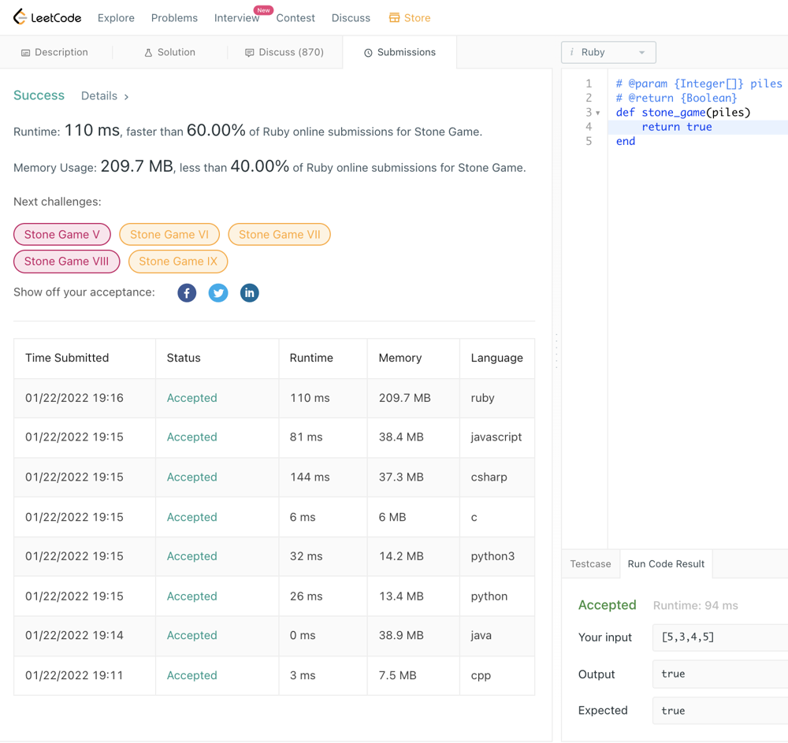

# ✔O(1) solution for C/C++/C#/Java/JavaScript/Python/Python3/Ruby

**Author:** milochen
**Votes:** 1
**Link:** [https://leetcode.com/problems/stone-game/solutions/1709156/](https://leetcode.com/problems/stone-game/solutions/1709156/)

---


When Alice always choice the max from remaind list. Alice will alwasy  win because Alice is the first people to take.
The following is the answer for all programming langauge afford by leetcode.  


C++
```C++
class Solution {
public:
    bool stoneGame(vector<int>& piles) {
        return true;
    }
};
```

Java
```Java
class Solution {
    public boolean stoneGame(int[] piles) {
        return true;
    }
}
```
Python
```Python
class Solution(object):
    def stoneGame(self, piles):
        """
        :type piles: List[int]
        :rtype: bool
        """
        return True
```

Python3
```Python
class Solution:
    def stoneGame(self, piles: List[int]) -> bool:
        return True
```


C
```C
bool stoneGame(int* piles, int pilesSize){
    return true;
}
```

C#
```C#
public class Solution {
    public bool StoneGame(int[] piles) {
        return true;
    }
}
```
JavaScript
```JavaScript
/**
 * @param {number[]} piles
 * @return {boolean}
 */
var stoneGame = function(piles) {
    return true;
};
```

Ruby 
```Ruby
# @param {Integer[]} piles
# @return {Boolean}
def stone_game(piles)
    return true
end
```

By the way, here is performance of all programming language. 

