# Image Explanation🏆- [Memoization -> B-Up DP -> DP Optimized] - C++/Java/Python

**Author:** aryan_0077
**Votes:** 95
**Link:** [https://leetcode.com/problems/profitable-schemes/solutions/3439788/](https://leetcode.com/problems/profitable-schemes/solutions/3439788/)

---

# Video Solution (`Aryan Mittal`) - Link in LeetCode Profile
`Profitable Schemes` by `Aryan Mittal`


# Approach & Intution
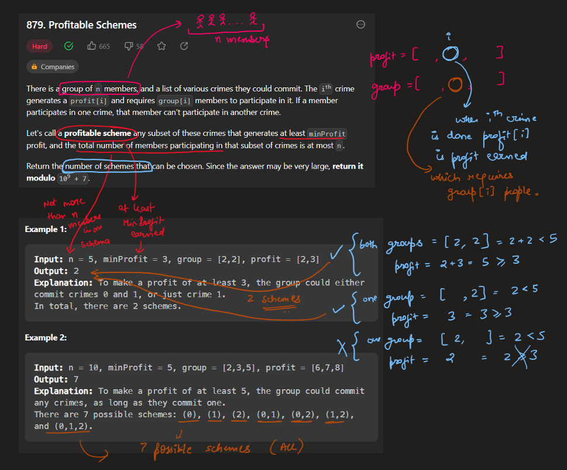
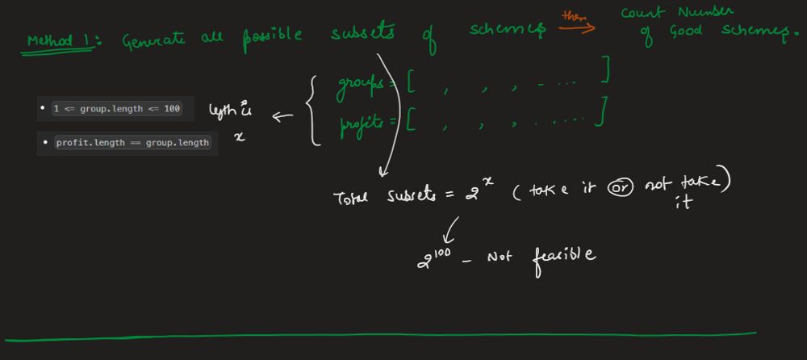
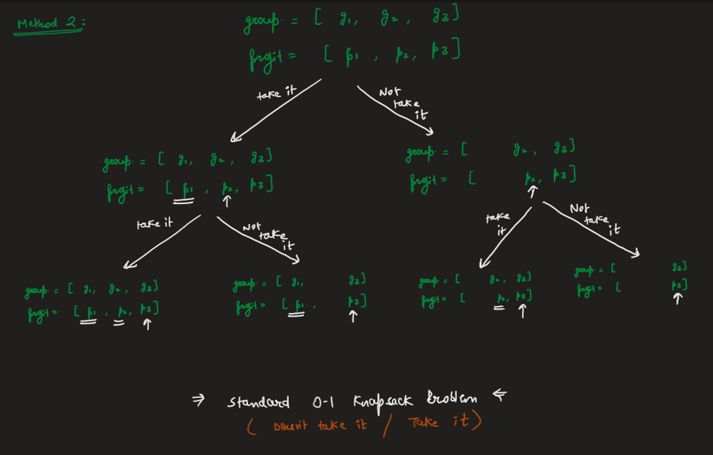
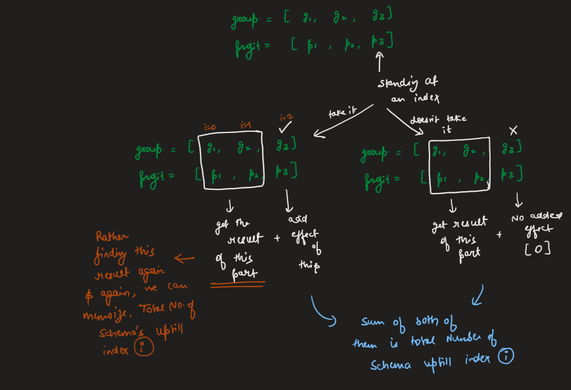
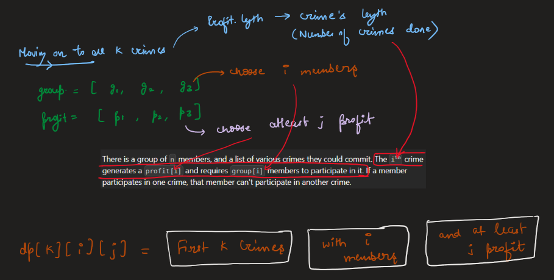
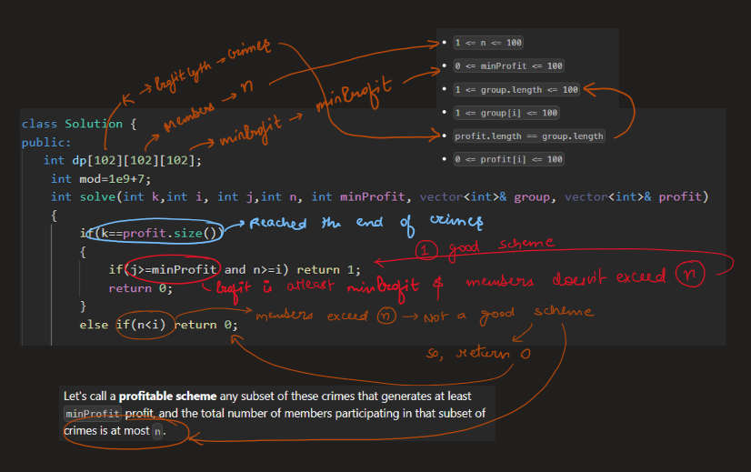
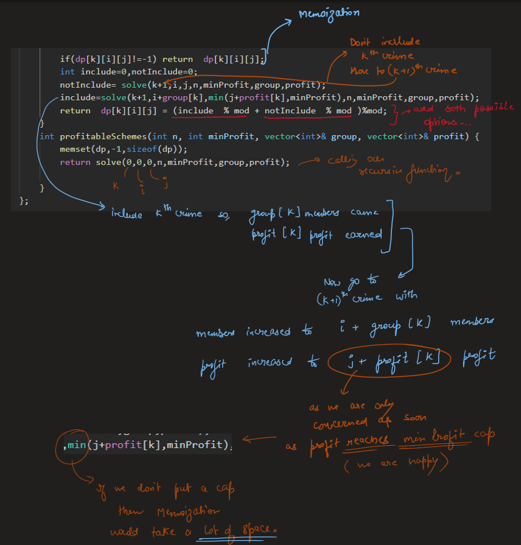
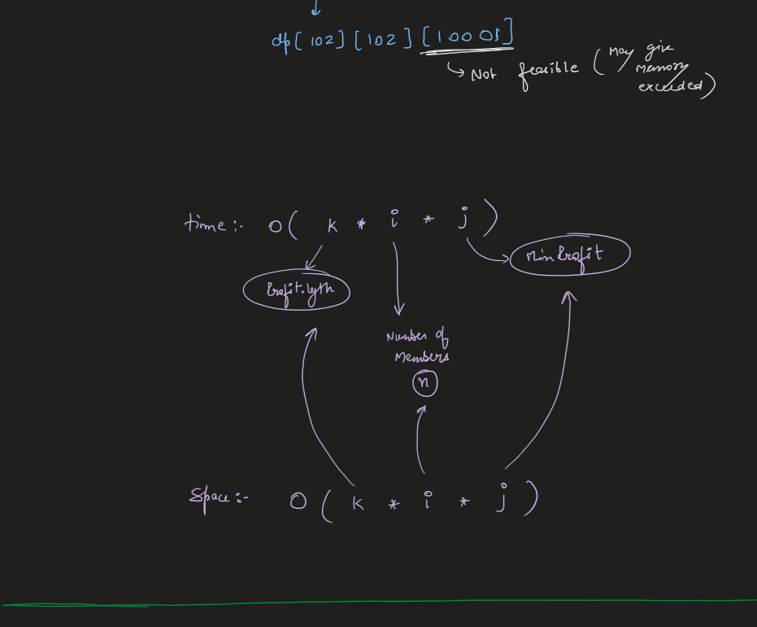
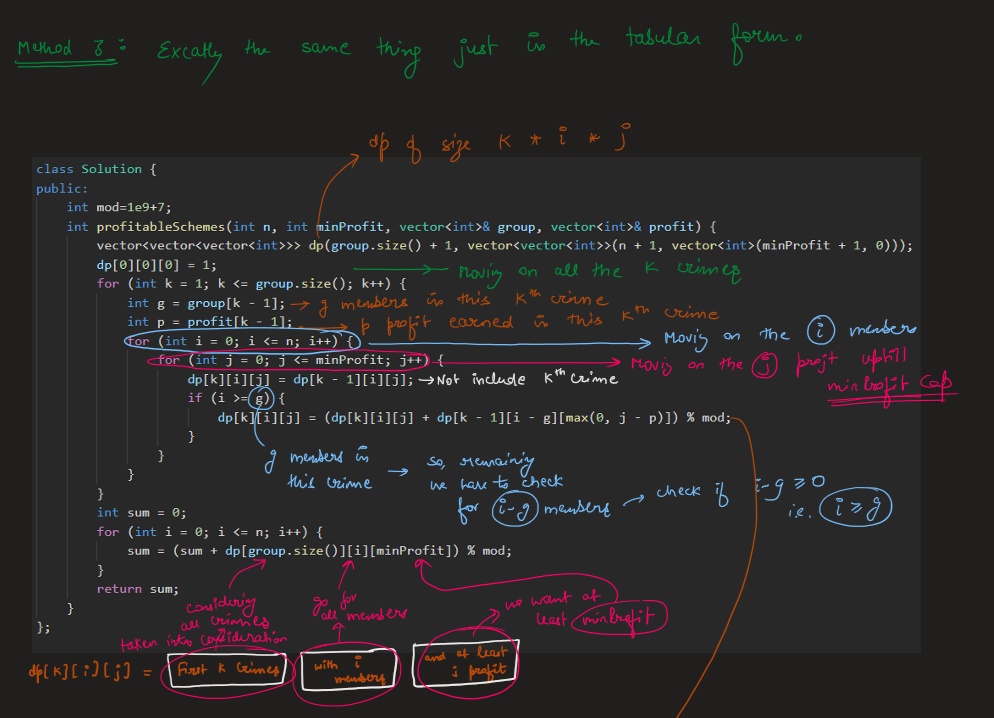
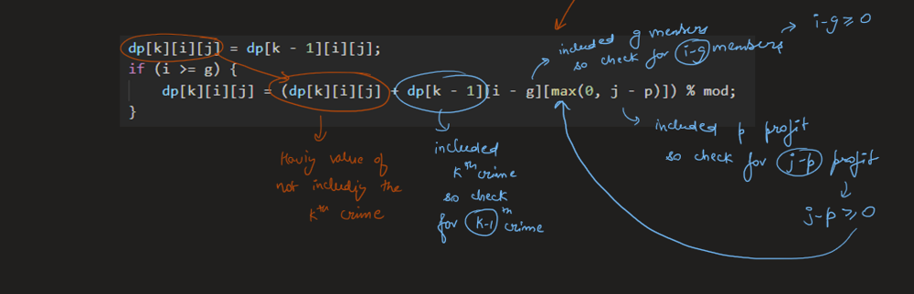
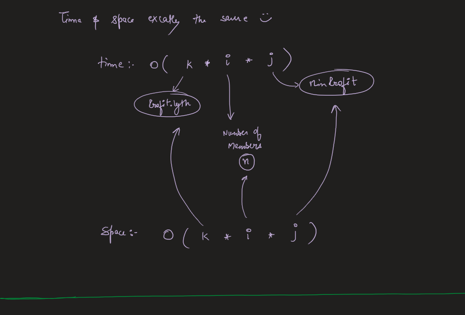
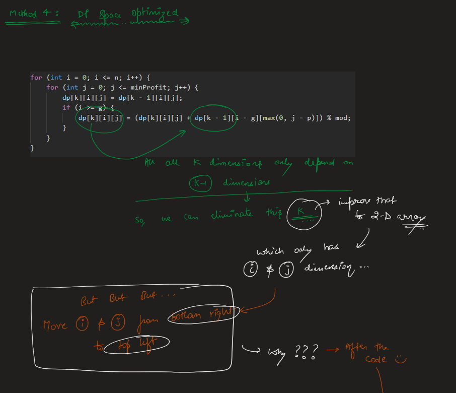
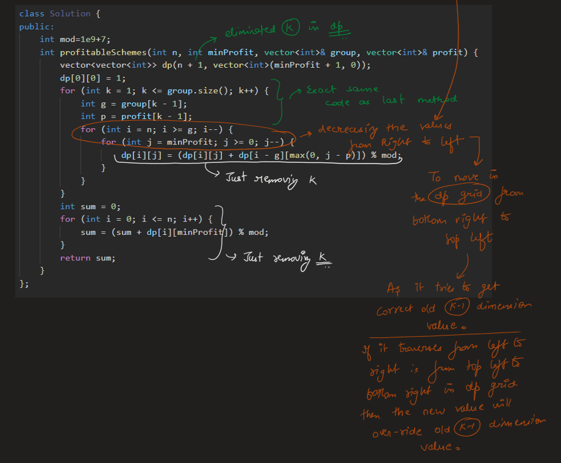
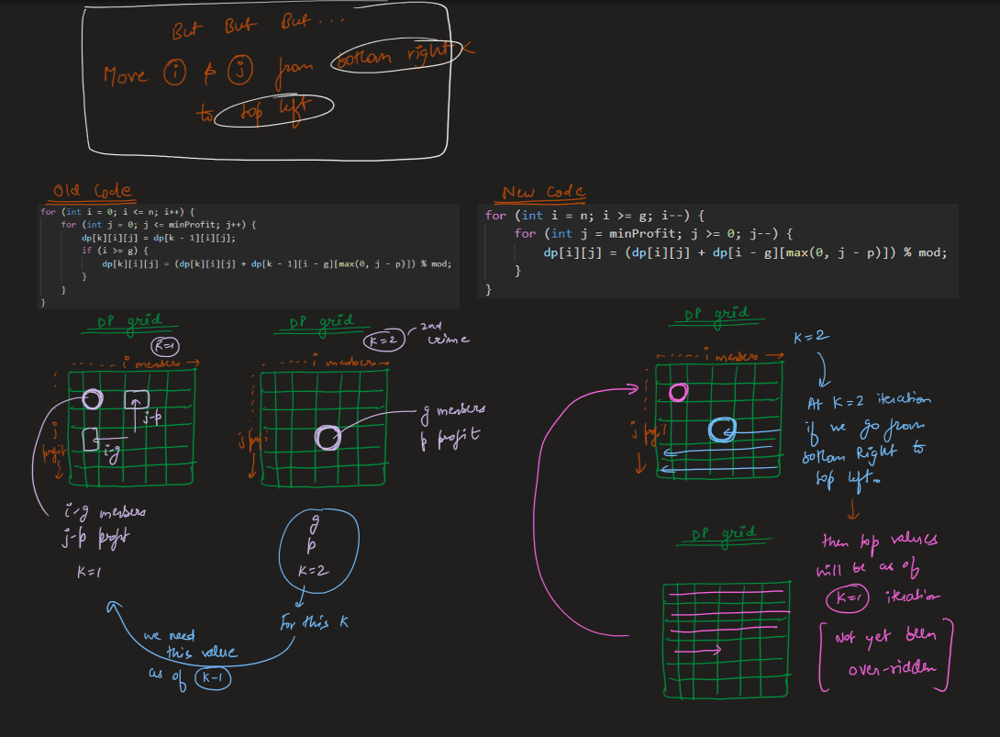
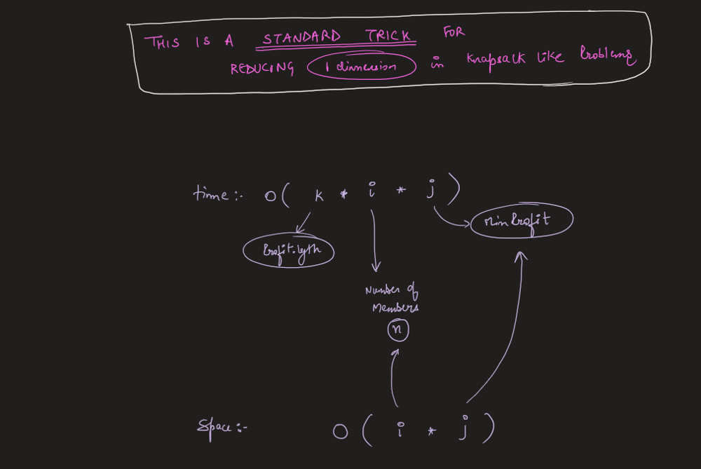


# Memoization Code
```
class Solution {
public:
   int dp[102][102][102];
    int mod=1e9+7;
    int solve(int k,int i, int j,int n, int minProfit, vector<int>& group, vector<int>& profit)
    {
        if(k==profit.size())
        {
            if(j>=minProfit and n>=i) return 1;
            return 0;
        }
        else if(n<i) return 0;
     
        if(dp[k][i][j]!=-1) return  dp[k][i][j];
        int include=0,notInclude=0;
        notInclude= solve(k+1,i,j,n,minProfit,group,profit);
        include=solve(k+1,i+group[k],min(j+profit[k],minProfit),n,minProfit,group,profit);
        return  dp[k][i][j] = (include  % mod + notInclude  % mod )%mod;
    }
    int profitableSchemes(int n, int minProfit, vector<int>& group, vector<int>& profit) {
        memset(dp,-1,sizeof(dp));
        return solve(0,0,0,n,minProfit,group,profit);
        
    }
};
```

# Bottom-Up DP Code
```
class Solution {
public:
    int mod=1e9+7;
    int profitableSchemes(int n, int minProfit, vector<int>& group, vector<int>& profit) {
        vector<vector<vector<int>>> dp(group.size() + 1, vector<vector<int>>(n + 1, vector<int>(minProfit + 1, 0)));
        dp[0][0][0] = 1;
        for (int k = 1; k <= group.size(); k++) {
            int g = group[k - 1];
            int p = profit[k - 1];
            for (int i = 0; i <= n; i++) {
                for (int j = 0; j <= minProfit; j++) {
                    dp[k][i][j] = dp[k - 1][i][j];
                    if (i >= g) {
                        dp[k][i][j] = (dp[k][i][j] + dp[k - 1][i - g][max(0, j - p)]) % mod;
                    }
                }
            }
        }
        int sum = 0;
        for (int i = 0; i <= n; i++) {
            sum = (sum + dp[group.size()][i][minProfit]) % mod;
        }
        return sum;
    }
};
```


# Bottom-Up DP Optimized Code
```C++ []
class Solution {
public:
    int mod=1e9+7;
    int profitableSchemes(int n, int minProfit, vector<int>& group, vector<int>& profit) {
        vector<vector<int>> dp(n + 1, vector<int>(minProfit + 1, 0));
        dp[0][0] = 1;
        for (int k = 1; k <= group.size(); k++) {
            int g = group[k - 1];
            int p = profit[k - 1];
            for (int i = n; i >= g; i--) {
                for (int j = minProfit; j >= 0; j--) {
                    dp[i][j] = (dp[i][j] + dp[i - g][max(0, j - p)]) % mod;
                }
            }
        }
        int sum = 0;
        for (int i = 0; i <= n; i++) {
            sum = (sum + dp[i][minProfit]) % mod;
        }
        return sum;
    }
};
```
```Java []
class Solution {
    private int mod = (int)1e9 + 7;
    public int profitableSchemes(int n, int minProfit, int[] group, int[] profit) {
        int[][] dp = new int[n + 1][minProfit + 1];
        dp[0][0] = 1;
        for (int k = 1; k <= group.length; k++) {
            int g = group[k - 1];
            int p = profit[k - 1];
            for (int i = n; i >= g; i--) {
                for (int j = minProfit; j >= 0; j--) {
                    dp[i][j] = (dp[i][j] + dp[i - g][Math.max(0, j - p)])%mod;
                }
            }
        }
        int sum = 0;                                                       
        for(int i = 0; i <= n; i++){
            sum = (sum + dp[i][minProfit])%mod;
        }
        return sum;
    }
}
```
```Python []
class Solution:
    def profitableSchemes(self, n: int, minProfit: int, group: List[int], profit: List[int]) -> int:
        mod = int(1e9) + 7
        dp = [[0] * (minProfit + 1) for _ in range(n + 1)]
        dp[0][0] = 1
        for k in range(1, len(group) + 1):
            g = group[k - 1]
            p = profit[k - 1]
            for i in range(n, g - 1, -1):
                for j in range(minProfit, -1, -1):
                    dp[i][j] = (dp[i][j] + dp[i - g][max(0, j - p)]) % mod
        return sum(dp[i][minProfit] for i in range(n + 1)) % mod
```
