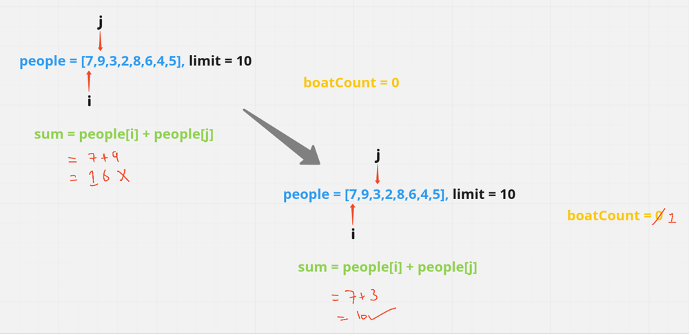
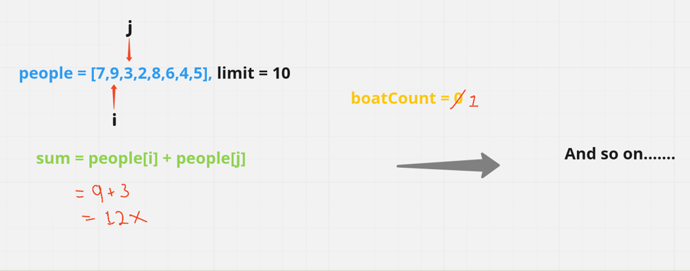
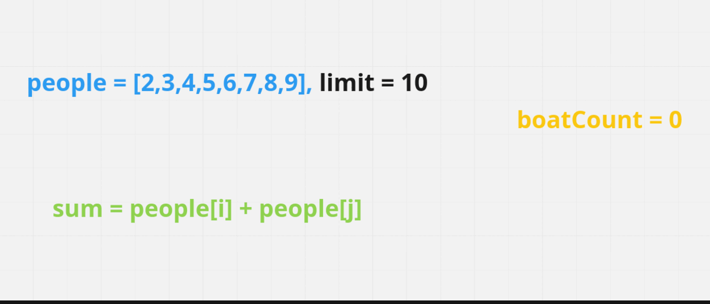

# [Java/C++] A very Easy EXPLANATION || TRUST ME <^^>

**Author:** hi-malik
**Votes:** 305
**Link:** [https://leetcode.com/problems/boats-to-save-people/solutions/1877945/](https://leetcode.com/problems/boats-to-save-people/solutions/1877945/)

---

How's going Ladies - n - Gentlemen, today we are going to solve another cooleast problem i.e. **Boats to Save People**

So, let's see what problem is saying,
```
We have given weight of peoples
Limit weight of boat & boats are available infinite
But, we can only put Minimum of 1 person & Maximum of 2 person
```

Let's take one example, inorder to understand the problem:-
**Input**: people = [7,9,3,2,8,6,4,5], limit = 10
**Output**: 5

Okay so let's see what the very **`Brute-Force approach`** comes in your mind after looking at this,
We have the array & use 2 pointers.
* One of them starting from **0th index** and another from **1st index**. We gonna have one count variable as well, which helps us in get the no. of count of boats. 


* Sum them up & if their weight is less than or equals to limit, then increment the count otherwise increment the **1st index** pointer, until we find less then or equal to the limit
* If unable to find anyone of them, we gonna increment the count of **0th index** pointer





So, as you can see it's not a good way, because we are re-visiting the character which we have already visited & we are recalculating it.

In this Approach, our **Time Complexity will be O(N^2)**

<hr>
<hr>

```
Now, you'll ask dude, then what's the Optimise solution
```

<hr>
<hr>

I'll say okay, let's move to Optimise Approach.
So, for optimisation my **1st Step is sort the Array**

Now you ask, what's the benefit of doing that? Well, the benefit of sorting is, we can take one max. weight person & one min weight person in the boat/ 
And for that we gonna sort the array.

Using above example :- 
`[7,9,3,2,8,6,4,5]`
**After Sorting**
`[2,3,4,5,6,7,8,9]`

So, for optimisation my **2nd Step will be create 2 pointer's**
* One will be my **left pointer** intially on the extreme left i.e. starting of the array


* One will be my **right pointer** intially on the extreme right i.e. end of the array

```
Okay, now when I sum up the value of:
Left + Right pointer, there could be 2 Possiblities

1.0 (sum <= limit)      "sum could be less then or equals to my limit"
2.0 (sum > limit)      "sum could be greater then my limit"
```

Let's talk about what we'll do when we face **`possibility no. 1.0`**
If that's the case then we only require single boat & increment the `boatCount`, `left pointer` & decrement the `right pointer`

Let's talk about what we'll do when we face **`possibility no. 2.0`**
If that's the case then we only one person will go in boat & increment the `boatCount` & decrement the `right pointer`

**We have talk a lot, now let's see it's visually:**



*I hope ladies - n - gentlemen approach is absolute clear,* **Let's code it up:**

**Java**
```
class Solution {
    public int numRescueBoats(int[] people, int limit) {
        int boatCount = 0;
        Arrays.sort(people);
        
        int left = 0;
        int right = people.length - 1;
        
        while(left <= right){
            int sum = people[left] + people[right];
            if(sum <= limit){
                boatCount++;
                left++;
                right--;
            }
            else{
                boatCount++;
                right--;
            }
        }
        return boatCount;
    }
}
```
**C++**
```
class Solution {
public:
    int numRescueBoats(vector<int>& people, int limit) {
        int boatCount = 0;
        sort(people.begin(), people.end());
        
        int left = 0;
        int right = people.size() - 1;
        
        while(left <= right){
            int sum = people[left] + people[right];
            if(sum <= limit){
                boatCount++;
                left++;
                right--;
            }
            else{
                boatCount++;
                right--;
            }
        }
        return boatCount;
    }
};
```

ANALYSIS:
* **Time Complexity :-** BigO(NlogN)

* **Space COmplexity :-** BigO(1)