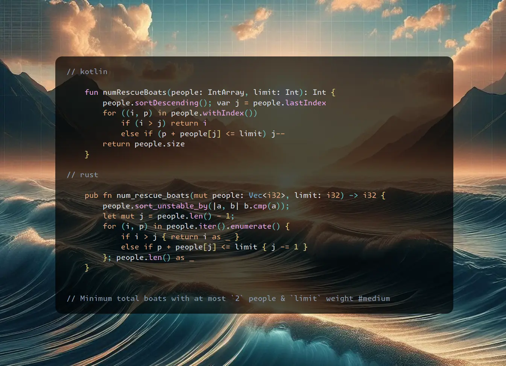

# Kotlin | Rust

**Author:** SamoylenkoDmitry
**Votes:** 3
**Link:** [https://leetcode.com/problems/boats-to-save-people/solutions/5109541/](https://leetcode.com/problems/boats-to-save-people/solutions/5109541/)

---


https://youtu.be/ZJSjkMMBSkA
#### Join me on Telegram

https://t.me/leetcode_daily_unstoppable/592

#### Problem TLDR

Minimum total boats with at most `2` people & `limit` weight #medium #two_pointers #greedy

#### Intuition

First idea as to try to take as much people as possible in a single boat: if we start with light first, then heavier people might not give a space for a `limit`. By intuition, we need to try put most heavy and most light people in pairs together:

```j
    // 6654321   limit = 6
    // i     j
    // i         +1
    //  i        +1
    //   i   j   +1
    //    i j    +1
    //     i     +1
```

#### Approach

The interesting part is how some conditions are not relevant: we can skip `i < j` check when moving `j--`.

#### Complexity

- Time complexity:
$$O(nlog(n))$$

- Space complexity:
$$O(1)$$

#### Code

```kotlin []

    fun numRescueBoats(people: IntArray, limit: Int): Int {
        people.sortDescending(); var j = people.lastIndex
        for ((i, p) in people.withIndex())
            if (i > j) return i
            else if (p + people[j] <= limit) j--
        return people.size
    }

```
```rust []

    pub fn num_rescue_boats(mut people: Vec<i32>, limit: i32) -> i32 {
        people.sort_unstable_by(|a, b| b.cmp(a)); 
        let mut j = people.len() - 1;
        for (i, p) in people.iter().enumerate() {
            if i > j { return i as _ }
            else if p + people[j] <= limit { j -= 1 }
        }; people.len() as _
    }

```