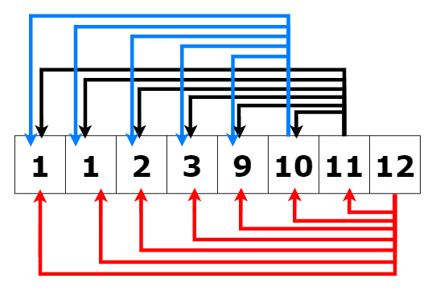
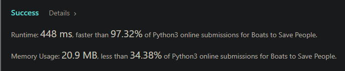

# ⭐Explained Python 2 Pointers Solution

**Author:** anCoderr
**Votes:** 58
**Link:** [https://leetcode.com/problems/boats-to-save-people/solutions/1878155/](https://leetcode.com/problems/boats-to-save-people/solutions/1878155/)

---

**OBSERVATIONS:**
```
Lets take an example: People = [1, 1, 2, 3, 9, 10, 11, 12] and Limit = 12
```

1. Since we want to minimise the number of boats used, we must try to form pair of largest and smallest numbers to fit them into one boat if possible. Taking two smaller weight people and adding them to one boat might waste some precious space.
2. Now we can see that as 12 tries to form a pair. Logically being the largest number it should start from the smallest. So it goes to 1's, then 2 then 3 and so on to form a pair. Now one thing to note is that if 12 cannot form a pair with the smallest number(that is 1), then there is no point looking forward to 2, 3 ... as it is certain that numbers beyond 1 will be equal to or larger than 1 and will definitely exceed the boats rated capacity if it did with 1 in the first place. 
3. Thus if the `people[hi]` cannot be seated with `people[lo]` in one boat then that means that people[hi] cannot form a pair with any of the remaining people, and we will thus stop looking for a partner for that person and give him a boat for him/her self.

**STEPS:**
1. Maintain 2 pointers `lo` and `hi` set to 0 and n-1 respectively.
2. Sort the array `people`.
3. Now traverse till `lo <= hi`.
4. If people[lo] + people[hi] <= target. That means they can form a pair and can sit in the same boat. 
5. If not then the people[hi] that is the person with the higher weight is the problem and must be given his own boat as we observed above. 

**CODE**
```
class Solution:
    def numRescueBoats(self, people: List[int], limit: int) -> int:
        people.sort()
        lo = 0
        hi = len(people)-1
        boats = 0
        while lo <= hi:
            if people[lo] + people[hi] <= limit:
                lo += 1
                hi -= 1
            else:
                hi -= 1
            boats += 1
        return boats
```
**SPACE & TIME COMPLEXITY:**
O(NlogN) time as we only traverse the array once but require NlogN to sort it in the first place.
and O(N) space in worst case as we only use 3 variables: `lo`, `hi` and `boats` **however Python sorting has a space complexity of `\u03A9(n)` {Upperbound at N or O(n) in the worst case}.** 


