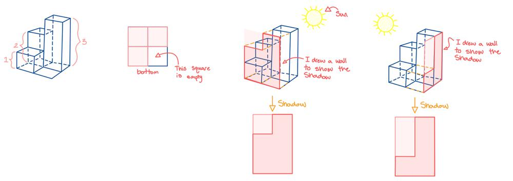

# Golang solution with quick explanation and images

**Author:** nathannaveen
**Votes:** 1
**Link:** [https://leetcode.com/problems/projection-area-of-3d-shapes/solutions/1194480/](https://leetcode.com/problems/projection-area-of-3d-shapes/solutions/1194480/)

---

[883. Projection Area of 3D Shapes](https://leetcode.com/problems/projection-area-of-3d-shapes/)

The core ideas of this solution are that there are three views that can be used to solve this problem. This can be shown using an example, `input : [[2,3][1,0]]`




We find the side shadows by finding the max value in each row and each column. Then we add the max to the result. Finally, we find the bottom shadow by checking whether `grid[i][j]` is not equal to `0`. If so, we can add one to `result`.


``` go
func projectionArea(grid [][]int) int {
	result := 0

	for i := 0; i < len(grid); i++ {
		maxRow, maxCol := 0, 0

		for j := 0; j < len(grid[i]); j++ {
			if grid[j][i] > maxRow {
				maxRow = grid[j][i]
			}
			if grid[i][j] > maxCol {
				maxCol = grid[i][j]
			}
			if grid[i][j] != 0 {
				result++
			}
		}
		result = result + maxCol + maxRow
	}

	return result
}
```