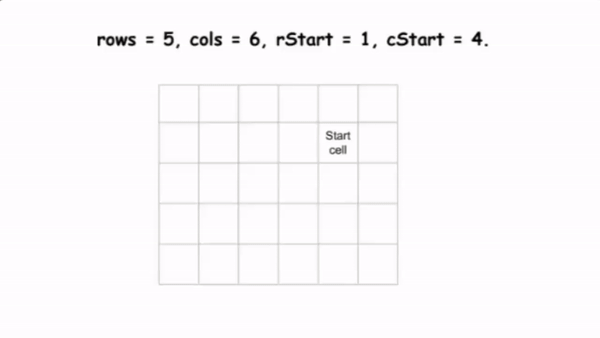

# Simulating Easy Solution that Beats 100%

**Author:** Sachinonly__
**Votes:** 163
**Link:** [https://leetcode.com/problems/spiral-matrix-iii/solutions/5604832/](https://leetcode.com/problems/spiral-matrix-iii/solutions/5604832/)

---



# Approach
1. initialize i,j variable which is the point in matrix from which we are going to start traversing.`i,j = rStart, cStart`
2. initialize a diriction movement `diri, dirj to 0, 1`  which is moving next cell to our current cell.
3. initialize other variables: 
    - **twice**: Counter to track the need to change direction.
    - **res**: Initialize the result list.
    - **moves**: Number of steps to move in the current direction.
    - **next_moves**: Number of steps to move after changing direction twice. 
4. now do a while loop till the last cell of matrix i.e. rows * cols
    - if our i and j are still inside the matrix append the index in res list.
    - now move in current direction and decrement the move by -1 whith every iteration.
    - if `moves == 0` it means that now we have to change the direction to 90 degrees clockwise.
    `i += diri
    j += dirj`
    - decrement twice by 1
    - If twice reaches zero, it indicates that we've changed direction twice (completed one spiral cycle). Reset twice to 2, update moves to next_moves, and increment next_moves for the next cycle.
    - If twice is not zero, set moves to next_moves - 1 for the next half-cycle indicating that we have to visit n -1 cells when twice is not 0

# Code
```python []
class Solution(object):
    def spiralMatrixIII(self, rows, cols, rStart, cStart):
        i,j = rStart, cStart

        diri, dirj = 0, 1 # directions to move
        twice = 2
        res = []
        moves = 1
        next_moves = 2

        while len(res) < (rows * cols):
            if (-1 < i < rows) and ( -1 < j < cols):
                res.append([i,j])
            
            i += diri
            j += dirj
            moves -= 1
            if moves == 0:
                diri, dirj = dirj, -diri # 90 deg Clockwise
                twice -= 1
                if twice == 0:
                    twice = 2
                    moves = next_moves
                    next_moves += 1
                else:
                    moves = next_moves - 1
        return res
```
```C++ []
class Solution {
public:
    vector<vector<int>> spiralMatrixIII(int rows, int cols, int rStart, int cStart) {
        int i = rStart, j = cStart;
        int diri = 0, dirj = 1; // directions to move
        int twice = 2;
        vector<vector<int>> res;
        int moves = 1;
        int next_moves = 2;

        while (res.size() < rows * cols) {
            if (i >= 0 && i < rows && j >= 0 && j < cols) {
                res.push_back({i, j});
            }

            i += diri;
            j += dirj;
            moves -= 1;
            if (moves == 0) {
                int temp = diri;
                diri = dirj;
                dirj = -temp; // right direction
                twice -= 1;
                if (twice == 0) {
                    twice = 2;
                    moves = next_moves;
                    next_moves += 1;
                } else {
                    moves = next_moves - 1;
                }
            }
        }
        return res;
    }
};
```

