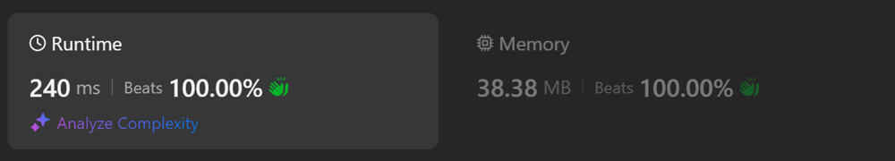

# Kotlin. Beats 100% (240 ms). OOP approach.

**Author:** mobdev778
**Votes:** 2
**Link:** [https://leetcode.com/problems/spiral-matrix-iii/solutions/5606228/](https://leetcode.com/problems/spiral-matrix-iii/solutions/5606228/)

---



# Code
```
class Solution {
    fun spiralMatrixIII(rows: Int, cols: Int, rStart: Int, cStart: Int): Array<IntArray> {
        reset()

        val pathRecorder = PathRecorder(rows, cols)
        var direction = directions[0]
        var vy = rStart
        var vx = cStart
        while (pathRecorder.isIncomplete()) {
            for (c in 0 until direction.maxSteps) {
                if (vy >= 0 && vy < rows && vx >= 0 && vx < cols) {
                    pathRecorder.addCell(vy, vx)
                }
                vx += direction.dx
                vy += direction.dy
            }
            direction.maxSteps += 2
            direction = direction.next!!
        }
        return pathRecorder.path()
    }

    class Direction(val dx: Int, val dy: Int, var maxSteps: Int) {
        var next: Direction? = null
    }

    class PathRecorder(rows: Int, cols: Int) {
        val result = Array<IntArray?>(rows * cols) { null }
        var i = 0

        inline fun isIncomplete(): Boolean {
            return i < result.size
        }

        inline fun addCell(row: Int, col: Int) {
            result[i++] = intArrayOf(row, col)
        }

        fun path(): Array<IntArray> {
            return result as Array<IntArray>
        }
    }

    companion object {
        val directions = arrayOf(
            Direction(1, 0, 1),
            Direction(0, 1, 1),
            Direction(-1, 0, 1),
            Direction(0, -1, 1)
        )
        init {
            directions[0].next = directions[1]
            directions[1].next = directions[2]
            directions[2].next = directions[3]
            directions[3].next = directions[0]
        }
        fun reset() {
            directions[0].maxSteps = 1
            directions[1].maxSteps = 1
            directions[2].maxSteps = 2
            directions[3].maxSteps = 2
        }
    }
}
```