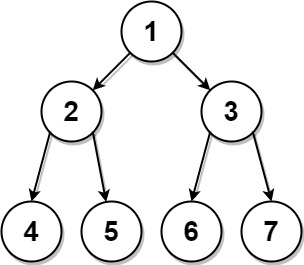

# [889. Construct Binary Tree from Preorder and Postorder Traversal](https://leetcode.com/problems/construct-binary-tree-from-preorder-and-postorder-traversal/)

| Category | Difficulty | Likes | Dislikes |
| :------: | :--------: | :---: | :------: |
| Algorithms | Medium | 3371 | 159 |

**Tags:** [`array`](https://leetcode.com/tag/array), [`hash-table`](https://leetcode.com/tag/hash-table), [`divide-and-conquer`](https://leetcode.com/tag/divide-and-conquer), [`tree`](https://leetcode.com/tag/tree), [`binary-tree`](https://leetcode.com/tag/binary-tree)

**Companies:** `google`, `amazon`

## Description

Given two integer arrays, `preorder` and `postorder` where `preorder` is the preorder traversal of a binary tree of **distinct** values and `postorder` is the postorder traversal of the same tree, reconstruct and return *the binary tree*.

If there exist multiple answers, you can **return any** of them.

 

**Example 1:**


```

Input: preorder = [1,2,4,5,3,6,7], postorder = [4,5,2,6,7,3,1]
Output: [1,2,3,4,5,6,7]

```

**Example 2:**

```

Input: preorder = [1], postorder = [1]
Output: [1]

```

 

**Constraints:**

	- `1 <= preorder.length <= 30`

	- `1 <= preorder[i] <= preorder.length`

	- All the values of `preorder` are **unique**.

	- `postorder.length == preorder.length`

	- `1 <= postorder[i] <= postorder.length`

	- All the values of `postorder` are **unique**.

	- It is guaranteed that `preorder` and `postorder` are the preorder traversal and postorder traversal of the same binary tree.

---

**Links:** [Submissions](https://leetcode.com/problems/construct-binary-tree-from-preorder-and-postorder-traversal/) | [Solutions](https://leetcode.com/problems/construct-binary-tree-from-preorder-and-postorder-traversal/)
