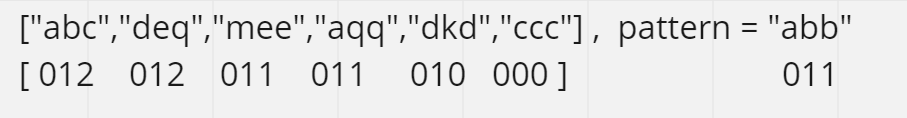

# ✔ | Python | Dictionary | Explained

**Author:** code_alone
**Votes:** 27
**Link:** [https://leetcode.com/problems/find-and-replace-pattern/solutions/2348835/](https://leetcode.com/problems/find-and-replace-pattern/solutions/2348835/)

---

**Now u can see the pattern ;)
define a function that calculates the the numeric pattern 
and compare with each word in words**

	class Solution:
		def findAndReplacePattern(self, words: List[str], p: str) -> List[str]:
			def find(w): # function thats calculate the numeric pattern
				l = []
				m = defaultdict(int)
				i = 0
				for c in w:
					if c in m:
						l.append(m[c])
					else:
						i+=1
						m[c]=i
						l.append(m[c])
				return l
			ans = []
			pfind = find(p)
			for w in words:
				wfind = find(w)
				if wfind == pfind: ans.append(w) #check if numeric pattern of pattern is equal to pattern of word 
			return ans