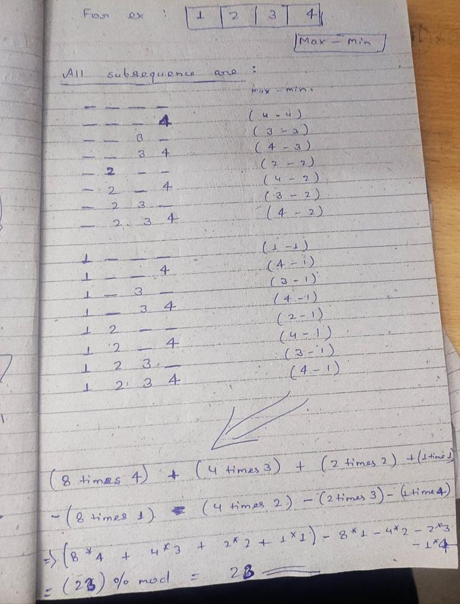

# [C++] - Sum of Subsequence Widths

**Author:** eshu97612__
**Votes:** 12
**Link:** [https://leetcode.com/problems/sum-of-subsequence-widths/solutions/2361648/](https://leetcode.com/problems/sum-of-subsequence-widths/solutions/2361648/)

---

The approach to the solution can be started by observing max and min(max-min) value of all subsequence and then go for simple maths as shown below:

Here is my code for the approach.....

class Solution {
public:
    int sumSubseqWidths(vector<int>& a) {
        
        int n=a.size(),i,j=n-1;
        
        sort(a.begin(),a.end());
        
        long long int p=1;
        
        long long int ans=0;
        
        long long int mod=1000000007;
        
        for(i=0;i<n;i++)
        {
            ans=(ans+p*a[i]-p*a[j])%mod;
            
            p=(p*2)%mod;
            
            j--;
        }
        return (int)ans;
    }
};