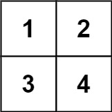
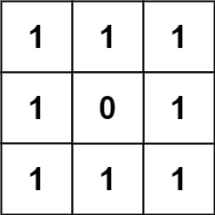
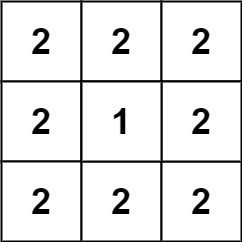

# [892. Surface Area of 3D Shapes](https://leetcode.com/problems/surface-area-of-3d-shapes/)

| Category | Difficulty | Likes | Dislikes |
| :------: | :--------: | :---: | :------: |
| Algorithms | Easy | 603 | 760 |

**Tags:** [`array`](https://leetcode.com/tag/array), [`math`](https://leetcode.com/tag/math), [`geometry`](https://leetcode.com/tag/geometry), [`matrix`](https://leetcode.com/tag/matrix)

**Companies:** `google`

## Description

You are given an `n x n` `grid` where you have placed some `1 x 1 x 1` cubes. Each value `v = grid[i][j]` represents a tower of `v` cubes placed on top of cell `(i, j)`.

After placing these cubes, you have decided to glue any directly adjacent cubes to each other, forming several irregular 3D shapes.

Return *the total surface area of the resulting shapes*.

**Note:** The bottom face of each shape counts toward its surface area.

 

**Example 1:**


```

Input: grid = [[1,2],[3,4]]
Output: 34

```

**Example 2:**


```

Input: grid = [[1,1,1],[1,0,1],[1,1,1]]
Output: 32

```

**Example 3:**


```

Input: grid = [[2,2,2],[2,1,2],[2,2,2]]
Output: 46

```

 

**Constraints:**

	- `n == grid.length == grid[i].length`

	- `1 <= n <= 50`

	- `0 <= grid[i][j] <= 50`

---

**Links:** [Submissions](https://leetcode.com/problems/surface-area-of-3d-shapes/) | [Solutions](https://leetcode.com/problems/surface-area-of-3d-shapes/)
