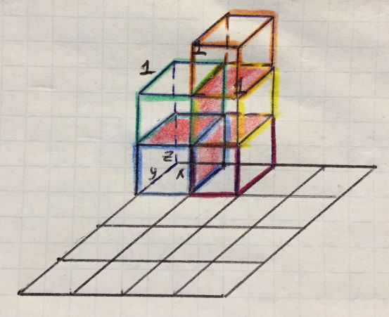

# 892. Surface Area of 3D Shapes. C++ solution with visual presentation

**Author:** langrenn
**Votes:** 40
**Link:** [https://leetcode.com/problems/surface-area-of-3d-shapes/solutions/473235/](https://leetcode.com/problems/surface-area-of-3d-shapes/solutions/473235/)

---

Surface area of 1 cube is equal to 6 according to description (1 * 1 * 1) * 6, cube have 6 sides.
grid[i][j] is a count of cubes placed on top of grid cell. For instance, if we have a grid[i][j] = 2, it means we placed two cubes one on other and they have a common area is equal to 2, because we have two connected sides. If the grid[i][j] = 3, then common area is equal to 4. 
It turns out when grid[i][j] is equal to:
2 cubes - 2
3 cubes - 4
4 cubes - 6
5 cubes - 8 => **2 * (grid[i][j] - 1)**
We also have to substract common area on **y** and **x** axis. We only compute up to **n - 1** for both axis by calculating minimum of two connected **V**s and multiply by 2.
Red squares is a common areas which we have to subtract from resulting total surface area.
The following depicted picture shows example: [[2, 3, 0, 0], [0, 0, 0, 0], [0, 0, 0, 0], [0, 0, 0, 0]]. The answer is: 5 * 6 - 2 - 4 = 20.



```
int surfaceArea(vector<vector<int>>& grid) {
	int n = grid.size();
	int res = 0;
	for (int i = 0; i < n; i++) {
		for (int j = 0; j < n; j++) {
			if (grid[i][j] == 0) continue;
			res += grid[i][j] * 6 - 2 * (grid[i][j] - 1); 
			if (i < n - 1) res -= 2 * min(grid[i][j], grid[i+1][j]);
			if (j < n - 1) res -= 2 * min(grid[i][j], grid[i][j+1]); 
		}
	}
	return res;
}
```
**Complexity Analysis**:

Time Complexity: **O(n\xB2)**, where N is the number of rows (and columns) in the grid.

Space Complexity: **O(1)**.