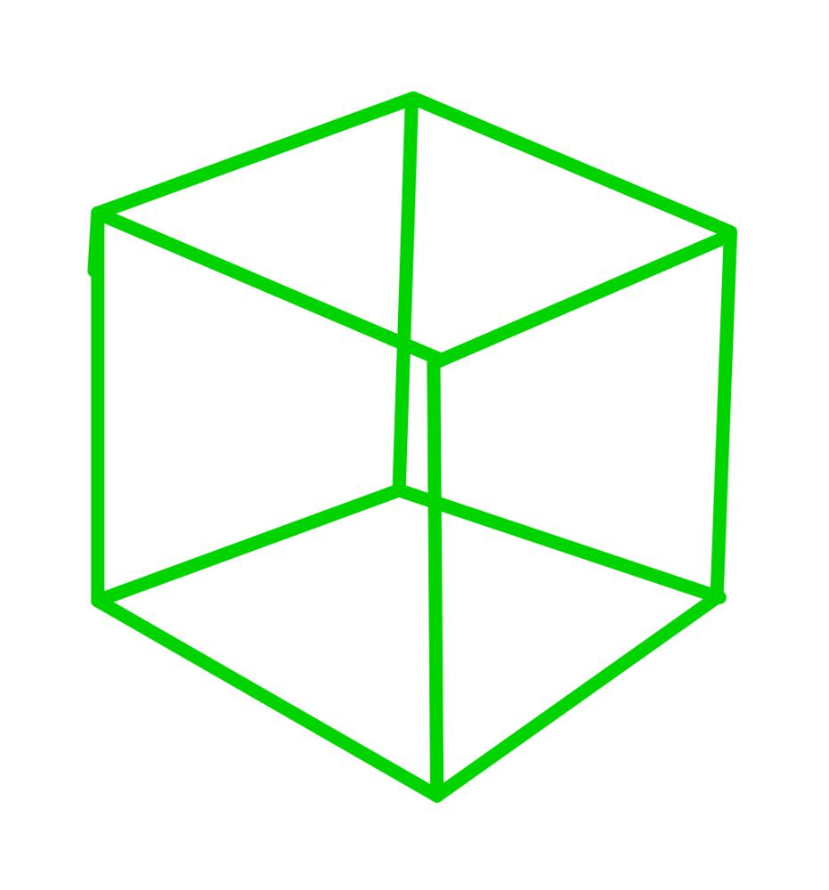
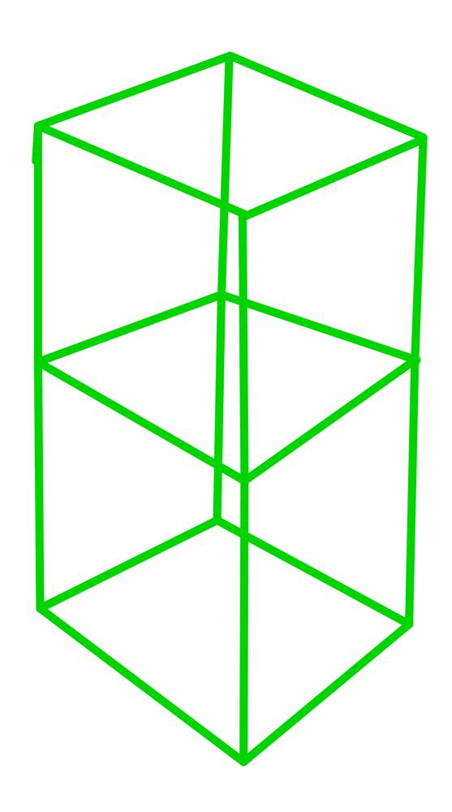
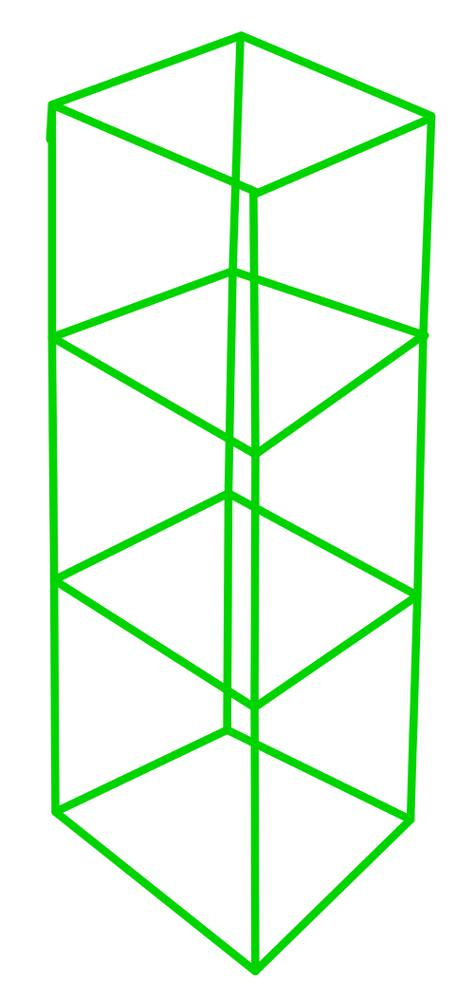
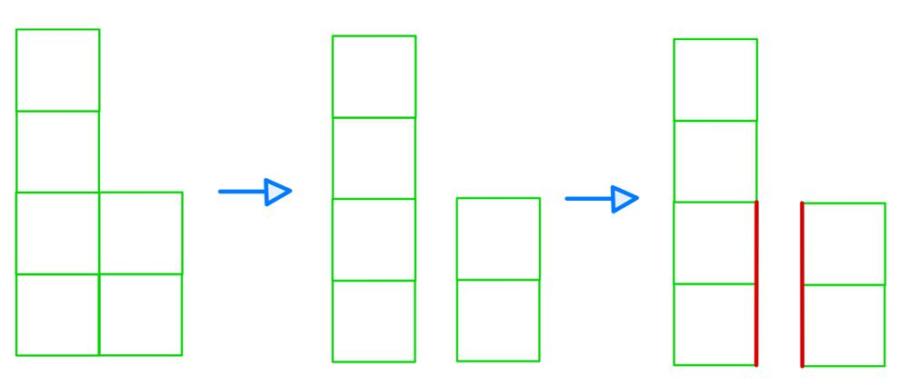

# Golang solution 100%, 100%, with explanation and images

**Author:** nathannaveen
**Votes:** 1
**Link:** [https://leetcode.com/problems/surface-area-of-3d-shapes/solutions/1149012/](https://leetcode.com/problems/surface-area-of-3d-shapes/solutions/1149012/)

---

[892. Surface Area of 3D Shapes](https://leetcode.com/problems/surface-area-of-3d-shapes/)

**The Idea Of This Solution:**

This solution uses the fact that each stack of cubes surface area is the equation `2 + 4 * v`. This works because each cube has `6` sides. This can be shown using some images:




> We can see that each cube has `6` planes. There are `4` sides, `1` top, and `1` bottom.




> Now, as we can see, there are `10` units of surface area while the other one only had `6`, there are `8` sides, `1` top, and `1` bottom.




> This example is `3` cubes, and it has a surface area of `14` units. There are `12` side units, `1` top, and `1` bottom.

As you can see in all three examples, there is always 1 top, one bottom, and four sides per cube, so we can write the equation `2 + 4 * v`, where `v` is the number of cubes. This equation will work for all stacks except for one with `v = 0`. This is because if we do this equation with `v = 0`, we get the output of `2`. After all, the code thinks that there is a top and a bottom, but we know that there is no top and no bottom on a stack of size `0`.

Now that we have got the total surface area, we have to subtract the overlapping part. Now you might be asking, what overlap? Just look at the following image:




> First, we can get the input of a stack of `4` and then a pile of `2` back to back, so we have to subtract the stack size `2`'s one side from the stack of size `2` and the pile of size `4`. So basically, we are subtracting `2 * minimum(grid before, current grid)`.

**The Code:**

``` go
func min(a, b int) int {
    if a < b {
        return a
    }
    return b
}

func surfaceArea(grid [][]int) int {
    // 2 + shape * 4 == area of each shape
    res := 0

    for i := 0; i < len(grid); i++ {
        for j := 0; j < len(grid[0]); j++ {
            if grid[i][j] != 0 {
                res += 2 + grid[i][j]*4
            }
            if i-1 >= 0 {
                res -= 2 * min(grid[i-1][j], grid[i][j])
            }
            if j-1 >= 0 {
                res -= 2 * min(grid[i][j-1], grid[i][j])
            }
        }
    }

    return res
}
```