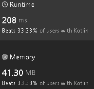

# HashMap array and a final HashMap

**Author:** sav20011962
**Votes:** 0
**Link:** [https://leetcode.com/problems/groups-of-special-equivalent-strings/solutions/5128742/](https://leetcode.com/problems/groups-of-special-equivalent-strings/solutions/5128742/)

---

# Approach
First I accumulate frequencies of even and odd characters in the HashMap array. Then I use this HashMap to form a final HashMap with quantities in groups. The length of this final HashMap gives the number of groups.
# Complexity
- Time complexity:
O(n*m)
- Space complexity:
O(n*m)
# Code

```
class Solution {
    fun numSpecialEquivGroups(words: Array<String>): Int {
        val len = words.size
        val lenw = words[0].length
        val map0 : Array<HashMap<Int, Int>> = Array(len,{HashMap()})
        val map_map : HashMap<HashMap<Int, Int>, Int> = HashMap()
        for (i in 0 until len) {
            val word = words[i]
            for (j in 0 until lenw) {
                val ch = word[j]-'a'
                if (j % 2 == 0) {
                    map0[i][ch] = map0[i].getOrDefault(ch, 0) + 1
                }
                else {
                    map0[i][ch+100] = map0[i].getOrDefault(ch+100, 0) + 1
                }
            }
            map_map[map0[i]] = map_map.getOrDefault(map0[i], 0) + 1
        }
        return map_map.size
    }
}
```