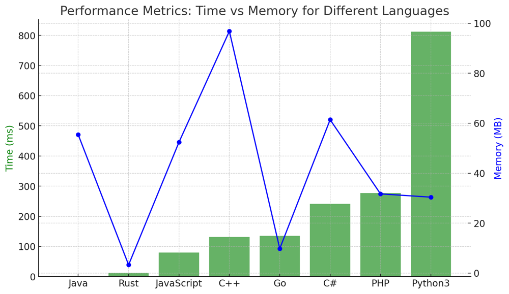

# ✅ 95.15% Single Pass Check

**Author:** vanAmsen
**Votes:** 120
**Link:** [https://leetcode.com/problems/monotonic-array/solutions/4102869/](https://leetcode.com/problems/monotonic-array/solutions/4102869/)

---

# Interview Guide: "Check Monotonic Array" Problem

## Problem Understanding

The "Check Monotonic Array" problem requires evaluating whether a given array is either entirely non-decreasing (monotonically increasing) or non-increasing (monotonically decreasing). The objective is to return a boolean value indicating the array's monotonicity.

## Key Points to Consider

### 1. Understand the Constraints

Before diving into the solution, it's crucial to recognize the problem's constraints. The length of the array `nums` is between 1 and $$10^5$$, and the integers in `nums` range between $$-10^5$$ and $$10^5$$. These constraints offer insights into potential solutions in terms of time and space complexity.

### 2. Single Pass Check

One efficient way to solve this problem is to use a single pass through the array to determine if it's increasing, decreasing, or neither. This approach reduces the number of checks and can potentially exit early if the array is neither increasing nor decreasing.

### 3. Understand Array Characteristics

A key observation is that if an array starts by increasing, it should not switch to decreasing later and vice versa. This observation forms the basis of the solution.

### 4. Explain Your Thought Process

Always articulate the rationale behind your approach. Describe the importance of determining the direction of monotonicity early on and how it can help in making the solution more efficient.

## Conclusion

The "Check Monotonic Array" problem emphasizes the significance of understanding array traversal and condition checks. By performing a single pass through the array, you can efficiently determine its monotonicity.

---

## Live Coding & Explain
https://youtu.be/INyEvNkNRcg?si=R2VWH4FxIb_nHWoH

# Approach: Single Pass Check

To solve the "Check Monotonic Array" problem using the single pass check:

## Key Data Structures:

- **direction**: A variable to keep track of the array's direction (increasing, decreasing, or unknown).

## Enhanced Breakdown:

1. **Initialization**:
   - If the array's length is less than 2, return `True` (arrays with 0 or 1 elements are always monotonic).
   - Initialize the `direction` as 0 (unknown).
   
2. **Traverse the Array**:
   - For every pair of adjacent elements, determine if the array is increasing, decreasing, or neither.
   - If the direction is set to increasing and a decreasing pattern is found, return `False`, and vice versa.
   
3. **Return the Result**:
   - If no violation of monotonicity is found during traversal, return `True`.

# Complexity:

**Time Complexity:** 
- The solution involves traversing the array once, leading to a time complexity of $$O(n)$$, where `n` is the length of the array `nums`.

**Space Complexity:** 
- The space complexity is $$O(1)$$ since the solution doesn't use any additional data structures that scale with the input size.

# Code Single Pass Check
``` Python []
class Solution:
    def isMonotonic(self, nums: List[int]) -> bool:
        if len(nums) < 2:
            return True
        
        direction = 0  # 0 means unknown, 1 means increasing, -1 means decreasing
        
        for i in range(1, len(nums)):
            if nums[i] > nums[i-1]:  # increasing
                if direction == 0:
                    direction = 1
                elif direction == -1:
                    return False
            elif nums[i] < nums[i-1]:  # decreasing
                if direction == 0:
                    direction = -1
                elif direction == 1:
                    return False
        
        return True
```
``` Go []
func isMonotonic(nums []int) bool {
    if len(nums) < 2 {
        return true
    }

    direction := 0  // 0 means unknown, 1 means increasing, -1 means decreasing

    for i := 1; i < len(nums); i++ {
        if nums[i] > nums[i-1] {  // increasing
            if direction == 0 {
                direction = 1
            } else if direction == -1 {
                return false
            }
        } else if nums[i] < nums[i-1] {  // decreasing
            if direction == 0 {
                direction = -1
            } else if direction == 1 {
                return false
            }
        }
    }

    return true
}
```
``` Rust []
impl Solution {
    pub fn is_monotonic(nums: Vec<i32>) -> bool {
        if nums.len() < 2 {
            return true;
        }

        let mut direction = 0;  // 0 means unknown, 1 means increasing, -1 means decreasing

        for i in 1..nums.len() {
            if nums[i] > nums[i-1] {  // increasing
                if direction == 0 {
                    direction = 1;
                } else if direction == -1 {
                    return false;
                }
            } else if nums[i] < nums[i-1] {  // decreasing
                if direction == 0 {
                    direction = -1;
                } else if direction == 1 {
                    return false;
                }
            }
        }

        true
    }
}
```
``` C++ []
class Solution {
public:
    bool isMonotonic(std::vector<int>& nums) {
        if (nums.size() < 2) return true;

        int direction = 0;  // 0 means unknown, 1 means increasing, -1 means decreasing

        for (size_t i = 1; i < nums.size(); i++) {
            if (nums[i] > nums[i-1]) {  // increasing
                if (direction == 0) direction = 1;
                else if (direction == -1) return false;
            } else if (nums[i] < nums[i-1]) {  // decreasing
                if (direction == 0) direction = -1;
                else if (direction == 1) return false;
            }
        }

        return true;
    }
};
```
``` Java []
public class Solution {
    public boolean isMonotonic(int[] nums) {
        if (nums.length < 2) return true;

        int direction = 0;  // 0 means unknown, 1 means increasing, -1 means decreasing

        for (int i = 1; i < nums.length; i++) {
            if (nums[i] > nums[i-1]) {  // increasing
                if (direction == 0) direction = 1;
                else if (direction == -1) return false;
            } else if (nums[i] < nums[i-1]) {  // decreasing
                if (direction == 0) direction = -1;
                else if (direction == 1) return false;
            }
        }

        return true;
    }
}
```
``` JavaScript []
var isMonotonic = function(nums) {
    if (nums.length < 2) return true;

    let direction = 0;  // 0 means unknown, 1 means increasing, -1 means decreasing

    for (let i = 1; i < nums.length; i++) {
        if (nums[i] > nums[i-1]) {  // increasing
            if (direction === 0) direction = 1;
            else if (direction === -1) return false;
        } else if (nums[i] < nums[i-1]) {  // decreasing
            if (direction === 0) direction = -1;
            else if (direction === 1) return false;
        }
    }

    return true;
};
```
``` PHP []
class Solution {
    function isMonotonic($nums) {
        if (count($nums) < 2) return true;

        $direction = 0;  // 0 means unknown, 1 means increasing, -1 means decreasing

        for ($i = 1; $i < count($nums); $i++) {
            if ($nums[$i] > $nums[$i-1]) {  // increasing
                if ($direction == 0) $direction = 1;
                else if ($direction == -1) return false;
            } else if ($nums[$i] < $nums[$i-1]) {  // decreasing
                if ($direction == 0) $direction = -1;
                else if ($direction == 1) return false;
            }
        }

        return true;
    }
}
```
``` C# []
public class Solution {
    public bool IsMonotonic(int[] nums) {
        if (nums.Length < 2) return true;

        int direction = 0;  // 0 means unknown, 1 means increasing, -1 means decreasing

        for (int i = 1; i < nums.Length; i++) {
            if (nums[i] > nums[i-1]) {  // increasing
                if (direction == 0) direction = 1;
                else if (direction == -1) return false;
            } else if (nums[i] < nums[i-1]) {  // decreasing
                if (direction == 0) direction = -1;
                else if (direction == 1) return false;
            }
        }

        return true;
    }
}
```

## Performance

| Language   | Time (ms) | Memory    |
|------------|-----------|-----------|
| Java       | 1 ms      | 55.4 MB   |
| Rust       | 12 ms     | 3.3 MB    |
| JavaScript | 80 ms     | 52.4 MB   |
| C++        | 131 ms    | 96.8 MB   |
| Go         | 135 ms    | 9.8 MB    |
| C#         | 241 ms    | 61.4 MB   |
| PHP        | 277 ms    | 31.7 MB   |
| Python3    | 812 ms    | 30.4 MB   |



The "Check Monotonic Array" problem is an interesting array traversal problem that tests the ability to keep track of a property (monotonicity) while traversing an array. It showcases the importance of efficient array traversal and conditional checks. \uD83D\uDE80\uD83E\uDDE0\uD83D\uDC69\u200D\uD83D\uDCBB\uD83D\uDC68\u200D\uD83D\uDCBB.