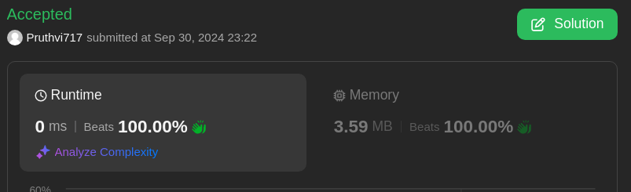

# Pointers approach in Go

**Author:** Pruthvi717
**Votes:** 0
**Link:** [https://leetcode.com/problems/rle-iterator/solutions/5853355/](https://leetcode.com/problems/rle-iterator/solutions/5853355/)

---



# Approach
- Approach is to keep track of `CurrentEvenIndex` and `CurrentElementCount` such that when `next(n)` method is called we traverse the occurences of `CurrentElement` and move the pointers if `CurrentElement` is exhausted till we reach the end of the `encoding`.

# Complexity
- Time complexity:
  $$O(n)$$ worst case for `next(n)` method
  $$O(1)$$ for init

- Space complexity:
  $$O(1)$$ no extra space

# Code
```golang []
type RLEIterator struct {
    Encoding []int
    CurrentEvenIndex int
    CurrentElement int
    CurrentElementCount int
}


func Constructor(encoding []int) RLEIterator {
    iter := RLEIterator{
        Encoding: encoding,
    }

    if len(encoding) > 0 {
        iter.CurrentElementCount = encoding[0]
        iter.CurrentElement = encoding[1]
    }

    return iter
}

// Next returns the nth next element in the encoding or -1 if there are less than n numbers
func (this *RLEIterator) Next(n int) int {
    for n > 0 {
        
        // current element has non traversed occurences
        if this.CurrentElementCount > 0 {
            if n <= this.CurrentElementCount {
                this.CurrentElementCount -= n
                return this.CurrentElement
            }

            n -= this.CurrentElementCount
            this.CurrentElementCount = 0
            continue;
        }
        
        // return -1 if we reach the end
        if (this.CurrentEvenIndex + 2 > len(this.Encoding) - 2) {
            return -1
        }

        // move the current pointers to next element
        this.CurrentEvenIndex += 2
        this.CurrentElementCount = this.Encoding[this.CurrentEvenIndex]
        this.CurrentElement = this.Encoding[this.CurrentEvenIndex + 1]
    }

    return -1
}
```