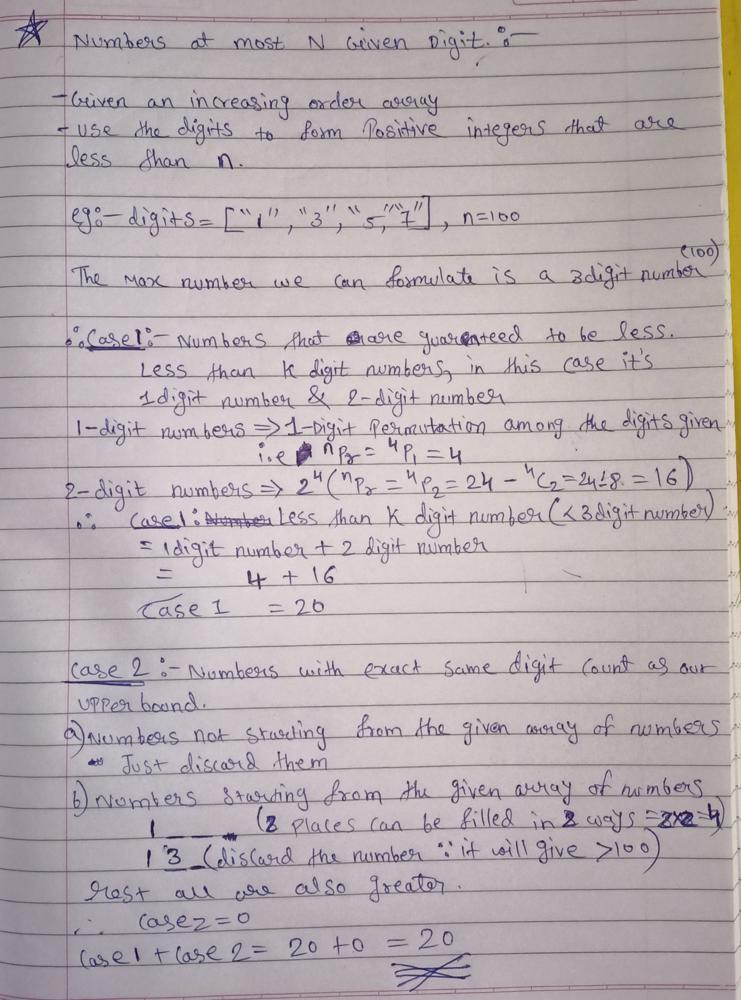

# C++ EASY TO SOLVE || Beginner Friendly Detailed Explanation with dry run

**Author:** Cosmic_Phantom
**Votes:** 64
**Link:** [https://leetcode.com/problems/numbers-at-most-n-given-digit-set/solutions/1633420/](https://leetcode.com/problems/numbers-at-most-n-given-digit-set/solutions/1633420/)

---

**Intuition:-**
We need to formulate the positive integers which are less than n. In terms of intuition we don't have much this time . The only intuition we can think of is that we have `upperLimit` i.e our `n`. The number which are guaranteed to be less than our `upperLimit` are the numbers which have less number of digits than our upperLimit and the `digitsize` whom having the clash with our  `upperLimit` size are the numbers where we have to be careful.
`
**For eg:-**
Input: digits = ["1","3","5","7"], n = 100 , here n is our upperLimit having the digitsize 3

**1'st scenerio:** The numbers with the digitsize less than 3 are guarenteed to be less than n

**2'nd scenerio**: The number's with the exact same digitsize i.e 3 
In this scenerio there arises two condition frst one having the same first digit as the given digits and the second one is having a another digit which is not given in the digits
1 _ _  ->1 is there in the given array of digits
2 _ _  ->2 is not there in the given array of digits
`

**Algorithm:-**
1. Let;s initialize some variables `upperLimit ->size of n , digitsize->size of digits array and result to 0`
2. For Scenerio 1 we will have a loop handling the count of _, _ _ where _ belongs to digits array. the sum will be 4+16 = 20 for the example we took .
3. For scenerio 2 we will have a loop handling where the number of digits are same as upperLimit.
4. In scenerio 2 we will be using a inner loop for finding out the number with exact same digits count as our upperLimit whose starting number can be same from our digits array

**Let's have a dry run before starting with code:-**



**Code:-**
```
//Comment and Upvote

class Solution {
public:
    int atMostNGivenDigitSet(vector<string>& digits, int n) {
        string upperLimit = to_string(n);
        int digit = upperLimit.size() , digitsize = digits.size() , result = 0;
        
        //Scenerio 1: where the number of digit is less than the upperlimit
        for(int i=1;i<digit;++i) result += pow(digitsize,i);
        
        //Scenerio 2:Where the number of digits are same as upperLimit
        for(int i=0;i<digit;++i){
            //if the number starts with same number i.e if the number starts with a digit which is present in our input array 'digits'
            bool startingSameNum = false;
            for(string &d :digits){
                if(d[0] < upperLimit[i]) result += pow(digitsize,digit -i - 1);
                else if (d[0]==upperLimit[i]) startingSameNum=true;
            }
            if(!startingSameNum) return result;
        }
        
        return result+1;
    }
};
```

**Time complexity [Non beginner friendly part :)]:** ***`O(log(N)) `***
For every digit we are iterating the entire decimal number series i.e from 0-9. Number of digits in a decimal integer is equal to log10(n) + 1. Thus it will be  O((log10(n) + 1) * size(digits)).
**Explanation why Number of digits in a decimal integer is equal to log10(n) + 1 :-**
Suppose that n has d digits; then 10d\u22121\u2264n<10d, because 10d is the smallest integer with d+1 digits. Now take logs base 10: log1010k=k, so the inequality becomes d\u22121\u2264log10n<d.
If you now take the floor (= integer part) of log10n,
throwing away everything to the right of the decimal point, 
you get \u230Alog10n\u230B=d\u22121. Thus, d=\u230Alog10n\u230B+1.

**Space complexity:** ***`O(1)`***

