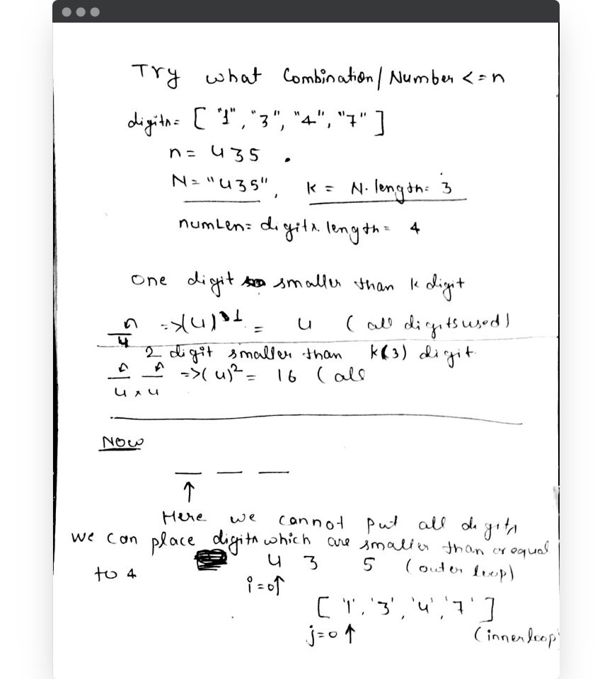
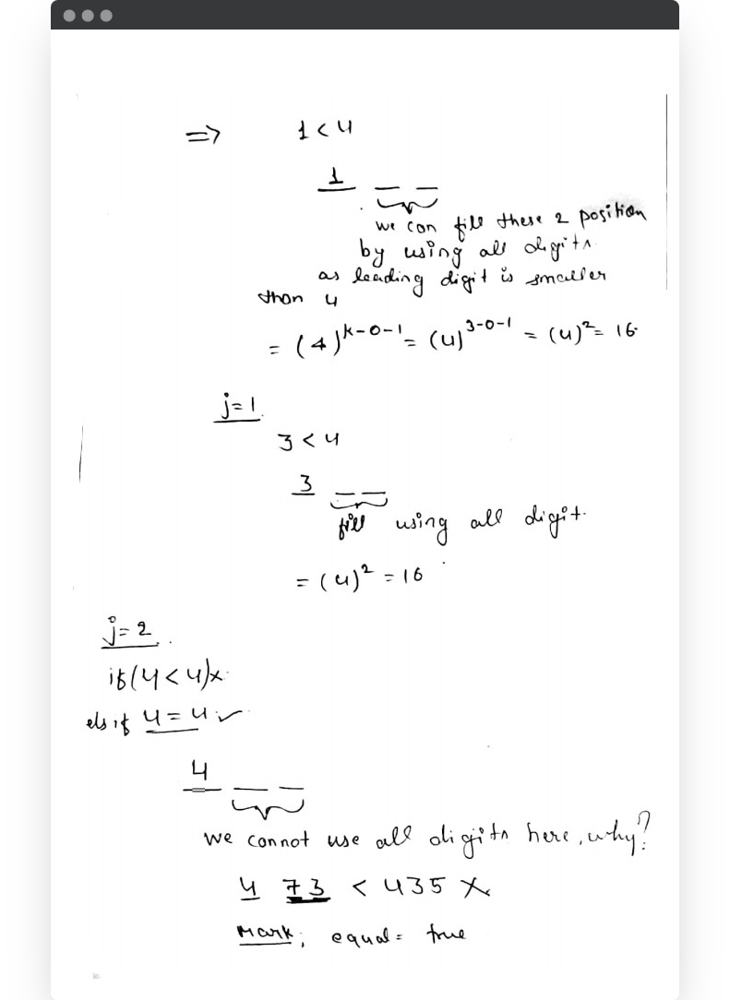
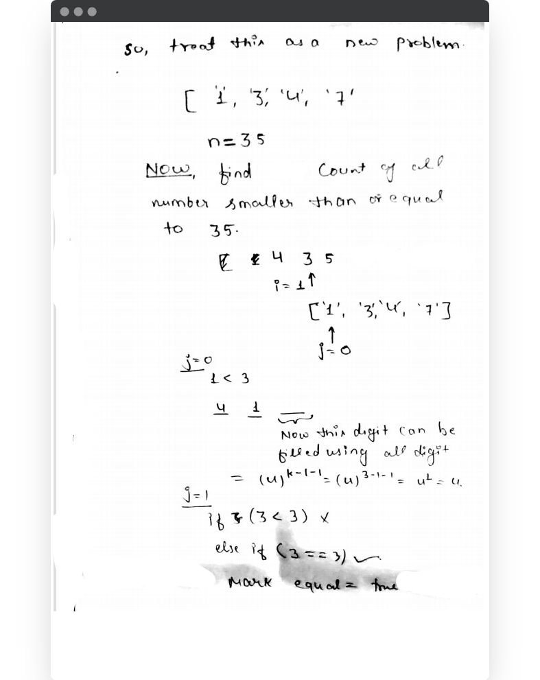
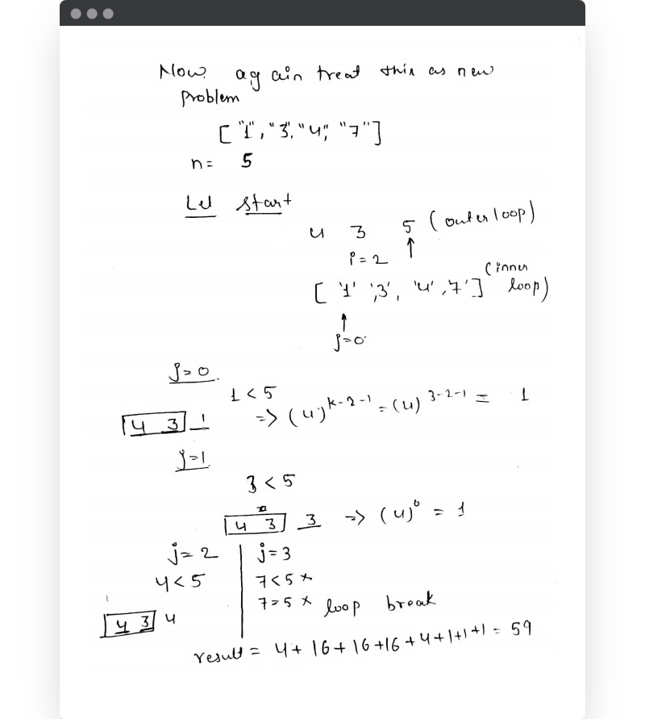
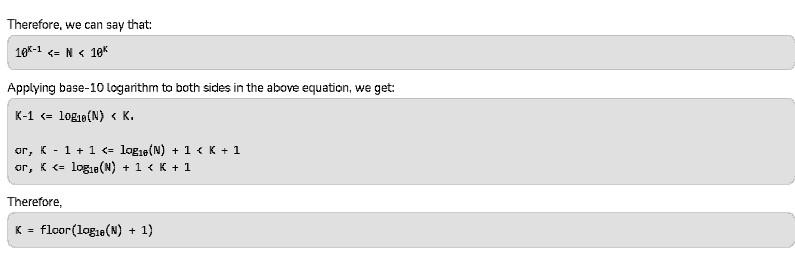

# Java Code || Explanation By Image || Dp | counting ||Beats 100%

**Author:** abhi9720
**Votes:** 18
**Link:** [https://leetcode.com/problems/numbers-at-most-n-given-digit-set/solutions/1633656/](https://leetcode.com/problems/numbers-at-most-n-given-digit-set/solutions/1633656/)

---

JUST SIMPLE TRY ALL CASES  BY PAPER - PEN , YOU GOT ALL YOUR ANSWERS, IT IS SIMPLE COUNTING OF NUMBER SMALLER THAN **n** USING **digits** ARRAY.
* 

---
* 

---
*  

---
* 


---
* All things goes fine till we are not filling kth position digit, we need to take care for filling kth position digit.
	

## Lets code \uD83D\uDC69\uD83C\uDFFB\u200D\uD83D\uDCBB\uD83D\uDCBB
---
> `writting this approch in o(1) space credited to @Cosmic_Phantom`

```
class Solution {
    public int atMostNGivenDigitSet(String[] digits, int n) {
        String N =  String.valueOf(n);
        int k =  N.length();
        int numsLen =digits.length;
        
        int count = 0;
        
		// all 1 to  k-1 digit number smaller than k digits number , can be made by using all digit 
        for(int i=1;i<k;i++){
            count += Math.pow(numsLen,i);
        }
        
        
        for(int i=0;i<k;i++){// iterate for digit in N
            int d =  N.charAt(i)-'0';
            boolean equal = false;
            for(int j=0;j < numsLen ;j++ ){
                if( Integer.valueOf(digits[j]) < d ){                     
                    count += Math.pow(numsLen,k-i-1);    

                }
                else if(Integer.valueOf(digits[j]) == d){
                    equal =  true;                    
                }
            }
            if(!equal){
                return count;
            }                       
        }
        
        return count+1;
           
    }
}
```

---
**SPACE =  O(1)
TIME = O(logn)**
---

.
.
--- Dp approch 
```
class Solution {
    public int atMostNGivenDigitSet(String[] digits, int N) {
        String S = String.valueOf(N);
        int K = S.length();
        int[] dp = new int[K+1];
        dp[K] = 1;

        
        for (int i = 1; i < K; ++i)
            dp[0] += Math.pow(digits.length, i);
        
        for (int i = K-1; i >= 0; --i) {
            // compute dp[i]
            int Si = S.charAt(i) - '0';
            for (String d: digits) {
                if (Integer.valueOf(d) < Si){
                    
                    dp[i] += Math.pow(digits.length, K-i-1);
                }
                else if (Integer.valueOf(d) == Si){
                    dp[i] += dp[i+1];
                }                    
            }            
        }                
        return dp[0];
    }
}
```

---
**SPACE =  O(logn)
TIME = O(logn)**

---
---

>> **here (log n) term is because :**

 


 

