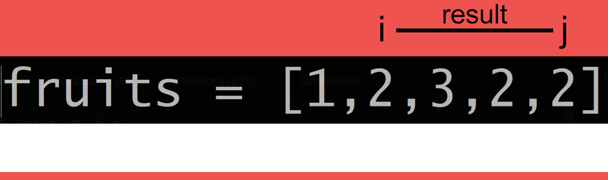

# PHP | Sliding Window for Fruit Picking

**Author:** billy_homeless
**Votes:** 1
**Link:** [https://leetcode.com/problems/fruit-into-baskets/solutions/3156479/](https://leetcode.com/problems/fruit-into-baskets/solutions/3156479/)

---




# Complexity
- Time complexity: $$O(n)$$
<!-- Add your time complexity here, e.g. $$O(n)$$ -->

- Space complexity: $$O(1)$$
<!-- Add your space complexity here, e.g. $$O(n)$$ -->

# Code
```
class Solution {

    /**
     * @param Integer[] $fruits
     * @return Integer
     */
    function totalFruit($fruits) {
        $i = 0;
        $tmpBasket = [];
      
        foreach($fruits as $j => $type) {
            $tmpBasket[$type] += 1;

            if (count($tmpBasket) > 2) {
                $tmpBasket[$fruits[$i]]--;

                if ($tmpBasket[$fruits[$i]] === 0) unset($tmpBasket[$fruits[$i]]);

                $i++;
            }
        }

        return $j - $i + 1;
    }
}
```