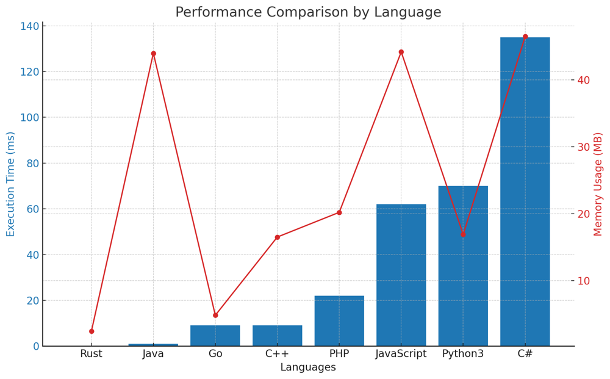

# ✅ 96.32%  Two-Pointer & One-Line

**Author:** vanAmsen
**Votes:** 64
**Link:** [https://leetcode.com/problems/sort-array-by-parity/solutions/4098143/](https://leetcode.com/problems/sort-array-by-parity/solutions/4098143/)

---

# Interview Guide: "Sort Array By Parity" Problem

## Problem Understanding

The "Sort Array By Parity" problem requires sorting an array of integers so that all even integers come before all odd integers. While the order of even and odd numbers doesn't matter, the even numbers should always precede the odd numbers in the resultant array.

## Key Points to Consider

### 1. Understand the Constraints

Before diving into the solution, it's essential to understand the problem's constraints. The length of the array `nums` is between 1 and 5000, and the integers in `nums` are between 0 and 5000. This provides insight into feasible solutions in terms of time and space complexity.

### 2. Two-Pointer Approach

One efficient method to solve this problem is to use two pointers, one starting from the beginning and the other from the end of the array. The idea is to swap elements whenever the left pointer points to an odd number, and the right pointer points to an even number.

### 3. Pythonic List Comprehension

Python provides a powerful feature called list comprehension that allows concise representation. It can be used to create two separate lists of even and odd numbers, which can then be concatenated.

### 4. Explain Your Thought Process

Always articulate the rationale behind your approach. Explain why the two-pointer method is effective in in-place sorting and how Python's list comprehension provides a more readable solution.

## Conclusion

The "Sort Array By Parity" problem showcases the importance of understanding array manipulation techniques. By using a two-pointer approach or leveraging Python's list comprehension, you can sort the array based on parity efficiently.

---

## Live Coding & Explain
https://youtu.be/8_5SklDeD7U?si=8KBFl6ZPfCiPe4Vj

# Approach 1: Two-Pointer Approach

To solve the "Sort Array By Parity" problem using the two-pointer approach:

## Key Data Structures:

- **i and j**: Two pointers initialized to the start and end of the array, respectively.

## Enhanced Breakdown:

1. **Initialization**:
   - Initialize `i` to 0 and `j` to the last index of the array.
   
2. **While Loop**:
   - Keep iterating until `i` is less than `j`.
   - Increment `i` if the element at `i` is even.
   - Decrement `j` if the element at `j` is odd.
   - Swap the elements at `i` and `j` if the above conditions aren't met.

3. **Return the Modified Array**:
   - After the loop completes, the array will be sorted by parity.

# Approach 2: Pythonic List Comprehension

To provide a more Pythonic solution:

## Key Steps:

1. **List Comprehension**:
   - Use list comprehension to construct a list of even numbers and then a list of odd numbers.
   
2. **Concatenate Lists**:
   - Concatenate the two lists to get the desired output.

# Complexity:

**Time Complexity (for both approaches):** 
- Both solutions involve traversing the array once, leading to a time complexity of $$ O(n) $$, where `n` is the length of the array `nums`.

**Space Complexity (for the two-pointer approach):** 
- The space complexity is $$ O(1) $$ since the solution modifies the array in place and doesn't use any additional data structures that scale with the input size.

**Space Complexity (for the list comprehension approach):** 
- The space complexity is $$ O(n) $$ since we create two new lists that scale with the input size.

# Code Two-Pointer
``` Python []
class Solution:
    def sortArrayByParity(self, nums: List[int]) -> List[int]:
        i, j = 0, len(nums) - 1
        
        while i < j:
            while i < j and nums[i] % 2 == 0:
                i += 1
            while i < j and nums[j] % 2 == 1:
                j -= 1
            
            nums[i], nums[j] = nums[j], nums[i]
        
        return nums
```
``` Go []
func sortArrayByParity(nums []int) []int {
    i, j := 0, len(nums) - 1
    
    for i < j {
        for i < j && nums[i] % 2 == 0 {
            i++
        }
        for i < j && nums[j] % 2 == 1 {
            j--
        }
        
        nums[i], nums[j] = nums[j], nums[i]
    }
    
    return nums
}
```
``` Rust []
impl Solution {
    pub fn sort_array_by_parity(nums: Vec<i32>) -> Vec<i32> {
        let mut nums = nums;
        let mut i = 0;
        let mut j = nums.len() - 1;
        
        while i < j {
            while i < j && nums[i] % 2 == 0 {
                i += 1;
            }
            while i < j && nums[j] % 2 == 1 {
                j -= 1;
            }
            
            nums.swap(i, j);
        }
        
        nums
    }
}
```
``` C++ []
class Solution {
public:
    std::vector<int> sortArrayByParity(std::vector<int>& nums) {
        int i = 0, j = nums.size() - 1;
        
        while (i < j) {
            while (i < j && nums[i] % 2 == 0)
                i++;
            while (i < j && nums[j] % 2 == 1)
                j--;
            
            std::swap(nums[i], nums[j]);
        }
        
        return nums;
    }
};
```
``` Java []
public class Solution {
    public int[] sortArrayByParity(int[] nums) {
        int i = 0, j = nums.length - 1;
        
        while (i < j) {
            while (i < j && nums[i] % 2 == 0)
                i++;
            while (i < j && nums[j] % 2 == 1)
                j--;
            
            int temp = nums[i];
            nums[i] = nums[j];
            nums[j] = temp;
        }
        
        return nums;
    }
}
```
``` PHP []
class Solution {
    function sortArrayByParity($nums) {
        $i = 0;
        $j = count($nums) - 1;
        
        while ($i < $j) {
            while ($i < $j && $nums[$i] % 2 == 0)
                $i++;
            while ($i < $j && $nums[$j] % 2 == 1)
                $j--;
            
            list($nums[$i], $nums[$j]) = array($nums[$j], $nums[$i]);
        }
        
        return $nums;
    }
}
```
``` JavaScript []
var sortArrayByParity = function(nums) {
    let i = 0, j = nums.length - 1;
    
    while (i < j) {
        while (i < j && nums[i] % 2 === 0)
            i++;
        while (i < j && nums[j] % 2 === 1)
            j--;
        
        [nums[i], nums[j]] = [nums[j], nums[i]];
    }
    
    return nums;
};
```
``` C# []
public class Solution {
    public int[] SortArrayByParity(int[] nums) {
        int i = 0, j = nums.Length - 1;
        
        while (i < j) {
            while (i < j && nums[i] % 2 == 0)
                i++;
            while (i < j && nums[j] % 2 == 1)
                j--;
            
            int temp = nums[i];
            nums[i] = nums[j];
            nums[j] = temp;
        }
        
        return nums;
    }
}
```

# Code List Comprehension
``` Python []
class Solution:
    def sortArrayByParity(self, nums: List[int]) -> List[int]:
        return [x for x in nums if x % 2 == 0] + [x for x in nums if x % 2 == 1]
```

## Performance

Certainly! Here's the data sorted by time (in ms) and presented in a markdown table format:

| Language   | Execution Time (ms) | Memory Usage (MB) |
|------------|---------------------|-------------------|
| Rust       | 0                   | 2.4               |
| Java       | 1                   | 44                |
| Go         | 9                   | 4.8               |
| C++        | 9                   | 16.5              |
| PHP        | 22                  | 20.2              |
| JavaScript | 62                  | 44.2              |
| Python3    | 70                  | 16.9              |
| C#         | 135                 | 46.5              |




The "Sort Array By Parity" problem is a classic example of array manipulation problems that can be approached in various ways. The choice of solution often depends on the trade-offs between readability, space, and efficiency. \uD83D\uDE80\uD83E\uDDE0\uD83D\uDC69\u200D\uD83D\uDCBB\uD83D\uDC68\u200D\uD83D\uDCBB.