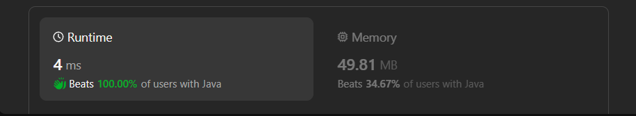

# ✅Beats 100% - C++/Java/Python/JS - Explained with [ Video ] - Monotonic Stack

**Author:** lancertech6
**Votes:** 298
**Link:** [https://leetcode.com/problems/sum-of-subarray-minimums/solutions/4595335/](https://leetcode.com/problems/sum-of-subarray-minimums/solutions/4595335/)

---



# YouTube Video Explanation:

<!-- **If you want a video for this question please write in the comments** -->

<!-- https://www.youtube.com/watch?v=ujU-jeO1v-k -->

https://youtu.be/XmFLB3dQ_WA

**\uD83D\uDD25 Please like, share, and subscribe to support our channel's mission of making complex concepts easy to understand.**

Subscribe Link: https://www.youtube.com/@leetlogics/?sub_confirmation=1

*Subscribe Goal: 1500 Subscribers*
*Current Subscribers: 1450*

---

# Intuition
<!-- Describe your first thoughts on how to solve this problem. -->
To arrive at the solution, we must track two things for each element arr[i]:

1. left[i]: the index of the first smaller element to the left of arr[i]
2. right[i]: the index of the first element that is less than or equal to arr[i] to the right

With left[i] and right[i] determined, the number of subarrays in which arr[i] is the minimum can be calculated by (i - left[i]) * (right[i] - i).

# Approach
<!-- Describe your approach to solving the problem. -->
The implementation leverages two main concepts: the "Monotonic Stack" pattern and the "Prefix Sum" pattern, to efficiently solve the problem without having to evaluate every subarray explicitly. Here's the walk-through of the implemented solution, step-by-step:

1. Initialize two arrays, `left` and `right`, of the same length as arr to n, with -1 and n respectively. These arrays will hold for each element the index of the previous smaller element `(left)` and the next smaller or equal element `(right)`.

2. Initialize a stack stk which we'll use to iterate over the array to find the `left` and `right` indices. The stack approach efficiently maintains a decreasing order of elements and their indices.

3. Iterate through the elements of `arr` from left to right. For each element, while the stack is not empty and the top element of the stack is greater than or equal to the current element, pop elements from the stack. This process is maintaining the stack in a strictly decreasing order.

4. After elements larger than the current one are popped off `stk`, if the stack is not empty, set `left[i]` to the index of the top element of stk, which is the closest previous element smaller than `arr[i]`. Then, push the current index i onto the stack.

5. Clear the stack and then iterate through the elements of `arr` from right to left to similarly identify `right[i]` for each element. The process mirrors step 3 and 4, but in the reversed direction and with the condition that any equal value element could also terminate the loop, maintaining strict decreasing order up to equal values.

6. Once both `left` and `right` arrays are filled with proper indices, calculate the sum. By iterating over all indices `i`, find the product of the count of subarrays where `arr[i]` is the minimum `((i - left[i]) * (right[i] - i))` and `arr[i]`. This represents the sum of `arr[i]` for all i in its valid subarrays.

7. Sum these products for all `i`. As the final sum might be very large, each addition is taken modulo `10^9 + 7` to prevent integer overflow.

By combining the Monotonic Stack to find bounds for each element and the Prefix Sum pattern to calculate each element's contribution to the total sum, the algorithm achieves an efficient solution that operates in O(n) time complexity, where n is the size of the input array `arr`.

# Complexity
- Time complexity: The time complexity of the code is O(n).
<!-- Add your time complexity here, e.g. $$O(n)$$ -->

- Space complexity: The space complexity of the code is O(n).
<!-- Add your space complexity here, e.g. $$O(n)$$ -->

# Code
```Java []
class Solution {
    public int sumSubarrayMins(int[] arr) {
        int length = arr.length;
        int[] left = new int[length];
        int[] right = new int[length];
      
        Arrays.fill(left, -1);
        Arrays.fill(right, length);
      
        Deque<Integer> stack = new ArrayDeque<>();
      
        for (int i = 0; i < length; ++i) {
            while (!stack.isEmpty() && arr[stack.peek()] >= arr[i]) {
                stack.pop();
            }
            if (!stack.isEmpty()) {
                left[i] = stack.peek();
            }
            stack.push(i);
        }
      
        stack.clear();
      
        for (int i = length - 1; i >= 0; --i) {
            while (!stack.isEmpty() && arr[stack.peek()] > arr[i]) {
                stack.pop();
            }
            if (!stack.isEmpty()) {
                right[i] = stack.peek();
            }
            stack.push(i);
        }
      
        int mod = (int) 1e9 + 7;
        long answer = 0;
      
        for (int i = 0; i < length; ++i) {
            answer += (long) (i - left[i]) * (right[i] - i) % mod * arr[i] % mod;
            answer %= mod;
        }
      
        return (int) answer;
    }
}
```
```C++ []
using ll = long long;
const int MOD = 1e9 + 7;

class Solution {
public:
    int sumSubarrayMins(vector<int>& nums) {
        int length = nums.size();
        vector<int> left(length, -1);
        vector<int> right(length, length);
        stack<int> stk;

        for (int i = 0; i < length; ++i) {
            while (!stk.empty() && nums[stk.top()] >= nums[i]) {
                stk.pop();
            }
            if (!stk.empty()) {
                left[i] = stk.top();
            }
            stk.push(i);
        }

        stk = stack<int>();

        for (int i = length - 1; i >= 0; --i) {
            while (!stk.empty() && nums[stk.top()] > nums[i]) {
                stk.pop();
            }
            if (!stk.empty()) {
                right[i] = stk.top();
            }
            stk.push(i);
        }

        ll sum = 0;

        for (int i = 0; i < length; ++i) {
            sum += static_cast<ll>(i - left[i]) * (right[i] - i) * nums[i] % MOD;
            sum %= MOD;
        }

        return sum;
    }
};
```
```Python []
class Solution:
    def sumSubarrayMins(self, arr: List[int]) -> int:
        n = len(arr)
        left = [-1] * n 
        right = [n] * n
        stack = []

        for i, value in enumerate(arr):
            while stack and arr[stack[-1]] >= value:  
                stack.pop()  
            if stack:
                left[i] = stack[-1]  
            stack.append(i) 

        stack = [] 

        
        for i in range(n - 1, -1, -1):  
            while stack and arr[stack[-1]] > arr[i]: 
                stack.pop()  
            if stack:
                right[i] = stack[-1]  
            stack.append(i) 

        mod = 10**9 + 7 

        result = sum((i - left[i]) * (right[i] - i) * value for i, value in enumerate(arr)) % mod
      
        return result 
```
```Javascript []
var sumSubarrayMins = function(arr) {
    const length = arr.length;
    const left = new Array(length).fill(-1);
    const right = new Array(length).fill(length);
    const stack = [];

    for (let i = 0; i < length; ++i) {
        while (stack.length > 0 && arr[stack[stack.length - 1]] >= arr[i]) {
            stack.pop();
        }
        if (stack.length > 0) {
            left[i] = stack[stack.length - 1];
        }
        stack.push(i);
    }

    stack.length = 0;

    for (let i = length - 1; i >= 0; --i) {
        while (stack.length > 0 && arr[stack[stack.length - 1]] > arr[i]) {
            stack.pop();
        }
        if (stack.length > 0) {
            right[i] = stack[stack.length - 1];
        }
        stack.push(i);
    }

    let sum = 0;

    for (let i = 0; i < length; ++i) {
        sum += (i - left[i]) * (right[i] - i) * arr[i] % (1e9 + 7);
        sum %= 1e9 + 7;
    }

    return sum;
};

```


