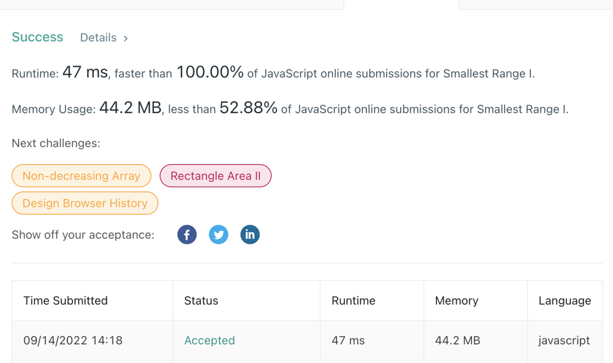

# JS faster than 100% best solution

**Author:** kunkka1996
**Votes:** 5
**Link:** [https://leetcode.com/problems/smallest-range-i/solutions/2574256/](https://leetcode.com/problems/smallest-range-i/solutions/2574256/)

---


```
var smallestRangeI = function(nums, k) {
    const min = Math.min(...nums);
    const max = Math.max(...nums);
    
    if (max - min <= 2*k) return 0;
    return max - min - 2*k;
};
```