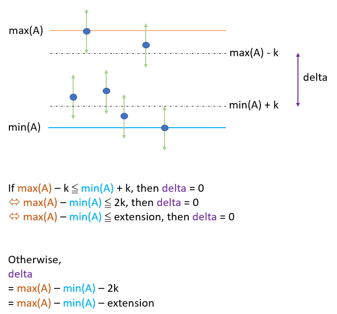

# Python O(n) by min & Max. 85%+ [w/ Visualization ]

**Author:** brianchiang_tw
**Votes:** 28
**Link:** [https://leetcode.com/problems/smallest-range-i/solutions/535164/](https://leetcode.com/problems/smallest-range-i/solutions/535164/)

---

Python O(n) by min & Max.

---

**Hint**:

The key factor to determine the gap size is the value of minimum of A (i.e., min(A) ) as well as maximum of A (i.e., max(A) ).

For B, every point value can go from A[i]-k to A[i]+k
What we want is the smallest gap size between maximum and minimum.

---

**Diagram**&**Abstract model**:



---

**Implementation**:

```
class Solution:
    def smallestRangeI(self, A: List[int], K: int) -> int:

        M, m = max(A), min(A)
        diff, extension = M - m, 2*K
        
        if diff <= extension:
            return 0
        
        else:
            return diff - extension
```

---

Reference:

[1] [Python official docs about built-in function min( ... )](https://docs.python.org/3/library/functions.html#min)

[2] [Python official docs about built-in function max( ... )](https://docs.python.org/3/library/functions.html#max)