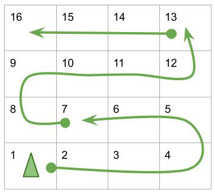
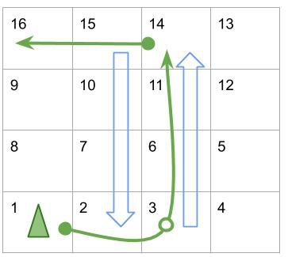
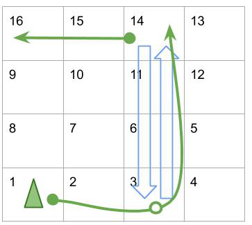
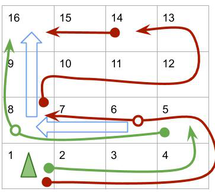

# BFS, intuition, diagrams and tests, c++, 12ms

**Author:** savvadia
**Votes:** 103
**Link:** [https://leetcode.com/problems/snakes-and-ladders/solutions/396710/](https://leetcode.com/problems/snakes-and-ladders/solutions/396710/)

---

Intuition: 
For each step we do the follwoing:
1. roll a dice (and check all 6 possible values, marking each as visited)
2. check if we land on a ladder and take it (no possibility to skip it, we must take it)
3. remember where to continue next time (add the new position to the queue)

Now let's take a look at scenarios:

1. Just step starting from square 1 with a dice where 6 is the best :)

[[-1,-1,-1,-1],[-1,-1,-1,-1],[-1,-1,-1,-1],[-1,-1,-1,-1]]
Answer: 3
Steps: e.g. 7 -> 13 -> 16

2. Take a ladder inside a step. Step over ladders with a "dice" move

[[-1,2,-1,-1],[-1,-1,-1,-1],[-1,-1,-1,-1],[-1,-1,14,-1]]
Answer: 2
Steps: [3]14 -> 16

3. We take just one ladder during the move ignoring a ladder which might be waiting on the other end

[[-1,-1,2,-1],[-1,-1,-1,-1],[-1,-1,-1,-1],[-1,-1,14,-1]]
Answer: 2
Steps: [3]14 -> 16
 
 4. Mark a position as visited only on a dice move (not after you took a ladder), because the position is covered only after you have checked a ladder from this position.
Red arrows show a longer way taking the first ladder, to 8. If we now mark 8 as visited, we would never take a ladder from 8 directly to the target.
 
[[-1,-1,-1,-1],[-1,-1,-1,-1],[16,-1,8,-1],[-1,-1,-1,-1]]
Answer: 2
Steps: e.g. 5 -> [8]16 

How can we make it faster?
* handle new positions with the smallest number of steps first
* consider how close we are to the target; it's better to try first the square closest to the target

If you are lost in a failing test, store the number of steps to reach the position in the visited array. Then you can print out the number of steps for positions in the correct answer and see where you took the wrong way.

```
typedef pair<int,int> Pi;
class Solution {
public:
    int snakesAndLadders(vector<vector<int>>& board) {
        int rows=board.size(), cols = board[0].size(), target=rows*cols, r, c, p;
        vector<int> visited(rows*cols + 1); // cells on board start from 1

        // queue contains <priority, square> sorted ascending by priority
        // prio = #steps * 1000 + (500 - square);
        // number of steps is critical and adds 1000; 500 is selected as it is higher than the max cell (20*20=400)
        priority_queue<Pi, vector<Pi>, greater<Pi>> q;
        q.push(make_pair(0,1)); // 0 steps to position 1
        visited[1] = true;

        while(q.size())
        {
            auto step_pos = q.top(); q.pop();
            int s = step_pos.first/1000 + 1;
            
            for(int i=1; i<=6; i++)
            {
                auto p = step_pos.second+i;
                if(visited[p]) continue;
                visited[p] = true;
                
                r = rows - (p-1) / cols - 1;
                c = (p-1) % cols;
                if((rows-r-1)%2) c = cols - c - 1; // change direction for odd lines
                int ladder = board[r][c];
                if(ladder>0 && ladder<=target)
                    p = ladder; // no update for steps. allow to come here again with a dice
                    
                if(p == target) return s;
                q.push(make_pair(s*1000+500-p, p));
            }
        }
        return -1;
    }
};
```

You can print the board and the ladders with the code:
```
        for(auto& v : board)
        {
            for(int i : v) cout <<i<<" ";
            cout<<endl;
        }        
        cout <<"---"<<endl;
        for(int i=rows-1;i>=0;i--)
        {
            if(i%2==0)
                for(int j=0;j<cols;j++)
                    cout << i*cols + j + 1<<" ";
            else
                for(int j=cols-1;j>=0;j--)
                    cout << i*cols + j + 1<<" ";
            cout <<endl;
        }
```

Answers for the tricky tests:
1. [[-1,1,2,-1],[2,13,15,-1],[-1,10,-1,-1],[-1,6,2,8]]

1 -> 7 [ladder to 10] -> 16, two moves in total
```
-1  1  2 -1 
 2 13 15 -1 
-1 10 -1 -1 
-1  6  2  8 
---
16 15 14 13 
 9 10 11 12 
 8  7  6  5 
 1  2  3  4 
```

2. [[-1,-1,19,10,-1],[2,-1,-1,6,-1],[-1,17,-1,19,-1],[25,-1,20,-1,-1],[-1,-1,-1,-1,15]]
Answer: 1->4->10[25] or 1->6->10[25], two steps
```
-1 -1 19 10 -1 
 2 -1 -1  6 -1 
-1 17 -1 19 -1 
25 -1 20 -1 -1 
-1 -1 -1 -1 15 
---
21 22 23 24 25 
20 19 18 17 16 
11 12 13 14 15 
10  9  8  7  6 
 1  2  3  4  5 
```

3. [[-1,-1,30,14,15,-1],[23,9,-1,-1,-1,9],[12,5,7,24,-1,30],[10,-1,-1,-1,25,17],[32,-1,28,-1,-1,32],[-1,-1,23,-1,13,19]]
Answer: 1->7[32]->36, two steps
```
-1 -1 30 14 15 -1 
23  9 -1 -1 -1  9 
12  5  7 24 -1 30 
10 -1 -1 -1 25 17 
32 -1 28 -1 -1 32 
-1 -1 23 -1 13 19 
---
36 35 34 33 32 31 
25 26 27 28 29 30 
24 23 22 21 20 19 
13 14 15 16 17 18 
12 11 10  9  8  7 
 1  2  3  4  5  6 
```