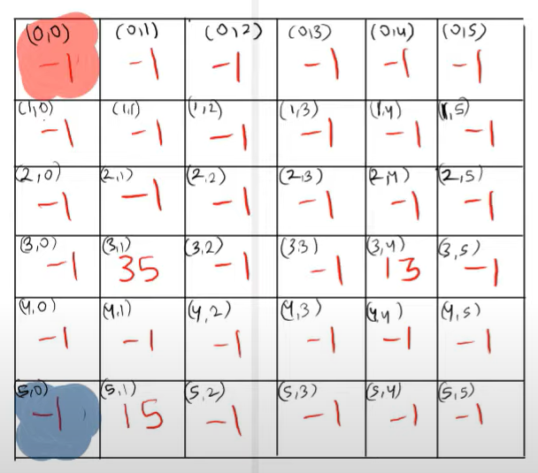

# Day 24 || Easiest Beginner Friendly Solution || O(n^2) time and O(n^2) space

**Author:** singhabhinash
**Votes:** 78
**Link:** [https://leetcode.com/problems/snakes-and-ladders/solutions/3092376/](https://leetcode.com/problems/snakes-and-ladders/solutions/3092376/)

---

# Intuition
This problem contains simple BFS but the main intution of this problem to find cordinates of particular value i.e. row and column.
1. the variable "row" is calculated by subtracting the quotient of (curr-1) / n from n-1. This is done to convert the 1-indexed position of the element to a 0-indexed position in the board.
2. the variable "col" is calculated by taking the remainder of (curr-1) % n. This gives the column position of the element on the board.
3. After that, the code checks if the row number is even or odd. If it is even, it returns a vector containing the row and the value of n-1-col (which is the inverted column position)
Otherwise, it returns a vector containing the row and the col.
<!-- Describe your first thoughts on how to solve this problem. -->


# Approach
1. Initialize the variables n as the size of the board, moves as 0, a queue q and a 2D boolean array visited with all elements as false.
2. Push the value 1 into the queue and mark the element at the last row and first column of the visited array as true.
3. Start a while loop until the queue is not empty.
4. In each iteration, set the size of the queue to a variable size.
5. Run a for loop for i from 0 to size
6. Dequeue the front element of the queue and store it in a variable currBoardVal
7. If currBoardVal is equal to n*n, return the value of moves.
8. Run a for loop for diceVal from 1 to 6.
9. If currBoardVal + diceVal is greater than n*n, break the loop.
10. Find the coordinates of the element at position currBoardVal + diceVal in the board by calling the findCoordinates function and store it in a vector pos.
11. Set row as the first element of the vector pos and col as the second element of the vector pos.
12. If the element at position row and col in the visited array is false, mark it as true.
13. If the value at the element at position row and col in the board is -1, push currBoardVal + diceVal into the queue.
14. Else, push the value at the element at position row and col in the board into the queue.
15. End the for loop for diceVal.
16. End the for loop for i.
17. Increment the value of moves by 1.
18. End the while loop.
19. If the while loop ends, return -1 as the final result.
REFERENCE VIDEO - https://www.youtube.com/watch?v=zWS2fCJGxmU
<!-- Describe your approach to solving the problem. -->

# Code
```C++ []
class Solution {
public:
    int snakesAndLadders(vector<vector<int>>& board) {
        int n = board.size();
        int moves = 0;
        queue<int> q;
        //setting visited array to false initially
        vector<vector<bool>> visited(n, vector<bool>(n, false));
        q.push(1);
        visited[n-1][0] = true;
        while(!q.empty()){
            int size = q.size();
            for(int i = 0; i < size; i++){
                int currBoardVal = q.front();
                q.pop();
                if(currBoardVal == n*n) 
                    return moves;
                for(int diceVal = 1; diceVal <= 6; diceVal++){
                    if(currBoardVal + diceVal > n*n) 
                        break;
                    vector<int> pos = findCoordinates(currBoardVal + diceVal, n);
                    int row = pos[0];
                    int col = pos[1];
                    if(visited[row][col] == false){
                        visited[row][col] = true;
                        if(board[row][col] == -1){
                            q.push(currBoardVal + diceVal);
                        }
                        else{
                            q.push(board[row][col]);
                        }
                    }
                }
            }
            moves++;
        }
        return -1;
    }
    //Function returns a vector of integers, representing the coordinates (row and column) of the element at position curr on the board.
    vector<int> findCoordinates(int currVal, int n) {
        //calculates the row by subtracting the quotient of (curr-1) / n from n-1. This is done to convert the 1-indexed position of the element to a 0-indexed position in the board.
        int row = n - (currVal - 1) / n - 1;
        int col = (currVal - 1) % n;
        if (row % 2 == n % 2) {
            return {row, n - 1 - col};
        } else {
            return {row, col};
        }
    }
};
```
```Java []
class Solution {
    public int snakesAndLadders(int[][] board) {
        int n = board.length;
        int moves = 0;
        Queue<Integer> q = new LinkedList<>();
        boolean[][] visited = new boolean[n][n];
        q.add(1);
        visited[n-1][0] = true;
        while(!q.isEmpty()){
            int size = q.size();
            for(int i = 0; i < size; i++){
                int currBoardVal = q.poll();
                if(currBoardVal == n*n) 
                    return moves;
                for(int diceVal = 1; diceVal <= 6; diceVal++){
                    if(currBoardVal + diceVal > n*n) 
                        break;
                    int[] pos = findCoordinates(currBoardVal + diceVal, n);
                    int row = pos[0];
                    int col = pos[1];
                    if(visited[row][col] == false){
                        visited[row][col] = true;
                        if(board[row][col] == -1){
                            q.add(currBoardVal + diceVal);
                        }
                        else{
                            q.add(board[row][col]);
                        }
                    }
                }
            }
            moves++;
        }
        return -1;
    }
    public int[] findCoordinates(int curr, int n) {
        int r = n - (curr - 1) / n  -1;
        int c = (curr - 1) % n;
        if (r % 2 == n % 2) {
            return new int[]{r, n - 1 - c};
        } else {
            return new int[]{r, c};
        }
    }
}

```
```Python []
class Solution:
    def snakesAndLadders(self, board: List[List[int]]) -> int:
        n = len(board)
        moves = 0
        q = collections.deque([1])
        visited = [[False for _ in range(n)] for _ in range(n)]
        visited[n-1][0] = True
        while q:
            size = len(q)
            for i in range(size):
                currBoardVal = q.popleft()
                if currBoardVal == n*n:
                    return moves
                for diceVal in range(1, 7):
                    if currBoardVal + diceVal > n*n:
                        break
                    pos = self.findCoordinates(currBoardVal + diceVal, n)
                    row, col = pos
                    if not visited[row][col]:
                        visited[row][col] = True
                        if board[row][col] == -1:
                            q.append(currBoardVal + diceVal)
                        else:
                            q.append(board[row][col])
            moves += 1
        return -1
    
    def findCoordinates(self, curr: int, n: int) -> Tuple[int, int]:
        row = n - (curr - 1) // n - 1
        col = (curr - 1) % n
        if row % 2 == n % 2:
            return (row, n - 1 - col)
        else:
            return (row, col)

```
- If my solution is helpful to you then please **UPVOTE** my solution, your **UPVOTE** motivates me to post such kind of solution.
- Please let me know in comments if there is need to do any improvement in my approach, code....anything.
- **Let's connect on** https://www.linkedin.com/in/abhinash-singh-1b851b188


# Complexity
- Time complexity: **O(n^2)**
The time complexity of BFS is O(\u2223V\u2223+\u2223E\u2223), where \u2223V\u2223 is the number of vertices and \u2223E\u2223 is the number of edges. We have \u2223V\u2223=n^2 and \u2223E\u2223<6*n^2
 , thus the total time complexity for BFS is O(7n^2)=O(n^2). We also spend some time associating each (row, col) with a label, but this also costs O(n^2), so the overall time complexity is O(n^2).
<!-- Add your time complexity here, e.g. $$O(n)$$ -->

- Space complexity: **O(n^2)** // we are using visited array of size n*n
<!-- Add your space complexity here, e.g. $$O(n)$$ -->