# 𝗪𝗵𝘆 𝗦𝗼𝗿𝘁𝗶𝗻𝗴? Explained with Visualization | 15 Languages | Beginner Level

**Author:** RohitSgh
**Votes:** 118
**Link:** [https://leetcode.com/problems/smallest-range-ii/solutions/3040404/](https://leetcode.com/problems/smallest-range-ii/solutions/3040404/)

---

---

# \u270D\uD83C\uDFFB Before Starting

This Solution is long, but it will slowly build the entire logic of solving the problem. Make sure you have

- Time
- Pen and Paper for visualization! 

Here is the Table of Contents for the Solution, although it's advisable to **read the solution thoroughly**.  
<!-- no toc -->
- [Problem Statement and Absolute Brute Force Analysis](#-problem-statement)
- [Analysis on Two Integers](#-zoom-in-and-analyse-more)
- [Analysis on N Integers. Thus, Sort it](#-zoom-out-with-fact-in-our-hand)
- [Code](#-code)
- [Code in Few Lines](#-fewer-lines-code)


\uD83D\uDE0E Tighten your Seat Belt! 
\u2764 *After finishing the journey if you are happy, feel free to upvote. Button on bottom left*

---

# \u2753 Problem Statement 

On every integer from `nums`, we either have to add `k` or subtract `k`. 

Since `k` is non-negative, we can say that we either have to "INCREASE integer by `k`", or "DECREASE integer by `k`"

After doing this, the **score** of `nums` is the difference between the maximum and minimum element of `nums`. We have to return the **minimum score possible**.

Let there be $N$ elements in `nums`. On every $N$ integer, we have $2$ options, thus there are $2^N$ possible `nums`, corresponding to which there can be at most $2^N$ possible **score**. Brute-Force would be to return a minimum from all scores. This therefore would be highly inefficient as $1 \\leq N \\leq 10^4$.

---

# \uD83D\uDD0D zOOm-In and Analyse More

When analysis of a large number of integers is tough, we often zOOm-In and analyze a few integers. 

Suppose we have only two integers `x` and `y` such that `x < y`. 


>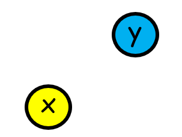


Hence, now we only have to analyze $2^2$ i.e. $4$ possible cases.

| Case | Diagram | Remarks | Score |
| :---: | :--- | :--- | :---: |
| **Case 1:** Increase `x` by `k` and Increase `y` by `k` | 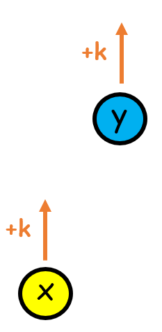 | Difference will remain same. Hence, **score** will be unchanged. New Maximum will be `y + k` and the new minimum will be `x + k`. | `y + k - (x + k) = y - x` |
| **Case 2:** Decrease `x` by `k` and Decrease `y` by `k` | 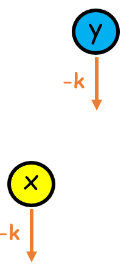 | Difference will remain same. Hence, **score** will be unchanged. New Maximum will be `y - k` and the new minimum will be `x - k`. | `y - k - (x - k) = y - x` |
| **Case 3:** Increase `x` by `k` and Decrease `y` by `k` | **a.** 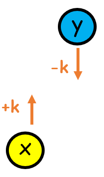 **b.** 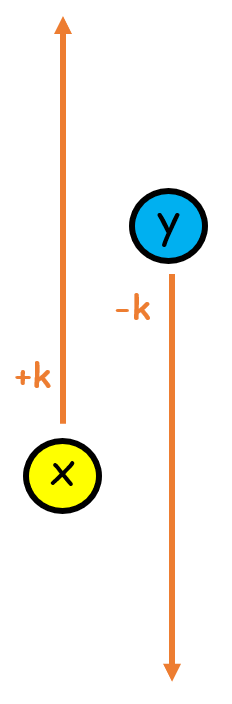 | Difference might reduce. However, we aren't sure if that would be the case because we don't know the value of `k`. **b** diagram shows that in this case, the difference might increase as well. Note that in all diagrams, we have to see the difference between arrowheads.  | We aren't sure of the maximum and minimum. Thus, we cannot comment. **However, one key to the problem is this only**. For the time being, we can write **score** as  `max(x + k, y - k) - min(x + k, y - k)` |
| **Case 4:** Decrease `x` by `k` and Increase `y` by `k` | 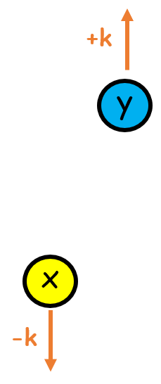 | Difference will obviously increase. Hence, **score** will increase. New Maximum will be `y + k` and the new minimum will be `x - k`. | `y + k - (x - k) = y - x + 2k`. Thus **score** increased by `2k` since `k` is non-negative |


**What we have gained from the analysis?**

> Since we want to minimize **score**, if we know `x < y`, WE WILL NEVER DECREASE `x` and INCREASE `y` simultaneously! Let's save this as **FACT**.

Thus, we can ignore Case 4. We are remaining with these cases only.

- Case 3 has both possibilities, we cannot ignore it.
  
- Case-1 and Case-2, let's call them trivial cases since we know that **score** will remain unchanged. However, we cannot ignore these cases, as Case-3 might maximize the **score**.

---

# \uD83D\uDD0E zOOm-Out with FACT in our hand!

Let's zOOm out to $N$ integers.

Our **FACT** offers us very important deductions.

- Let's assume we are planning to increase $\\alpha$, then WE WILL NEVER decrease number which are less than $\\alpha$. *Here, $\\alpha$ can be interpreted as `y` of Case-4.*
  
  In other words, **if we are adamant to increase a number, we will also increase all numbers less than it**.

- Let's assume we are planning to decrease $\\alpha$, then WE WILL NEVER increase number which are greater than $\\alpha$. *Here, $\\alpha$ can be interpreted as `x` of Case-4.*

  In other words, **if we are adamant to decrease a number, we will also decrease all numbers greater than it**.


Now, as per the problem description, for every integer, we have to either **I**-NCREASE or **D**-ecrease. Hence, we can have two sets. *(Math-oriented readers can think of them as Mutually Exclusive and Collectively Exhaustive sets of `nums`)*.

Any element in `nums` will belong to ONE and ONLY ONE set out of **I** and **D**

- Let `i` be the largest number which is increased. Then, all numbers less than `i` will also be increased (as per the first deduction). Let's call their set **I**. Set **I** can be visually represented as  
  
  > 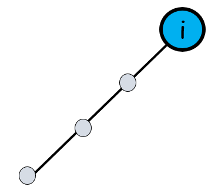

- Let `d` be the smallest number that is decreased. Then, all numbers greater than `d` will also be decreased (as per the second deduction). Let's call their set **D**. Set **D** can be visually represented as  
  
  > 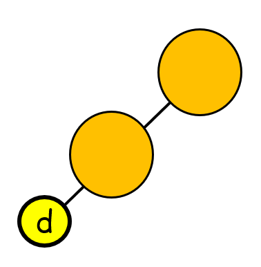


Now, these **I** and **D** can be thought of as (Discrete) Intervals, and thus can be arranged in **six** different ways as shown below.

|  | Diagram | Remarks | 
| :---: | :---: | :--- |
| **1** | 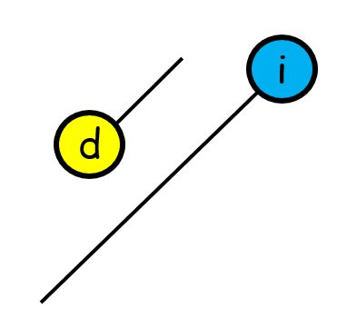 | **ARRANGEMENT NOT POSSIBLE:** All numbers which were being decreased are also being increased by `k`. We should do ONE and ONLY ONE Operation. |
| **2** | 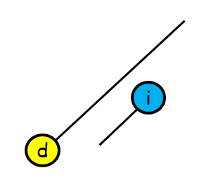 | **ARRANGEMENT NOT POSSIBLE:** All numbers which were being increased are also being decreased by `k`. We should do ONE and ONLY ONE Operation. |
| **3** | 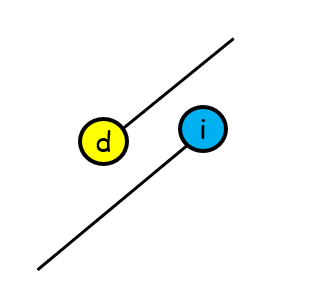 | **ARRANGEMENT NOT POSSIBLE :** Two operations on intersecting part. We should do ONE and ONLY ONE Operation. |
| **4** | 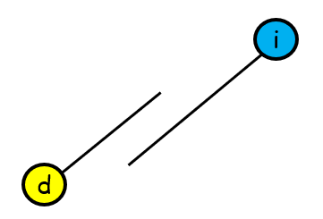 | **ARRANGEMENT NOT POSSIBLE :** Two operations on intersecting part. We should do ONE and ONLY ONE Operation.  |
| **5** | 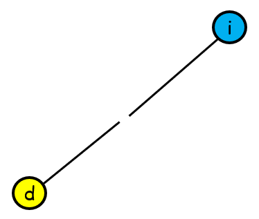 | Well, ONE and ONLY ONE Operation on each number. But is it possible? Turns out it violates both deductions. Few numbers less than `i` are being decreased (connected by `d`), and few numbers greater than `d` are being increased (connected by `i`). Thus, **NOT POSSIBLE**  |
| **6** | 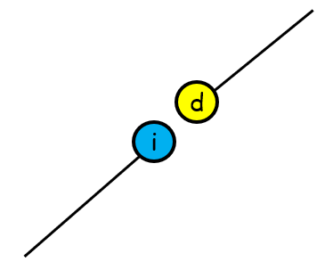 | Well, ONE and ONLY ONE Operation on each number. But, again, is it possible? Well, it fulfills both deductions. And this is the only possible arrangement of **I** and **D** |

Let's rephrase ONLY POSSIBLE ARRANGEMENT. 

> Every element in `nums` will be either a member of **I** or **D**. As defined before, `i` is $\\max(I)$ and `d` is $\\min(D)$. And due to the only possible arrangement, we have `i < d`. We can imagine a **divider/partition** between `i` and `d`

**By the way, is there any special name given to ONLY POSSIBLE ARRANGEMENT?**

Yes, it's often called SORTED ORDER, more specifically sorting in non-decreasing order.

Thus, SORT THE `nums`. And all these we came to know because of saved **FACT**

---

# \uD83E\uDD39\uD83C\uDFFB\u200D\u2642\uFE0F Sorting

After sorting, our task is to find the most optimal **divider**. 

> Don't confuse it with any Arithmetic Division. It's just a wall. The divider can be visualized as a wall between two sets.

The number immediately before **divider** will be `i` and the number immediately after **divider** will be `d`. All numbers before **divider** have to be incremented by `k`, and after **divider** have to be decremented by `k`.

> **How many Dividers do we have?**
>
> A quick zOOm-in by having $N$ as $2$ will reveal that we have $N+1$ dividers. This can be proved by [Principle of Mathematical Induction (Link)](https://ediscretestructures.blogspot.com/2022/03/principle-of-mathematical-induction.html).
>
> 
> 
>
> **Once Again Repeating**, All numbers before **divider** have to be incremented by `k`, and after **divider** have to be decremented by `k`.
>
> - Divider C boils down to increment all numbers by `k`. Our trivial Case 1. The difference would remain the same. After sorting, can be computed by `nums[last] - nums[first]`
> - Divider B means increment `nums[0]` and decrement `nums[1]`. 
> - Divider A boils down to decrement all numbers by `k`. Our trivial Case 2. The difference would remain the same.
> 
> Thus, out of $N + 1$ cases, $2$ will be trivial. Our focus will be on $N - 1$ non-trivial cases.


**Thus, check for the score for all $N-1$ non-trivial dividers!**  
(Non-trivial means both **I** and **D** would be non-empty. In trivial, one of them was empty)

For **score**, we need **MAXIMUM** and **MINIMUM**.

**MAXIMUM:** Let's try to find the maximum from each of the sets. These sets, along with the entire `nums` are also sorted.
  - **I**: Since it is sorted, and `k` has to be added to all numbers, the previous maximum, with added `k` will be the new maximum. Previous Maximum (in **I**) is nothing but a number just before **divider**. Thus, `nums[before Divider] + k`
  - **D**: Since it is sorted, and `k` has to be subtracted from all numbers, the previous maximum, with subtracted `k` will be the new maximum. Previous Maximum (in **D**) is nothing but `nums[last]`. Thus, `nums[last] - k`

  Hence, for this particular divider, **MAXIMUM** would be   
  `max( nums[before Divider] + k, nums[last] - k )`

**MINIMUM:** Let's try to find the minimum from each of the sets. These sets, along with the entire `nums` are also sorted.
  - **I**: Since it is sorted, and `k` has to be added to all numbers, the previous minimum, with added `k` will be the new minimum. The previous Minimum (in **I**) is nothing but `nums[first]`. Thus, `nums[first] + k`
  - **D**: Since it is sorted, and `k` has to be subtracted from all numbers, the previous minimum, with subtracted `k` will be the new minimum. The previous Minimum (in **D**) is nothing but a number just after **divider**. Thus, `nums[after Divider] - k`

  Hence, for this particular divider, **MINIMUM** would be
  `min( nums[first] + k, nums[after Divider] - k )`

And **score** would be **MAXIMUM** - **MINIMUM**. In terms of `divider`, it would be `max( nums[before Divider] + k, nums[last] - k ) - min( nums[first] + k, nums[after Divider] - k )`

And the algorithm!

---

# \uD83E\uDD38\uD83C\uDFFB\u200D\u2642\uFE0F Algorithm

1. Sort the `nums`

2. In a variable `score`, save the score of the trivial case. After sorting, it will be `nums[last] - nums[first]`
   
3. In a variable `ans`, save `score`. This will be the minimum score.
  
4. Iterate variable `divider` from index `0` to `N - 2` (both included), where `N` is the length of `nums`.
   
    - Visualize partition as a wall after `divider`. Element before wall/partition is at index `divider`. Element after wall/partition is at index `divider + 1`
   
    - Compute `maximumAfterDivision` as maximum of `nums[divider] + k` and `nums[last] - k`
   
    - Compute `minimumAfterDivision` as minimum of `nums[divider + 1] - k` and `nums[first] + k`
     
    - `score` for this particular partition is `maximumAfterDivision - minimumAfterDivision`
 
    - if `score` is less than `ans`, update `ans` to be this `score`

5. Return `ans`     


>**Note :** In Explanation, our **divider** is visualized as something between two indices. But we cannot have some variable to point between two indices. Thus, `divider` in implementation means **divider/wall** is after *this index*, and before *next index*. (Moreover, *this index* represents `i` and *next index* represents `d`) 

---

# \uD83D\uDDA5 Code

Here is the over-commented code in Python3 for understanding, and better readability.

```python3
class Solution:
    def smallestRangeII(self, nums: List[int], k: int) -> int:

        # Number of Elements
        N  = len(nums)
      
        # Sort so that we can have partition
        nums.sort()

        # Trivial Case, all incremented OR all decremented
        score = nums[-1] - nums[0]

        # To store minimum score
        ans   = score

        # Check all N-1 Non-Trivial partitions/walls. 
        # Both sets will be non-empty   
        for divider in range(0, N-1):

            # Compute maximum and minimum after partitioning
            # Kudos! We only have two candidates for each
            maximumAfterDivision = max(nums[divider]    + k , nums[-1] - k)
            minimumAfterDivision = min(nums[divider+1]  - k , nums[0]  + k)

            # Score after dividing here
            score = maximumAfterDivision - minimumAfterDivision

            # ans will be minimum score
            ans = min(ans, score)
        
        # return answer
        return ans
```

----

# \uD83D\uDDB1\uFE0F Your Language

Code in your language!

If your language is not visible because of UI, [Open Link in New Tab](https://leetcode.com/playground/QX8AzFYa/shared). Come back for Complexity Analysis

<iframe src="https://leetcode.com/playground/QX8AzFYa/shared" frameBorder="0" width="900" height="720"></iframe>

----

# \uD83D\uDCC8 Complexity Analysis

- **Time Complexity :** $O(N \\cdot \\log N)$, where $N$ is number of elements in `nums`.

  Because sorting takes $O(N \\cdot \\log N)$, then we are linearly computing the `score` for all $N-1$ dividers. Each computation takes constant time. Thus, $O(N \\cdot \\log N)$ is dominating.

- **Space Complexity:** Well it depends on the method used for sorting the `nums`. It can be $O(N)$, or $O(\\log N)$, or $O(1)$, depending on sorting algorithm. But in the worst case, it would be $O(N)$.

---


# \u23F3 Fewer Lines Code

Fewer Lines of code with
**a.** no comments
**b.** minimum variables
**c.** no long variable names

```python3 []
class Solution:
    def smallestRangeII(self, nums: List[int], k: int) -> int:
        nums.sort()
        ans = nums[-1] - nums[0]

        for i in range(0, len(nums) - 1):
            ans = min(ans, max(nums[i] + k, nums[-1] -
                      k) - min(nums[i+1] - k, nums[0] + k))

        return ans
```
```cpp []
class Solution {
public:
    int smallestRangeII(vector<int>& nums, int k) {
        sort(nums.begin(), nums.end());
        int ans = nums.back() - nums[0];
        for (int i = 0; i < nums.size() - 1; ++i) {
            ans = min(ans, max(nums[i] + k, nums.back() - k) - min(nums[i + 1] - k, nums[0] + k));
        }
        return ans;
    }
};
```
```java []
class Solution {
    public int smallestRangeII(int[] nums, int k) {
        Arrays.sort(nums);
        int ans = nums[nums.length - 1] - nums[0];
        for (int i = 0; i < nums.length - 1; ++i) {
            ans = Math.min(ans, Math.max(nums[i] + k, nums[nums.length - 1] - k) - Math.min(nums[i + 1] - k, nums[0] + k));
        }
        return ans;
    }
}
```
```c []
int cmpfunc (const void * a, const void * b) {
   return ( *(int*)a - *(int*)b );
}

int smallestRangeII(int* nums, int numsSize, int k){
    qsort(nums, numsSize, sizeof(int), cmpfunc);
    int ans = nums[numsSize - 1] - nums[0];
    for (int i = 0; i < numsSize - 1; ++i) {
        ans = fmin(ans, fmax(nums[i] + k, nums[numsSize - 1] - k) - fmin(nums[i + 1] - k, nums[0] + k));
    }
    return ans;
}
```
```csharp []
public class Solution {
    public int SmallestRangeII(int[] nums, int k) {
        Array.Sort(nums);
        int ans = nums[nums.Length - 1] - nums[0];
        for (int i = 0; i < nums.Length - 1; ++i) {
            ans = Math.Min(ans, Math.Max(nums[i] + k, nums[nums.Length - 1] - k) - Math.Min(nums[i + 1] - k, nums[0] + k));
        }
        return ans;
    }
}
```
```javascript []
var smallestRangeII = function(nums, k) {
    nums.sort((a, b) => a - b);
    let ans = nums[nums.length - 1] - nums[0];
    for (let i = 0; i < nums.length - 1; ++i) {
        ans = Math.min(ans, Math.max(nums[i] + k, nums[nums.length - 1] - k) - Math.min(nums[i + 1] - k, nums[0] + k));
    }
    return ans;
};
```
```ruby []
def smallest_range_ii(nums, k)
    nums.sort!
    ans = nums[-1] - nums[0]
    for i in 0..nums.size - 2
        ans = [ans, [nums[i] + k, nums[-1] - k].max - [nums[i + 1] - k, nums[0] + k].min].min
    end
    ans
end
```
```swift []
class Solution {
    func smallestRangeII(_ nums: [Int], _ k: Int) -> Int {
        var nums = nums.sorted()
        var ans = nums[nums.count - 1] - nums[0]
        for i in 0..<(nums.count - 1) {
            ans = min(ans, max(nums[i] + k, nums[nums.count - 1] - k) - min(nums[i + 1] - k, nums[0] + k))
        }
        return ans
    }
}
```
```golang []
func smallestRangeII(nums []int, k int) int {
    sort.Ints(nums)
    ans := nums[len(nums)-1] - nums[0]
    for i := 0; i < len(nums)-1; i++ {
        ans = min(ans, max(nums[i]+k, nums[len(nums)-1]-k)-min(nums[i+1]-k, nums[0]+k))
    }
    return ans
}

func min(a, b int) int {
    if a < b {
        return a
    }
    return b
}

func max(a, b int) int {
    if a > b {
        return a
    }
    return b
}
```
```scala []
object Solution {
    def smallestRangeII(nums: Array[Int], k: Int): Int = {
        val numsSorted = nums.sorted
        var ans = numsSorted.last - numsSorted.head
        for (i <- 0 until numsSorted.length - 1) {
            ans = Math.min(ans, Math.max(numsSorted(i) + k, numsSorted.last - k) - Math.min(numsSorted(i + 1) - k, numsSorted.head + k))
        }
        ans
    }
}
```
```kotlin []
class Solution {
    fun smallestRangeII(nums: IntArray, k: Int): Int {
        nums.sort()
        var ans = nums[nums.size - 1] - nums[0]
        for (i in 0 until nums.size - 1) {
            ans = Math.min(ans, Math.max(nums[i] + k, nums[nums.size - 1] - k) - Math.min(nums[i + 1] - k, nums[0] + k))
        }
        return ans
    }
}
```
```rust []
impl Solution {
    pub fn smallest_range_ii(nums: Vec<i32>, k: i32) -> i32 {
        let mut nums = nums;
        nums.sort();
        let mut ans = nums[nums.len() - 1] - nums[0];
        for i in 0..nums.len() - 1 {
            ans = ans.min((nums[i] + k).max(nums[nums.len() - 1] - k) - (nums[i + 1] - k).min(nums[0] + k));
        }
        ans
    }
}
```
```php []
class Solution {
    function smallestRangeII($nums, $k) {
        sort($nums);
        $ans = $nums[count($nums) - 1] - $nums[0];
        for ($i = 0; $i < count($nums) - 1; ++$i) {
            $ans = min($ans, max($nums[$i] + $k, $nums[count($nums) - 1] - $k) - min($nums[$i + 1] - $k, $nums[0] + $k));
        }
        return $ans;
    }
}
```
```typescript []
function smallestRangeII(nums: number[], k: number): number {
    nums.sort((a, b) => a - b);
    let ans = nums[nums.length - 1] - nums[0];
    for (let i = 0; i < nums.length - 1; ++i) {
        ans = Math.min(ans, Math.max(nums[i] + k, nums[nums.length - 1] - k) - Math.min(nums[i + 1] - k, nums[0] + k));
    }
    return ans;
};
```
```Dart []
class Solution {
  int smallestRangeII(List<int> nums, int k) {
    nums.sort();
    int ans = nums[nums.length - 1] - nums[0];
    for (int i = 0; i < nums.length - 1; ++i) {
      ans = min(ans, max(nums[i] + k, nums[nums.length - 1] - k) - min(nums[i + 1] - k, nums[0] + k));
    }
    return ans;
  }
}
```


---


# \uD83D\uDCA1 Conclusion

Hence, by repeatedly zOOming in and zOOming-out, we analyzed our problem visually and derived a very important **FACT**. The **FACT** offered two important deductions which hint at SORTING. After sorting, we can look at each partition and compute the minimum score. And, slowly we were able to solve the problem!


<br>

- \u2B06\uFE0F If you have gained some insights, feel free to upvote. Button Below 
- \u2B50 Feel free to add to your Favorite Solutions by clicking on Star.
- \uD83D\uDE15 If you are confused, or have some doubts, post comments.
- \uD83D\uDCA1 Any mistake or Have another idea? Share in Comments. 


----

# \uD83D\uDCDD Similar Questions

- [926. Flip String to Monotone Increasing](https://leetcode.com/problems/flip-string-to-monotone-increasing/description/)
- [2740. Find the Value of the Partition](https://leetcode.com/problems/find-the-value-of-the-partition/description/)


----

# \uD83D\uDC99 Edits/Replying to Queries

Space for your feedback. This Section will take care of Edits and Replies to Comments/Doubts.


----