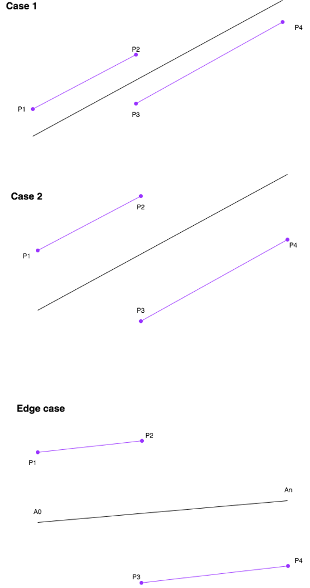

# Golang 100% solution with explanation

**Author:** JieBai
**Votes:** 2
**Link:** [https://leetcode.com/problems/smallest-range-ii/solutions/980417/](https://leetcode.com/problems/smallest-range-ii/solutions/980417/)

---

Sort A as the black line.

In order to get smallest range, the left part of A need to be added to K (P1 - P2) and right part need to be substracted K (P3 - P4)

We could see in both case 1 (K is smaller) and case 2 (K is bigger), max value is max(P2, P4) and min value is min(P1, P3). What we are looking for is min(max(P2, P4) - min(P1, P3))

Be noted the edge case, the smallest range is just An - A0, so we use it as defaul result value.





```
func smallestRangeII(A []int, K int) int {
    if len(A) == 1 {
        return 0
    }
    sort.Ints(A) 
    res := A[len(A) - 1] - A[0] //default value, for the edge case 
    P1 := A[0] + K
    P4 := A[len(A) - 1] - K
    for i := 0; i < len(A) - 1; i++ {
        P2 := A[i] + K
        P3 := A[i + 1] - K
        res = min(res, max(P2, P4) - min(P1, P3))
    }
    return res
}

func min(a, b int) int {
    if a < b {
        return a
    } else {
        return b
    }
}

func max(a, b int) int {
    if a > b {
        return a
    } else {
        return b
    }
}
```