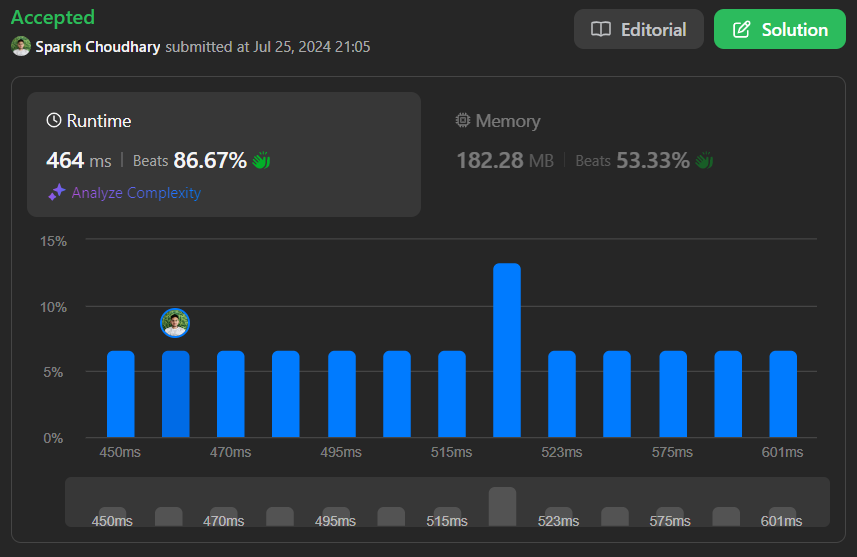

# ✨ | MERGE SORT | DART | Beats : 86.67% ✨ |

**Author:** CodeWithSparsh
**Votes:** 2
**Link:** [https://leetcode.com/problems/sort-an-array/solutions/5534723/](https://leetcode.com/problems/sort-an-array/solutions/5534723/)

---


# Intuition
My first thought for solving this problem is to use a sorting algorithm that efficiently handles sorting in \\(O(n \\log n)\\) time complexity. Since built-in functions are not allowed, implementing a classic sorting algorithm like Merge Sort, which meets the time complexity requirement, would be appropriate. Merge Sort is a divide-and-conquer algorithm, making it a good fit for this task.

# Approach
1. **Divide**: Split the array into two halves until each sub-array contains a single element.
2. **Conquer**: Recursively sort each half.
3. **Combine**: Merge the two sorted halves to produce the final sorted array.

By repeatedly dividing the array into smaller parts and sorting each part before merging them back together, we can efficiently sort the entire array.

# Complexity
- **Time complexity**: \\(O(n \\log n)\\). Merge Sort divides the array into halves (\\(\\log n\\) levels) and merges them back together, each step taking linear time.
- **Space complexity**: \\(O(n)\\). The additional space is required for the temporary arrays during the merge process.

# Code
```dart
class Solution {
  List<int> sortArray(List<int> nums) {
    return sortArrayNow(nums);
  }

  void merge(List<int> nums, int left, int middle, int right) {
    int n1 = middle - left + 1;
    int n2 = right - middle;

    // Create temporary arrays
    List<int> leftArray = List.filled(n1, 0);
    List<int> rightArray = List.filled(n2, 0);

    // Copy data to temporary arrays
    for (int i = 0; i < n1; i++) {
      leftArray[i] = nums[left + i];
    }
    for (int j = 0; j < n2; j++) {
      rightArray[j] = nums[middle + 1 + j];
    }

    // Merge the temporary arrays back into nums[left..right]
    int i = 0, j = 0;
    int k = left;
    while (i < n1 && j < n2) {
      if (leftArray[i] <= rightArray[j]) {
        nums[k] = leftArray[i];
        i++;
      } else {
        nums[k] = rightArray[j];
        j++;
      }
      k++;
    }

    // Copy the remaining elements of leftArray[], if any
    while (i < n1) {
      nums[k] = leftArray[i];
      i++;
      k++;
    }

    // Copy the remaining elements of rightArray[], if any
    while (j < n2) {
      nums[k] = rightArray[j];
      j++;
      k++;
    }
  }

  void mergeSort(List<int> nums, int left, int right) {
    if (left < right) {
      int middle = left + (right - left) ~/ 2;

      // Sort first and second halves
      mergeSort(nums, left, middle);
      mergeSort(nums, middle + 1, right);

      // Merge the sorted halves
      merge(nums, left, middle, right);
    }
  }

  List<int> sortArrayNow(List<int> nums) {
    mergeSort(nums, 0, nums.length - 1);
    return nums;
  }
}
```

This implementation uses the Merge Sort algorithm to sort the given array in ascending order while adhering to the required time and space complexity constraints.