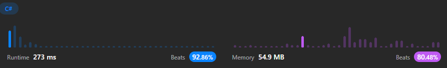

# 🚀Fast | C# & TypeScript Solution | Merge Sort ❇️✅

**Author:** ArafatSabbir
**Votes:** 3
**Link:** [https://leetcode.com/problems/sort-an-array/solutions/3242666/](https://leetcode.com/problems/sort-an-array/solutions/3242666/)

---

# \u2B06\uFE0FLike|\uD83C\uDFAFShare|\u2B50Favourite

# Runtime & Memory



# Complexity
- Time complexity:
O(nlog(n))

- Space complexity:
O(n)

# C# Code
```
public class Solution
{
    public int[] SortArray(int[] nums)
    {
        int[] temp = new int[nums.Length];
        MergeSort(nums, temp, 0, nums.Length - 1);
        return nums;
    }

    private void MergeSort(int[] nums, int[] temp, int left, int right)
    {
        if (left < right)
        {
            int mid = (left + right) / 2;
            MergeSort(nums, temp, left, mid);
            MergeSort(nums, temp, mid + 1, right);
            Merge(nums, temp, left, mid, right);
        }
    }

    private void Merge(int[] nums, int[] temp, int left, int mid, int right)
    {
        int i = left;
        int j = mid + 1;
        int k = left;
        while (i <= mid && j <= right)
        {
            if (nums[i] <= nums[j])
            {
                temp[k++] = nums[i++];
            }
            else
            {
                temp[k++] = nums[j++];
            }
        }

        while (i <= mid)
        {
            temp[k++] = nums[i++];
        }

        while (j <= right)
        {
            temp[k++] = nums[j++];
        }

        for (int m = left; m <= right; m++)
        {
            nums[m] = temp[m];
        }
    }
}
```

# TypeScript Code
```
function sortArray(nums: number[]): number[] {
    let temp: number[] = new Array(nums.length);
    mergeSort(nums, temp, 0, nums.length - 1);
    return nums;
};

function mergeSort(nums: number[], temp: number[], left: number, right: number): void {
    if (left < right) {
        let mid: number = Math.floor((left + right) / 2);
        mergeSort(nums, temp, left, mid);
        mergeSort(nums, temp, mid + 1, right);
        merge(nums, temp, left, mid, right);
    }
}

function merge(nums: number[], temp: number[], left: number, mid: number, right: number): void {
    let i: number = left;
    let j: number = mid + 1;
    let k: number = left;
    while (i <= mid && j <= right) {
        if (nums[i] <= nums[j]) {
            temp[k++] = nums[i++];
        }
        else {
            temp[k++] = nums[j++];
        }
    }

    while (i <= mid) {
        temp[k++] = nums[i++];
    }

    while (j <= right) {
        temp[k++] = nums[j++];
    }

    for (let m: number = left; m <= right; m++) {
        nums[m] = temp[m];
    }
}
```