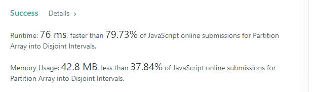

# 915 - Return i+1 when if prefixMax[i] <= suffixMin[i]

**Author:** pgmreddy
**Votes:** 1
**Link:** [https://leetcode.com/problems/partition-array-into-disjoint-intervals/solutions/1357213/](https://leetcode.com/problems/partition-array-into-disjoint-intervals/solutions/1357213/)

---

---

It looks simple, but a difficult question :)

---

**Algo**
- Move from left to right in the given array
  - Find max.. till now..
    - Save it another array called `prefixMax`
- Now move from right to left
  - Find min.. till now..
    - Save it another array called `suffixMin`
- Now we have both arrays
  - Can we get the answer required?
   - Yes
   - Now come from left to right again
     - But this time, dont look into the given array
	   - But look into `prefixMax` & `suffixMin` arrays, which are of same length of given array
	   - The key is if `prefixMax` is less than or equal to `suffixMin` we return that as answer
  	     - Why did we do `+1` below?
		   - Because it was an index, and we needed length, `length will be index+1`

Hope it is simple to understand.

---

```
var partitionDisjoint = function (A) {
    let n = A.length;

    let prefixMax = [...A];
    for (let i = 1; i < n; i++) {
        prefixMax[i] = Math.max(A[i], prefixMax[i - 1]);
    }

    let suffixMin = [...A];
    for (let i = n - 2; i >= 0; i--) {
        suffixMin[i] = Math.min(A[i], suffixMin[i + 1]);
    }

    for (let i = 0; i < n; i++) {
        if (prefixMax[i] <= suffixMin[i + 1]) {
            return i + 1;
        }
    }
};
```



----------

Problem explanation:
----------
```
Example:

Divide below 
[5,0,3,8,6,10] 
into 2 sub arrays 
with at least one element 

[5,0,3,8,6,10] 
becomes 
. left subarray and right subarray 
as 
. [5] and [0,3,8,6,10] 
. [5,0] and [3,8,6,10] 
. [5,0,3] and [8,6,10] 
. [5,0,3,8] and [6,10] 
. [5,0,3,8,6] and [10] 

while doing above 
make sure 
all elements on left subarray 
are less than 
all elements on right subarray 

. all elements of [5] are less than all of [0,3,8,6,10]? - No, because 5 in left array < 0 in right array is false 
. all elements of [5,0] are less than all of [3,8,6,10]? - No, because 5 in left array < 3 in right array is false 
. all elements of [5,0,3] are less than all of [8,6,10]? - Yes, because 5,0&3 in left array are < all (8,6,10) in right array <------ A 
. all elements of [5,0,3,8] are less than all of [6,10]? - No, because 8 in left array < 6 in right array is false 
. all elements of [5,0,3,8,6] are less than all of [10]? - Yes, because 5,0,3,8&6 in left array are < all (10) in right array <------ B 

In cases, both A & B (see above, on right)
are Yes 
comparing both left side subarray: 
. [5,0,3] and 
. [5,0,3,8,6] 

We would need smallest of above two 
it is 
. [5,0,3] 

the length of above is 3 
so, the answer is 3 
```
----------
