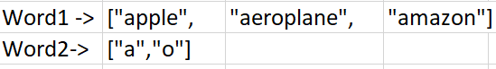
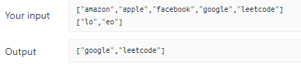
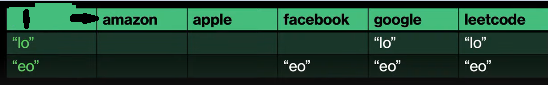
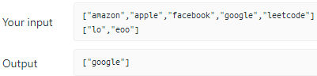
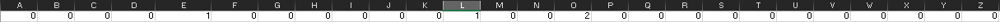

# C++ Solution Explained || Easy Understanding || Hashing || strings || Commented Code

**Author:** _hjaswal
**Votes:** 118
**Link:** [https://leetcode.com/problems/word-subsets/solutions/2353065/](https://leetcode.com/problems/word-subsets/solutions/2353065/)

---

**Before Getting to solution Lets try to understand question First**
The questions says that for Word to be Universal in word1 array It must have all strings given in word2 array as a part of it. i.e for each Universal word The frequency of any character (i.e present in word2 as well) must be greater then the freq of that character present in word2.
Let's See Example to understand clearly :



Here for each string in word2 we can see that we have the strings "aeroplane" and "amazon" which have character of all the strings in it so these to are our Universal strings whereas apple doesn't have 'o' so it is not included.

Let See one more example :





Here you can see that only the words "google" and "leetcode" have both "lo" and "eo" part of it so these are universal if be take facebook then it have "eo"  but does't have 'l' that's why it cant have "lo" . so it is not Universal String.

**So if we think about brute force approch then**
1: For each word in word1 we will iterate whole word2 array and will check if each string is part of it or not.
2: if Each string is part of it then we will add that word from word1 to ans.
Time Complexity for this Soltuion would be : O(N * M) where n and m specifies size of words1 and word2.

**Let's look at optimised approch**
Let's see one more Example and will try to observe somthing.

Now can you observe that we have "lo" and "eoo" in word2 and for a word in words1 to be Universal word it should have atleast 2 "o"  and alteast 1 "e" and 1 "l".

so here we can use freq array i.e for each character of each string in word2 array we will take its freq to be max of all the frequencies from the words in word2; 
ie. we can have freq array which will store max freq of each character in word2

Now we will iterate over each each string in words1 
if for a string its freq for the characters present in freq array is >= for the all charater present in freq array then it is Universal string we will add it to ans.

```
class Solution {
public:
    // calculate the frequency of string s
    vector<int> giveMeFreq(string s)
    {
        vector<int> freq(26,0);
        for(int i = 0; i < s.length(); i++)
        {
            freq[s[i] - 'a']++;
        }
        return freq;
    }
    
    vector<string> wordSubsets(vector<string>& words1, vector<string>& words2) 
    {
       vector<string> ans; // store ans
       vector<int> max_Freq_w2(26, 0);   // store max freq of each character present in word2 stirngs
	   
        // we will Iterate over word to and try to find max freq for each character present in all strings.
		for(auto &x : words2) 
        {
            vector<int> freq = giveMeFreq(x);
            for(int i = 0; i < 26; i++)
            {
                max_Freq_w2[i] = max(freq[i], max_Freq_w2[i]);  // upadate freq to max freq
            }
        }
        
		// we will iterate for each string in words1 ans if it have all charaters present in freq array with freq >= that     then we will add it to ans
        for(auto &x : words1)
        {
            vector<int> freq = giveMeFreq(x);  // gives freq of characters for word in words1
            bool flag = true;
            for(int i = 0; i < 26; i++)
            {
                if(freq[i] < max_Freq_w2[i]) // specifies that word did not have all the characters from word2 array
                {
                    flag = false;
                    break;
                }
            }
            if(flag) ans.push_back(x);   // string x is Universal string
        }
        return ans;
    }
};
```
Time Complexity for this soltuion is : O(M + N) where m and n is size of words1 and words2 array


Upvote if you find it helpful
Please let me know if i made any mistake
Thankyou.


