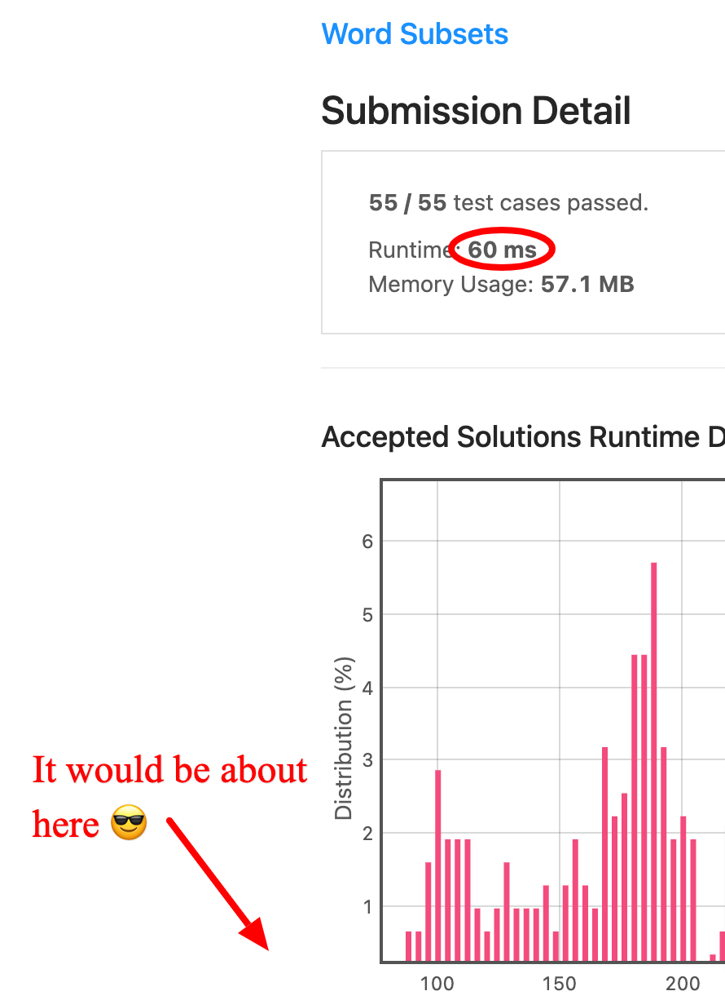

# [C++] 60ms Array-based Solution Explained, 100% Time,  100% Space

**Author:** Ajna
**Votes:** 6
**Link:** [https://leetcode.com/problems/word-subsets/solutions/1128958/](https://leetcode.com/problems/word-subsets/solutions/1128958/)

---

Cool problem, where again the rather simple instructions leave your hands free to focus on the logic, squeezing as much performance as possible out of it.

To solve this problem, we will first of all declare a few support variables:
* `res` is our usual accumulator variable to store the final result as we go;
* `freqs` is an array of `26` elements that will store the overall number of chars we need to match in each valid string;
* `tmp` is a similar array for temporary computations in our 2 main loops;
* `isIncluded` is a booleand to store information whether or not the string being considered makes the cut to `res`.

We will then parse each string `bit` in `b` and:
* iterate through its characters `c` to compute the frequency of them in `tmp`;
* again for each character `c` in `bit` we will:
	* normalise `c` to be in the `0 - 25` range;
	* update the matching cell in `freqs` as the maximum between its current value and `tmp[c]`;
	* reset `tmp[c]` to `0` for the next use - not that is much cheaper than looping through `tmp` all the time to reset just a few cells.

Time to parse `a` and for each element `word` in it:
* set `isIncluded` to `true`;
* loop through all its characters with an index `i` and for all its elements:
	* assign the normalised value of `word[i] - 'a'` to `c`;
	* `continue` if that character is not even present in `freqs`;
	* increasse `tmp[c]` by `1` otherwise;
* then check for each potential mismatch and, looping with `i` in the `0 - 25` range:
	* if `freqs[i] > tmp[i]` we flag `isIncluded` as `false`;
	* in any case we reset `tmp[i]` to `0`;
* finally, if `isIncluded` we will push `word` into `res`.

When we are done, we can just return `res` :)

The code:

```cpp
class Solution {
public:
    vector<string> wordSubsets(vector<string>& a, vector<string>& b) {
        // support variables
        vector<string> res;
        int freqs[26] = {}, tmp[26] = {};
        bool isIncluded;
        for (string bit: b) {
            // populating tmp
            for (char c: bit) {
                tmp[c - 'a']++;
            }
            // updating bFreqs
            for (char c: bit) {
                c -= 'a';
                freqs[c] = max(freqs[c], tmp[c]);
                tmp[c] = 0;
            }
        }
        // populating chars
        for (string word: a) {
            isIncluded = true;
            for (int i = 0, lmt = word.size(), c; i < lmt; i++) {
                // updating tmp
                c = word[i] - 'a';
                if (!freqs[c]) continue;
                tmp[c]++;
            }
            // checking for mismatches
            for (int i = 0; i < 26; i++) {
                if (freqs[i] > tmp[i]) {
                    isIncluded = false;
                }
                // clearing tmp
                tmp[i] = 0;
            }
            if (isIncluded) res.push_back(word);
        }
        return res;
    }
};
```

Alternative version burning a few more bytes, but gaining 4-8ms not having to normalise the characters in the `0 - 25` range at each step:

```cpp
class Solution {
public:
    vector<string> wordSubsets(vector<string>& a, vector<string>& b) {
        // support variables
        vector<string> res;
        int freqs[123] = {}, tmp[123] = {};
        bool isIncluded;
        for (string bit: b) {
            // populating tmp
            for (char c: bit) {
                tmp[c]++;
            }
            // updating bFreqs
            for (char c: bit) {
                freqs[c] = max(freqs[c], tmp[c]);
                tmp[c] = 0;
            }
        }
        // populating chars
        for (string word: a) {
            isIncluded = true;
            for (int i = 0, lmt = word.size(), c; i < lmt; i++) {
                // updating tmp
                c = word[i];
                if (!freqs[c]) continue;
                tmp[c]++;
            }
            // checking for mismatches
            for (int i = 97; i < 123; i++) {
                if (freqs[i] > tmp[i]) {
                    isIncluded = false;
                }
                // clearing tmp
                tmp[i] = 0;
            }
            if (isIncluded) res.push_back(word);
        }
        return res;
    }
};
```

And then I thought I might improve a lot if I only set `res` to be of the right size from the beginning. And so I did, getting consistently 100% memory:

```cpp
class Solution {
public:
    vector<string> wordSubsets(vector<string>& a, vector<string>& b) {
        // support variables
        int freqs[123] = {}, tmp[123] = {}, tot = 0;
        bool isIncluded;
        for (string bit: b) {
            // populating tmp
            for (char c: bit) {
                tmp[c]++;
            }
            // updating bFreqs
            for (char c: bit) {
                freqs[c] = max(freqs[c], tmp[c]);
                tmp[c] = 0;
            }
        }
        // populating chars
        for (int i = 0, lmt = a.size(); i < lmt; i++) {
            string word = a[i];
            isIncluded = true;
            for (int i = 0, lmt = word.size(), c; i < lmt; i++) {
                // updating tmp
                c = word[i];
                if (!freqs[c]) continue;
                tmp[c]++;
            }
            // checking for mismatches
            for (int i = 97; i < 123; i++) {
                if (freqs[i] > tmp[i]) {
                    isIncluded = false;
                }
                // clearing tmp
                tmp[i] = 0;
            }
            if (isIncluded) tot++;
            else a[i] = "*";
        }
        vector<string> res(tot);
        for (int i = a.size() - 1; i > -1 && tot > -1; i--) {
            string word = a[i];
            if (word == "*") continue;
            else res[--tot] = word;
        }
        return res;
    }
};
```

But, wait: who does even need a new vector for the result?

Refactored:

```cpp
class Solution {
public:
    vector<string> wordSubsets(vector<string>& a, vector<string>& b) {
        // support variables
        int freqs[123] = {}, tmp[123] = {}, pos = 0;
        bool isIncluded;
        for (string bit: b) {
            // populating tmp
            for (char c: bit) {
                tmp[c]++;
            }
            // updating bFreqs
            for (char c: bit) {
                freqs[c] = max(freqs[c], tmp[c]);
                tmp[c] = 0;
            }
        }
        // populating chars
        for (string word: a) {
            isIncluded = true;
            for (int i = 0, lmt = word.size(), c; i < lmt; i++) {
                // updating tmp
                c = word[i];
                if (!freqs[c]) continue;
                tmp[c]++;
            }
            // checking for mismatches
            for (int i = 97; i < 123; i++) {
                if (freqs[i] > tmp[i]) {
                    isIncluded = false;
                }
                // clearing tmp
                tmp[i] = 0;
            }
            if (isIncluded) a[pos++] = word;
        }
        a.resize(pos);
        return a;
    }
};
```

The brag:

