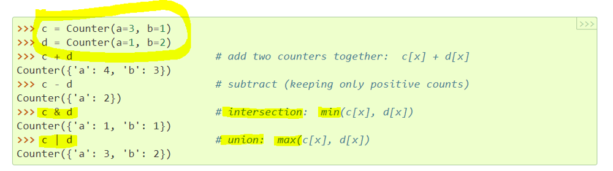

# Python/Go sol by Counter() [w/ Hint]

**Author:** brianchiang_tw
**Votes:** 7
**Link:** [https://leetcode.com/problems/word-subsets/solutions/1128155/](https://leetcode.com/problems/word-subsets/solutions/1128155/)

---

**Hint**:

Take advantage of **union** operation as well as **intersection** operation in **Counter**()

**Example**:



[Source: Python official docs](https://docs.python.org/3/library/collections.html#collections.Counter)

---

**Implementation** by Counter

```
class Solution:
    def wordSubsets(self, A: List[str], B: List[str]) -> List[str]:
        
        # union operation in Counter() means updating with maximum occurrence
        max_occurrence_of = lambda d1, d2: (d1 | d2)
        
        # intersection operation in Counter() means updating with minimum occurrence
        min_occurrence_of = lambda d1, d2: (d1 & d2)
        
        
        ## dictionary
        # key: distinct character
        # value: max occurence of distinct character among words in B
        max_char_occ_dict_of_b = Counter()
        
        
        # compute maximum occrrence of distinct character
        
        for b in B:
            max_char_occ_dict_of_b = max_occurrence_of( max_char_occ_dict_of_b, Counter(b) )
        

        # if Counter(a) can cover max_char_occ_dict_of_b, than a is universal word
        
        universal_words = []
        
		# scan each word in A
        for a in A:
            
            if min_occurrence_of( Counter(a), max_char_occ_dict_of_b ) == max_char_occ_dict_of_b:
                
                universal_words.append( a )
                
        return universal_words
```

---

Share another similar implementation by Counter()

```
class Solution:
    def wordSubsets(self, A: List[str], B: List[str]) -> List[str]:
        
        # union operation in Counter() means updating with maximum occurrence
        max_occurrence_of = lambda d1, d2: (d1 | d2)
        
        
        ## dictionary
        # key: distinct character
        # value: max occurence of distinct character among words in B
        max_char_occ_dict_of_b = Counter()
        
        
        # compute maximum occrrence of distinct character in B
        
        for b in B:
            max_char_occ_dict_of_b = max_occurrence_of( max_char_occ_dict_of_b, Counter(b) )
        
        
        universal_words = []
        
        # scan each word in A
        for current_word in A:
            
            # scan each distinct character and corresponding max occurrence in B
            for char, max_occ in max_char_occ_dict_of_b.items():
                
                if current_word.count(char) < max_occ:
                    
                    # current word has not enough occurrence of char to cover B
                    break
                    
            else:
                
                # current word has enough occurrence on every distinct character to cover B
                universal_words.append( current_word )
                
        return universal_words
```

---

**Implementation** by dictionary in Golang:

```
func wordSubsets(A []string, B []string) []string {

    
    //// dictionary
    // key: distinct character
    // value: max occurence of distinct character among words in B
    charOccDict := genDict("")
    
    // compute maximum occrrence of distinct character in B
    for _, str := range B{
        
        curOccDict := genDict(str)
        
        pickMaxOccurrence(curOccDict, charOccDict)
    }
    
    universalWords := make([]string,0)
    
    // scan each word in A
    for _, src := range A{
        
        srcOccDict := genDict( src )
        
        // current word has enough occurrence on every distinct character to cover B
        if contains(srcOccDict, charOccDict){
            
            universalWords = append(universalWords, src)
        }
    }
    
    return universalWords
}


// generate character<->occurrence mapping from string
func genDict( s string) *map[rune]int{
    
    charOccDict := make(map[rune]int)
    
    for _, char := range s{
        
        charOccDict[char] += 1
        
    }
    
    return &charOccDict
}

// max function for two integers
func max(x, y int)int{
    if x > y{
        return x
    }
    return y
}


// pick maximum occurrence between src, and dst.
// save maximum occurrence to dst
func pickMaxOccurrence( src *map[rune]int, dst *map[rune]int ) {
    
    for letter := 'a' ; letter <= 'z' ; letter++{
        (*dst)[letter] = max((*dst)[letter], (*src)[letter])
    }
}


// check whether src dictionary can cover target dictionary
func contains( src *map[rune]int, target *map[rune]int) bool{
    
    for letter := 'a' ; letter <= 'z' ; letter ++{
        if (*src)[letter] < (*target)[letter]{
            return false
        }
    }
    
    return true
}
```

---

Reference:

[1] [Python official docs about specialized dictionary Counter( ... )](https://docs.python.org/3/library/collections.html#collections.Counter)

[2] [Golang official docs about dictioanry map\\[ \\] ](https://gobyexample.com/maps)